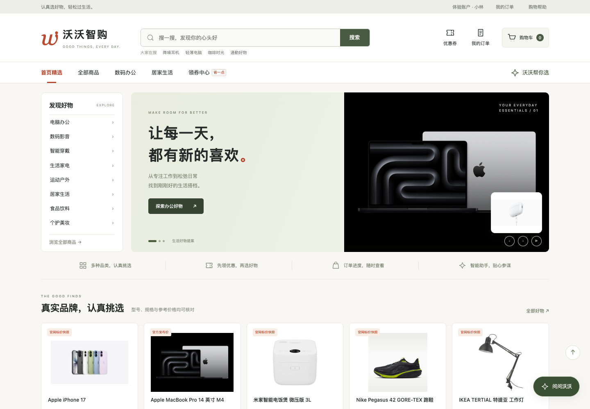
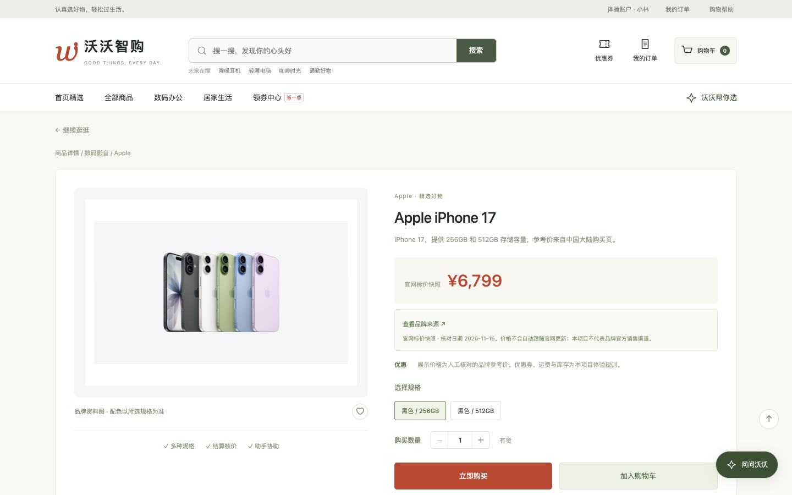
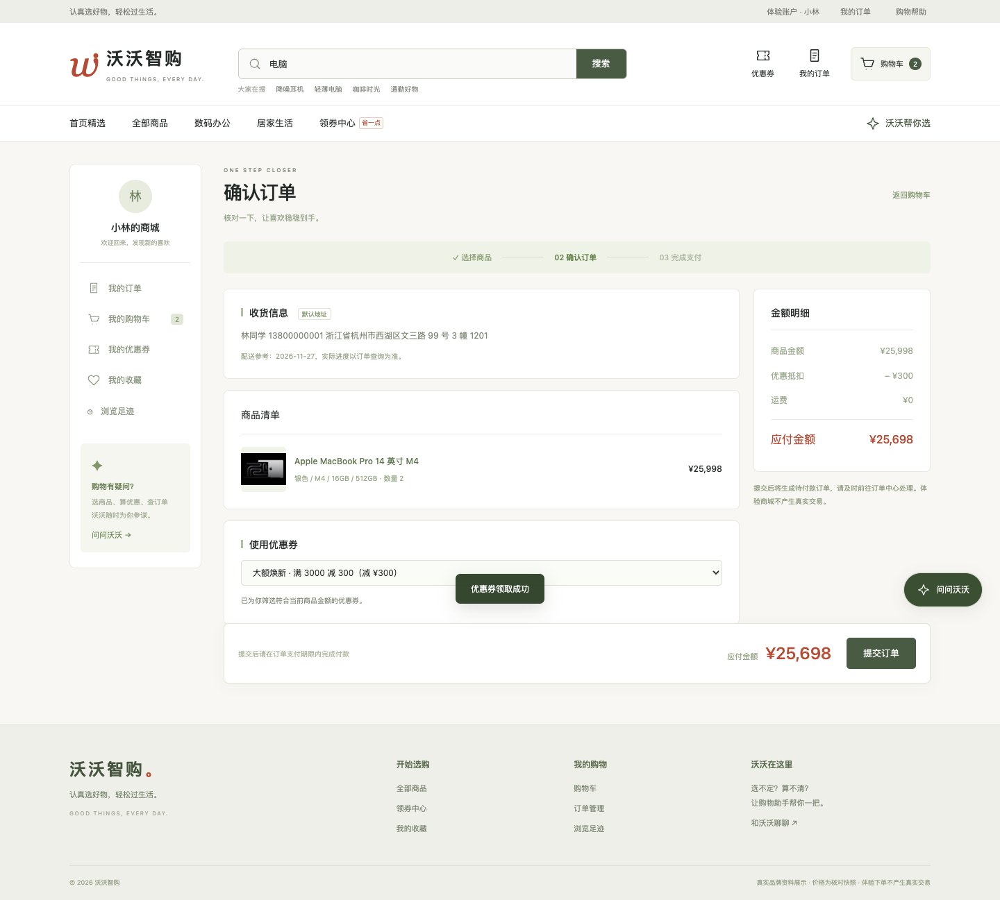
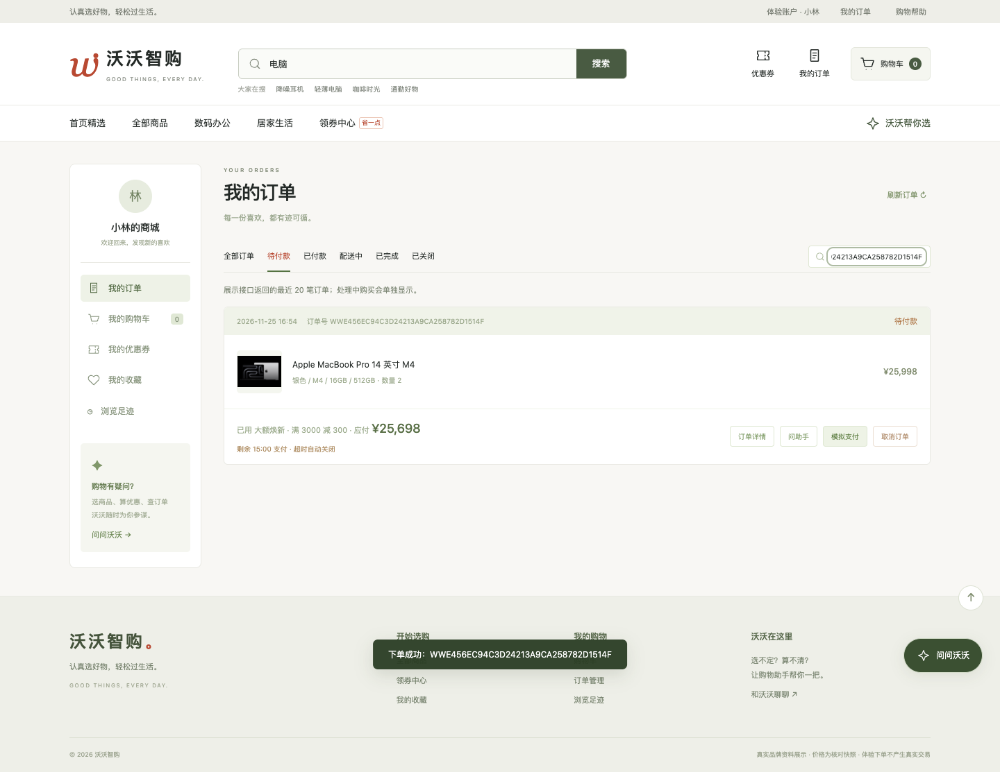
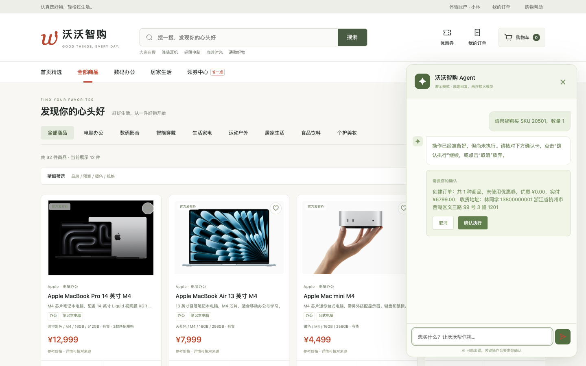
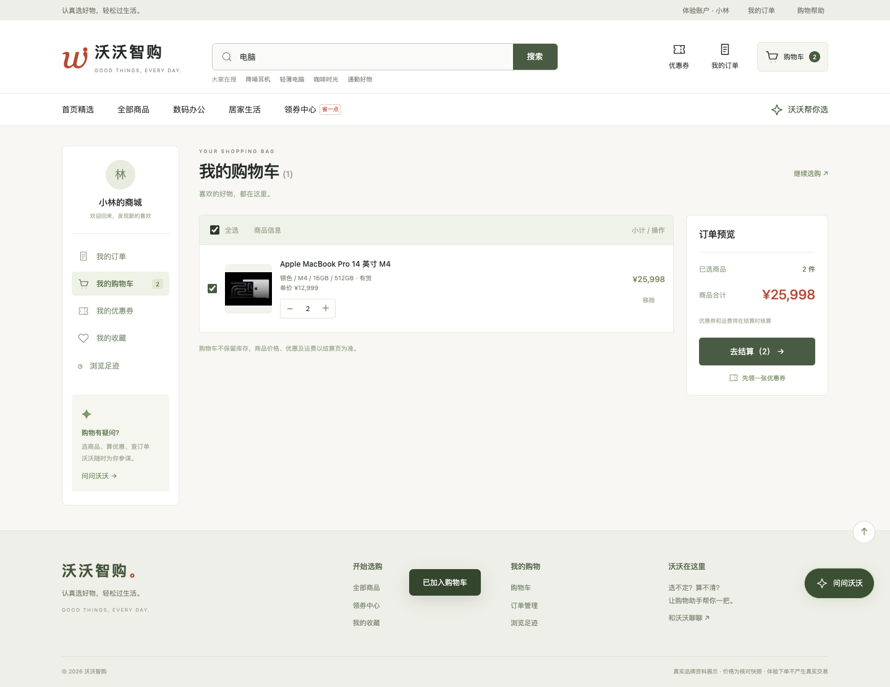
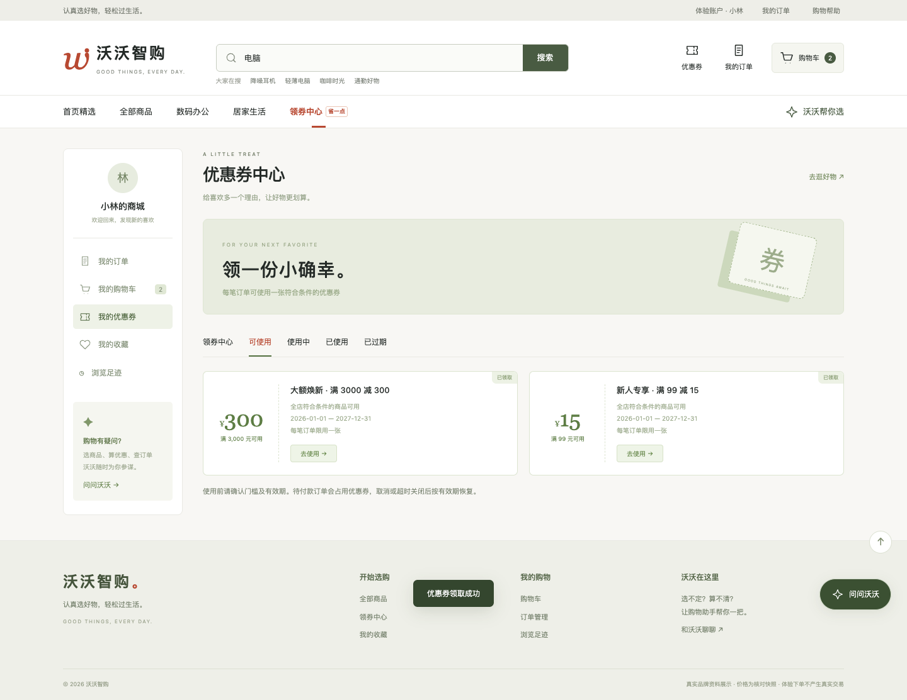

# AI - Mall 智能商城

一个带购物助手的 Java 商城。用户可以在页面浏览、领券和下单，也可以在对话中查询商品、试算价格、确认购买。页面和 Agent 共用同一套业务服务。

[商城界面](#商城界面) · [快速启动](#最快体验) · [功能 Spec](openspec/README.md) · [设计、测试与面试资料](docs/README.md)

## 整体架构图

[](docs/images/system-architecture.svg)

商城请求直达业务服务，Agent 经受控工具调用同一套服务。模型网关负责每一步推理，支持三态熔断和可选的百炼 `qwen-plus` 备用。点击架构图可查看可缩放的 SVG。

## 商城界面

截图取自本地 demo，商品图、品牌与参考价格见 [商品来源](openspec/specs/product-catalog/spec.md#真实商品与价格从哪里来)。订单、地址和库存使用演示数据。

[](docs/images/storefront-home.png)

| 商品详情 · 选择 SKU | 结算页 · 核对地址和金额 |
| --- | --- |
| [](docs/images/storefront-product.png) | [](docs/images/storefront-checkout.png) |
| **订单页 · 筛选与查看状态** | **购物助手 · 核对确认卡** |
| [](docs/images/storefront-orders.png) | [](docs/images/storefront-assistant.png) |

<details>
<summary>查看更多：购物车与优惠券</summary>

| 购物车 | 优惠券中心 |
| --- | --- |
| [](docs/images/storefront-cart.png) | [](docs/images/storefront-coupons.png) |

</details>

## 一分钟介绍项目

> 我做的是一个带智能助手的商城。页面和 Agent 共用同一套业务 Service，模型负责理解意图和选择工具，价格、库存和订单状态由后端判断。
>
> 商品稳定资料按“参数校验 → Caffeine → Redisson Bloom → Redis → RLock 与锁后双检 → 数据库”读取，再批读 SKU 公开价格与可售量组成详情。建单/关单只刷新相关规格库存；空值缓存和随机 TTL 继续保护回源。交易使用后端 trace 标识购买意图，AOP 分布式锁减少重复执行，数据库行锁、CAS 和唯一约束兜底。
>
> 同步和异步共用建单事务。异步在 Redis 预扣后持久化受理状态和 Outbox，再由 RocketMQ 消费者建单；失败和中断通过持久化状态幂等恢复。Agent 写操作先保存确认卡，用户同意后恢复后端参数，再调用这些业务服务。
>
> 模型故障时，网关只切换当前推理步骤，保留已完成的工具结果。如果模型都不可用，后端仍能展示已经保存的确认卡。

## 项目实际具备什么

- 商品搜索/详情、购物车、领券、结算、建单、订单查询、取消和模拟支付。
- 建单后默认 15 分钟未支付，RocketMQ 定时消息触发关单、返库存和释放券，数据库扫描兜底。
- 按交易压力选择同步/异步；两种模式共用 SKU 库存池与数据库建单规则。
- Spring AI 同步工具循环与 SseEmitter 实时输出、按需加载业务手册、持久化确认卡、会话历史和用户偏好。
- 后台回答支持刷新后重连。模型网关按候选维护熔断状态，记录调用耗时和 Token，用已保存的确认卡兜底。[Agent 设计](docs/agent-design.md#模型网关与熔断)
- 按品牌与文档类别检索退换货、保修、配送等政策，提供官方来源，缺失资料时明确补问。
- 真实 MySQL / Redis / RocketMQ 联调，以及区分缓存命中、缓存构建、受理 QPS 和成功建单 TPS 的压测。

主技术栈：Java 17、Spring Boot 4.1.2、Spring AI 2.0.2、MyBatis-Plus 3.5.18、Jackson 3、Flyway、MySQL、PostgreSQL / pgvector、Redis / Redisson、Caffeine、RocketMQ。前端为 HTML / CSS / JavaScript。

## 最快体验

在 Java 17、Maven 和项目依赖已准备好的环境中运行；首次编译的 HotKey 依赖说明见 [启动文档](docs/deployment.md#2-首次编译与快速体验)：

```bash
ORDER_SUBMISSION_MODE=SYNC mvn spring-boot:run -Dspring-boot.run.profiles=demo
```

打开 <http://localhost:8080>，依次体验：商品详情 → 购物车/立即购买 → 结算 → 下单 → 查询/取消；在助手中先查询并选定具体 SKU，再要求购买，观察试算和确认卡。

**上述命令显式使用 SYNC：demo 使用内存 H2、确定性助手，关闭交易 Redis 预扣；重启重置数据。** 真实模型、Redis 预扣与 MQ 链路使用普通配置，环境变量见 [.env.example](.env.example)，具体部署见 [启动与排查](docs/deployment.md)。

## 面试时需要明确的边界

- 这是单应用按业务分包，尚未拆成独立部署的微服务，也没有实现分库分表。
- 使用演示用户身份，未接入真实登录；支付是显式启用的模拟入口，售后没有接入真实退款渠道。
- 知识检索默认数据库关键词；已实现可配置 HYBRID 与查询增强，并完成百炼 embedding / DeepSeek 真实联调。向量存储已接 PostgreSQL + pgvector，支持数据库精确/HNSW 检索；当前未做大库容量评测，见 [RAG Spec](openspec/specs/knowledge-retrieval/spec.md)。
- Agent 会话互斥目前是单进程能力；订单具备的数据库幂等不能直接等同于 Agent 会话跨实例串行。
- 压测记录代表对应机器、参数和场景。数据库建单成功后可能仍有 Redis 整理或 Outbox 发送积压，不能把单秒峰值写成生产持续容量。

验证命令：`mvn test`。本次文档的源码入口和接口清单均对应当前代码；各项边界见对应主题文档。

详细入口：[商城前台 Spec](openspec/specs/storefront-experience/spec.md) · [数据库 DDL 与初始化](docs/database/README.md) · [Agent 运行 Spec](openspec/specs/agent-runtime/spec.md)。
