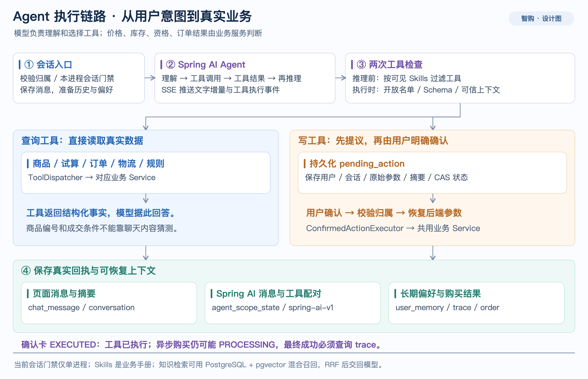
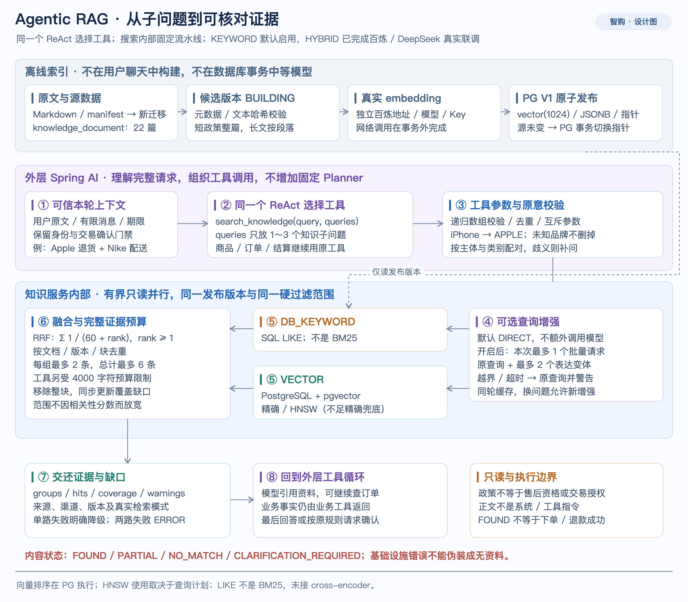

# Agent 设计：让模型通过工具办理真实业务

返回 [学习导航](README.md) · 业务请求参照 [接口流程](api-flows.md) / [下单设计](order-design.md)

运行与真实模型配置见 [启动文档](deployment.md)；框架测试与真实模型效果的区别见 [测试与压测](testing.md)。

[](images/agent-execution.svg)

左侧查询直接访问真实业务；右侧写操作先生成持久化提议，再由用户批准执行。 点击图片查看可缩放 SVG。


## 1. 模型在项目里负责什么

模型负责理解意图、选择工具、组织回答；商品、价格、库存、优惠和订单状态从业务工具查询。写操作先准备确认卡，得到用户明确同意后才进入业务 Service。

Spring AI 的 ReAct 循环可理解为：**理解用户请求 → 选择工具 → 读取工具结果 → 决定继续查询或结束**。模型提供的字段会被后端校验，模型文字不当作数据库事实。

## 2. 一轮聊天怎样走

```text
POST /api/agent/chat 或 /chat/stream
  → ConversationService 创建/检查会话归属
  → AgentRunGate 获取本进程会话执行权
  → 若有待确认卡：优先返回该卡，不继续创建另一项交易
  → 保存用户消息，整理历史/摘要
  → 构建系统提示、最近完整轮次、用户偏好和原生状态
  → Spring AI ChatClient 工具循环 运行
       每次推理前按 Skills 过滤工具
       工具适配器再检查开放名单和参数 Schema
       查询工具：调用真实 Service，返回数据
       写工具：持久化待确认操作，返回卡片
  → 保存回复、Spring AI Message 及工具配对
  → 返回 JSON 或 SSE done，释放会话执行权
```

真实 AI 和 demo 是显式配置的两条响应路径。demo 用确定性规则访问真实业务；模型调用失败会明确提示不可用/结果需要核对，不会偷偷用 demo 冒充模型正常工作。

## 3. 工具为什么不直接交给模型随便调用

| 保障 | 当前怎样实现 | 防止什么 |
|---|---|---|
| 固定工具目录与 Schema | ToolProvider 提供名称、参数格式、风险等级、所需技能和处理器 | 随意工具名、未知字段、类型错误 |
| 按需加载 Skills | load_skill 返回数据库中的业务手册，成功结果带结构化元数据 | 还没了解办理步骤就开放复杂写工具 |
| 推理前过滤 | SkillContextPolicy 根据当前可见历史决定可用工具 | 被裁剪掉的手册继续充当授权 |
| 执行时再校验 | CommerceToolCallback 检查本轮允许名单，ToolDispatcher 再查技能 | 模型猜到隐藏工具名就越过限制 |
| 服务端业务上下文 | 工具从上下文取得当前用户/会话，不接受模型随意传 userId | 模型改参数查别人订单；HTTP 身份本身仍是演示实现 |
| 业务 Service 重检 | 当前价格、状态、地址和券资格由数据库规则决定 | 相信模型推测或过时工具结果 |

Skills 在这里是存于数据库的办理手册，不是能任意执行命令的脚本。会话里普通文本提到技能名不代表加载；成功加载结果和完整手册仍在模型可见历史中，技能才保持有效。

## 4. “帮我下单”为什么要两阶段

以订单为例：

1. 查询商品/规格、确认数量、地址与优惠，得到后端试算金额。
2. 模型调用 order_create。ToolDispatcher 识别 WRITE，**只生成 pending_action**，保存原始参数、摘要、用户、会话和幂等信息；同时准备对应的后端购买 trace。
3. 页面显示实际持久化确认卡。模型说“请点确认”却没有记录时，后台会检查并最多续跑纠正一次，仍无卡则明确告知未生成。
4. 用户调用 `POST /api/agent/actions/{actionId}/confirm`，只提交同意/拒绝，不重新提交价格或商品参数。
5. 后端核对归属与参数摘要，CAS 把 PENDING 改为批准/拒绝；重复决定不能再次执行。
6. 批准后，ConfirmedActionExecutor 从后端记录恢复参数，调用业务服务；同步业务变更和 EXECUTED 标记同事务提交。异步订单在这里执行的是可靠受理，仍可能返回 PROCESSING。
7. 保存真实工具回执和回复；订单结果不确定时携带原 trace 查询，不新建另一笔购买。

**pending_action 和 trace 不重复：** 前者回答“用户是否批准这个工具操作”，后者回答“这次购买最终有没有建立订单”。确认卡 EXECUTED 对异步订单只表示工具受理已执行，不表示订单必然创建成功，更不表示已经付款。

待确认操作的防重复 key 还包含本轮 requestId、工具名和规范化参数；与订单按 userId/traceId 的幂等是两个层次。参数相同的新一轮合理购买可以产生新的意图。

## 5. 为什么分开存历史、模型状态和长期记忆

| 数据 | 保存什么 | 用途 |
|---|---|---|
| chat_message / conversation | 页面消息、会话、摘要和水位 | 刷新后展示历史，整理较早对话 |
| agent_scope_state | Spring AI 消息、调用和结果（spring-ai-v1 键；历史表名保留） | 恢复模型上下文，保持调用与回包配对 |
| user_memory | 用户明确要求记住的偏好 | 跨会话复用稳定信息 |
| conversation_skill | 当前仍有效的加载状态 | 配合可见工具结果更新，不能代替完整手册 |

当前历史选择按完整用户轮次裁剪，默认保留最近 6 轮、约束 32000 个消息表示字符；这不是精确 token 预算。页面摘要是确定性整理，不是模型生成的可靠事实库。

设计重点：工具调用和结果不能拆散；被裁掉的手册不能继续开放写工具；不把一次聊天中的临时信息自动固化为长期偏好。

## 6. SSE 和 RAG 各解决什么

- **SSE**：`/chat/stream` 推送文本增量、工具开始/结束和最终完成事件。前端能知道正在查商品还是等待工具，不需要等全部结束才看到回复。断开/超时取消订阅，不等同于事务回滚；已发生业务仍按 trace 查询。
- **Agentic RAG**：外层 ReAct 组织知识子问题并选择 search_knowledge，内部执行原意约束、归一化、可选增强、DB_KEYWORD / PGVECTOR HYBRID、RRF 和完整证据打包；业务工具仍返回价格、库存和订单事实。默认 KEYWORD，已完成百炼 embedding 与 DeepSeek 真实联调。边界与图解见 [知识检索设计](knowledge-design.md)。

[](images/knowledge-retrieval.svg)

检索工具先把文档和出处返回给模型，模型再形成最终回答。每一步的输入、筛选条件和异常分支见 [完整流程说明](knowledge-design.md#一次请求怎么走)。

## 7. 面试应重点讲的三个取舍

1. **复用业务服务**：手动下单与 Agent 下单的幂等、库存和事务规则一致，避免出现两套交易正确性。
2. **模型意图与用户授权分开**：WRITE 工具产生可审计提议，用户确认以后才执行；确认时恢复后端参数并重检业务。
3. **上下文可恢复且有边界**：原生状态与页面历史分开存，按完整轮次裁剪；当前会话互斥仅单进程，多实例需要额外协调。

还需补齐：批准到实际执行前崩溃的自动恢复；多实例会话并发控制；真实登录/退款渠道；并发售后申请的更强唯一约束或订单级互斥。不能声称支持任意中断位置的精确断点续跑。

## 8. 按职责定位源码

| 要看什么 | 入口 |
|---|---|
| 聊天总流程 | [AgentChatService](../src/main/java/com/bitmall/agent/agent/service/chat/AgentChatService.java) |
| 模型运行与工具事件 | [SpringAiResponder](../src/main/java/com/bitmall/agent/agent/service/runtime/SpringAiResponder.java) |
| Skills 如何影响工具 | [SkillContextPolicy](../src/main/java/com/bitmall/agent/agent/service/skill/SkillContextPolicy.java) |
| 入口校验与分发 | [CommerceToolCallback](../src/main/java/com/bitmall/agent/agent/service/tool/CommerceToolCallback.java)、[ToolDispatcher](../src/main/java/com/bitmall/agent/agent/service/tool/ToolDispatcher.java) |
| 确认卡准备与执行 | [PendingActionService](../src/main/java/com/bitmall/agent/agent/service/action/PendingActionService.java)、[AgentActionService](../src/main/java/com/bitmall/agent/agent/service/action/AgentActionService.java) |
| 确认的事务边界 | [ConfirmedActionExecutor](../src/main/java/com/bitmall/agent/agent/service/action/ConfirmedActionExecutor.java) |
| 历史裁剪和偏好 | [AgentHistorySelector](../src/main/java/com/bitmall/agent/agent/service/conversation/AgentHistorySelector.java)、[MemoryService](../src/main/java/com/bitmall/agent/agent/service/memory/MemoryService.java) |

## 9. Spring AI 2 的使用方式

本项目使用 **Spring Boot 4.1.2 + Spring AI 2.0.2 + MyBatis-Plus 3.5.18**，保留 Java 17。AgentScope 已从依赖和运行实现移除。框架承担模型协议、ChatClient 门面、消息类型、工具 Schema、流式聚合和 embedding；商城服务负责授权和交易正确性。

| Spring AI 对象 | 本项目用途 | 主要入口 |
|---|---|---|
| ChatModel / OpenAiChatModel | 访问现有 DeepSeek 兼容网关，模型请求不自动重试 | SpringAiConfiguration |
| ChatClient | 每次推理与可选 RAG 查询改写的统一门面 | SpringAiResponder / SpringAiQueryEnhancer |
| ToolCallback / ToolDefinition | 把已有 ToolProvider 定义转成 Spring AI 工具 | CommerceToolCallback / DynamicToolCatalog |
| ToolContext | 传后端身份及开放名单，不把身份交给模型填写 | SpringAiResponder.execute |
| Message / AssistantMessage / ToolResponseMessage | 保存完整工具调用关系，支持中断恢复 | AgentStateStoreService / AgentInputBuilder |
| MessageAggregator | 聚合 SSE 中拆开的工具参数，同时向页面转发文本增量 | SpringAiResponder.step |
| EmbeddingModel / OpenAiEmbeddingModel | 百炼向量协议，校验身份、顺序、维度和有限值 | SpringAiEmbeddingClient |

### 为什么显式控制工具循环

Spring AI 2 默认由 ToolCallingAdvisor 自动循环。这里每次请求使用 `AdvisorParams.toolCallingAdvisorAutoRegister(false)`，由服务显式推进下一步：**裁剪历史 → 更新技能 → 推理 → 保存调用 → 校验并执行工具 → 保存结果**。这样每一步都有可检查的权限、确认状态、预算和中断记录。属于官方支持的 User-Controlled Tool Execution，不是把框架加进依赖后仍使用旧 SDK。

没有同时启用自动 ChatMemory Advisor 或 QuestionAnswerAdvisor。自动插入另一份历史或 RAG 结果会绕过现有完整轮次、品牌/类别硬过滤和多问题证据打包。持久化和 RAG 编排在业务服务中清楚可见；`pgvector` 仍通过独立 MyBatis Mapper 查询，不自动换表或重建索引。

默认每轮最多 12 次推理、总预算 180 秒、单次模型 60 秒、工具 15 秒、单次模型最多 16 个工具请求。工具顺序执行，不宣传并行写交易。模型异常不切 demo；工具超时不自动重试，不声明业务一定回滚。虚构确认卡最多纠正一次，并仍受总预算约束。

### 旧会话怎么处理

`agent_scope_state` 是历史表名，保留它避免改写 V5 迁移。新的 JSON 使用 `spring-ai-v1` 键，与旧 SDK 状态隔离；旧记录不删除、不直接反序列化。第一次由 Spring AI 接管时读取页面普通历史，技能手册需重新真实加载。之后恢复新状态，并补入后端确认回执。

若工具调用已保存、结果未保存，下一轮补一个“中断、未自动重放”的工具结果，再通过业务查询确认实际效果。恢复配对不等于恢复交易，也不代表多实例会话并发问题已解决。

官方依据：[工具循环与显式执行](https://docs.spring.io/spring-ai/reference/api/tools.html)、[Spring AI 版本兼容](https://github.com/spring-projects/spring-ai/blob/main/README.md)。
