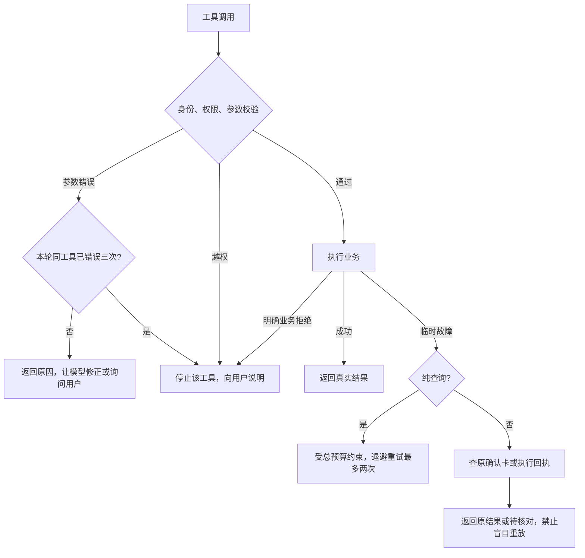

# Agent 设计

聊天、确认和会话存储分别按职责查阅。

- [Agent 运行与工具调用](../openspec/specs/agent-runtime/spec.md)

- [用户确认与执行](../openspec/specs/agent-confirmation/spec.md)

- [会话历史与模型状态](../openspec/specs/agent-memory/spec.md)

## 商城页面的后台回答与重连

页面通过 `POST /api/agent/chat/turns` 提交问题。MySQL 在同一事务保存用户消息和助手占位，助手消息的 ID 用于订阅和查询，客户端请求编号用于幂等重试。活动回复在本进程积累草稿，`GET /api/agent/messages/{messageId}/stream` 返回带版本的完整快照，再按顺序推送增量。断线只清理对应连接，工作线程继续生成。最终正文和生成状态入库后才发送终态。

刷新页面先读会话快照。若有 `activeMessageId`，前端重新订阅该消息，收到快照后覆盖旧气泡。模型失败或服务器重启中断时，页面显示失败提示。草稿与会话互斥按单实例管理。确认卡和订单状态继续根据数据库中的确认记录和购买 trace 恢复。

## 兼容入口的同步执行与 SSE

`POST /api/agent/chat/stream` 由 Controller 创建 `SseEmitter`，把一轮聊天提交给独立的有界线程池。`AgentChatService` 在普通 Java 调用栈中持有会话执行权，最后通过 `finally` 释放。

1. 检查会话归属与待确认操作，发送 `start`。
2. `SpringAiResponder` 用 `for` 循环整理历史、校验技能并发送本轮工具定义。
3. `SpringAiStreamReader` 同步迭代模型文本片段，通过回调立即发送 `delta`。Spring AI 自身使用流式 HTTP，适配层负责关闭流和合并分片工具参数。
4. 模型请求工具时发送 `reset`、`tool_start`，在同一工作线程校验并执行工具，保存对应结果，再发送 `tool_end`，进入下一轮推理。
5. 完成回答后根据数据库中的确认卡修正文案，保存页面回复，发送 `done`，关闭连接。

同步 JSON 接口也调用同一个模型循环，只是不发送中间事件。循环的局部变量和上下文每轮创建，线程池复用不会共享用户消息。

### 执行预算与取消

SSE 工作线程池为核心 4、最多 16、等待队列 32，满时发送 `error` 提示稍后重试。排队计入 `app.agent.request-timeout-seconds`，默认总预算 180 秒。每次模型推理最多 60 秒，每次工具最多 15 秒，均受本轮剩余预算约束。

兼容的 POST SSE Controller 检测到发送失败、容器超时或连接结束后，用 `AgentExecution.cancel()` 中断工作线程。模型流在 try-with-resources 中关闭，后续推理和工具在执行前检查取消。如果当前数据库调用暂时忽略中断，会话执行权保留到它真正退出；持久化确认卡和交易结果仍按业务服务核对。没有配对结果的工具调用继续沿用下一轮恢复机制，补中断回执并由用户决定后续动作。

[同步模型循环](../src/main/java/com/bitmall/agent/agent/service/runtime/SpringAiResponder.java) · [SDK 流式适配](../src/main/java/com/bitmall/agent/agent/service/runtime/SpringAiStreamReader.java) · [请求预算](../src/main/java/com/bitmall/agent/agent/service/runtime/AgentExecution.java) · [SSE Controller](../src/main/java/com/bitmall/agent/agent/controller/AgentChatController.java)

## 工具调用失败后怎么办

所有工具先检查后端用户身份、技能权限和参数，再调用业务。失败回执除了 `ok=false`、`error`，还有 `code` 和 `nextAction`，后端按错误类型决定是否可以继续。

| 情况 | 实际处理 |
|---|---|
| 缺参、类型或枚举错误 | 返回 `INVALID_ARGUMENT`，模型可根据已知信息修正两次；缺少用户信息就询问，不猜地址或订单号。第三次错误后返回 `CORRECTION_LIMIT`，本轮禁止再执行该工具。 |
| 越权或业务拒绝 | 返回 `FORBIDDEN` / `BUSINESS_REJECTED`，停止本轮该工具并说明原因。库存不足、订单不可取消不是改参数重试的理由。 |
| 纯查询遇到可识别的超时、连接故障等 | 最多自动重试两次，分别等待 200～299ms、400～499ms；仍失败返回 `RETRY_EXHAUSTED`。等待计入整轮预算。 |
| 产生副作用的调用结果不确定 | 返回 `RESULT_UNKNOWN`，查询已有确认卡；查到则返回原卡，查不到或查询失败也不重放。加载技能、保存偏好也按有副作用处理。 |
| 用户确认后的响应丢失 | 重复提交原 `actionId`，读取原结果。已经 EXECUTED 则返回原回执，APPROVED 则提示处理中或待核对；下单继续查询原 trace。 |

次数按“本轮请求＋工具名”统计，模型换调用 ID 无法重置。新一轮用户消息重新计数。停止只针对出错工具，模型可以解释错误或调用其他允许的查询工具。业务状态与数据库幂等仍是写操作的最终保障。

例如领券已成功，但保存助手回复时数据库连接断开：先查询确认记录，发现 `EXECUTED` 就返回原成功回执，不能再次领券，也不能标记业务失败。恢复响应 `messageId=0`、`debug.recovered=true` 表示未新增聊天记录。异步下单回执中的 `PROCESSING` 只代表受理，最终建单成功仍以 trace 为准。

当前没有自动续跑所有 `APPROVED` 操作的后台任务；如果执行前进程崩溃，保留原编号核对，不保证自动完成。真实模型能否一次修正参数属于模型效果，本次通过可控模型与故障注入验证后端策略。

[恢复策略](../src/main/java/com/bitmall/agent/agent/service/tool/ToolCallRecovery.java) · [确认恢复](../src/main/java/com/bitmall/agent/agent/service/action/AgentActionService.java)
