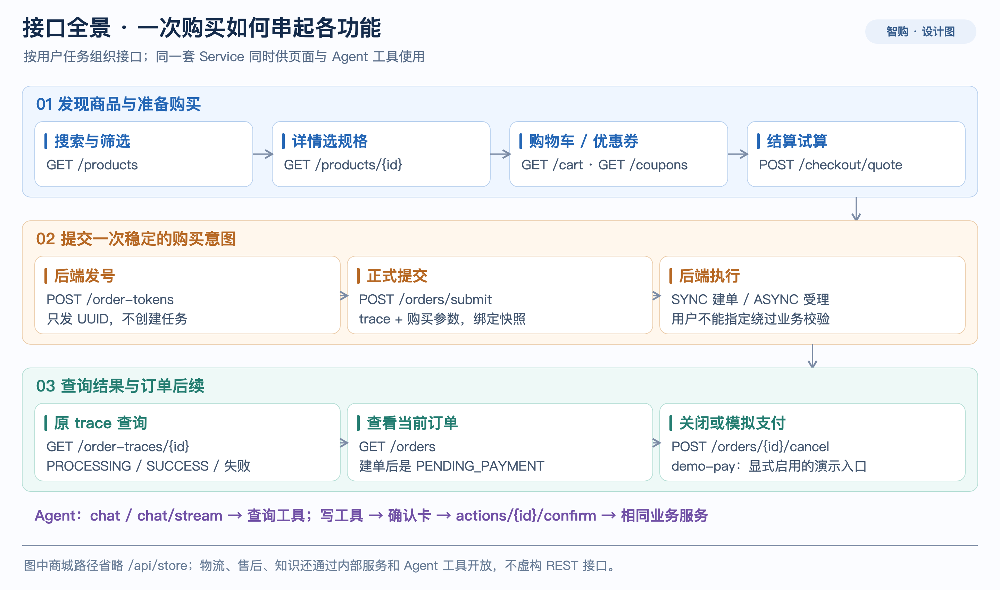

# 接口与功能流程：从请求到结果

返回 [学习导航](README.md) · 配套 [下单设计](order-design.md) / [Agent 设计](agent-design.md)

商品缓存与检索的完整细节见 [商品设计](product-design.md)，存储关系与约束见 [数据模型](data-design.md)。

本文覆盖当前 Controller 的 **26 个 HTTP 路由**。`/api/store` 是商城入口，`/api/agent` 是助手入口；物流、售后和规则检索还有工具入口，见最后一节。

[](images/api-journey.svg)

先看购买任务怎样经过查询、试算、发号、提交和结果查询，再对照下面的具体路由。 点击图片查看可缩放 SVG。


## 1. 商品查询

| 接口 | 执行流程 | 重要设计 |
|---|---|---|
| GET /api/store/products | 接收关键词、预算、属性、排序和分页 → 完整条件生成缓存 key → 查搜索缓存 → 未命中执行数据库筛选/排序/分页 | 条件或页码不同不能共用同一个缓存；当前为数据库检索 |
| GET /api/store/product-filters | 按品类查询可用筛选选项 → 返回品牌/颜色/尺码等 | 当前直接由检索服务读取选项，不走商品详情缓存 |
| GET /api/store/products/{productId} | 校验正整数 ID → 多级缓存 → 未命中构建详情 → 返回商品与可见 SKU、属性 | 商品 ID 是公共详情，实际购买指定 SKU |

**详情未命中的完整顺序：**

```text
参数校验 → 按策略查 Caffeine；命中直接返回
  本地未命中 → Redisson RBloomFilter 检查
      明确不存在：返回无商品，不读共享详情缓存、不竞争重建锁、不查数据库
      可能存在/未知：查 Redis；命中直接返回
      Redis 未命中：Redisson RLock → 锁后重查缓存
          仍未命中 → 取得回源名额 → 查商品/SKU/属性
          有结果：带随机 TTL 回填，符合本地策略再放 Caffeine
          无结果：短 TTL 空值标记
  finally：只释放当前线程仍持有的 RLock
```

拿不到 Redis 重建锁时，会有界等待并重查缓存；超时或回源并发超过上限返回 503。Redis 暂不可用时，使用有并发上限的数据库路径，避免无限打数据库。

| 防护 | 解决的问题 | 当前实现 |
|---|---|---|
| 防穿透 | 不存在的商品反复查数据库 | Bloom；误判后查不到则缓存 `product=null` 的短期标记 |
| 防击穿 | 一个 key 失效，大量请求同时重建 | Redisson RLock；拿锁后再查缓存，失锁的旧持有者不能回填 |
| 缓解雪崩 | 大量 key 同时过期或缓存故障 | TTL 随机偏移、每实例最多 16 个回源、有限等待/拒绝和故障冷却 |

默认详情 Redis TTL 为 20～24 秒，空值 3～3.6 秒，Caffeine 为 2 秒。默认策略 HOTKEY，HotKey 开关默认关闭；仅用默认配置启动不会提升到本地缓存。压测用 ALL/OFF 分别测本地和 Redis 路径，不代表所有运行环境都自动使用 L1。

商品/库存变更提交后切换 Redis 缓存代际，并广播清理本地缓存；旧 loader 回填要校验代际和锁所有者，避免旧查询覆盖更新后的缓存。当前是命名空间级代际失效，影响范围较大；稳定详情与易变价格/库存尚未拆开缓存。展示值允许短暂过时，广播也不是事务内强同步，**结算和建单仍核对数据库。**

源码：[ProductService](../src/main/java/com/bitmall/agent/product/service/ProductService.java) → [CatalogCache](../src/main/java/com/bitmall/agent/product/cache/CatalogCache.java) → [ProductRepository](../src/main/java/com/bitmall/agent/product/dao/repository/ProductRepository.java)。

## 2. 购物车

| 接口 | 执行流程 | 重要设计 |
|---|---|---|
| GET /api/store/cart | 按用户查询条目 → 汇总数量和勾选金额 → 返回 | 购物车金额用于展示，结算会重算 |
| POST /api/store/cart | 校验数量 1～20 → 查 SKU 与当前购物车 → 检查累计数量/库存 → 写入 → 返回新购物车 | 同 SKU 可以增加数量；这是累加语义，没有订单 trace 那样的请求幂等 |
| PATCH /api/store/cart/{itemId} | 查当前用户名下条目 → 核对数量/库存 → 修改数量或勾选状态 → 返回 | 不能只凭 itemId 修改别人的条目 |
| DELETE /api/store/cart/{itemId} | 按用户与条目 ID 删除 → 返回新购物车 | 数据访问带用户范围 |

加入购物车不预占库存；库存检查用于早提示，真正购买时还会核对。购物车页面变化不能改变已经绑定的下单快照。

源码：[CartService](../src/main/java/com/bitmall/agent/cart/service/CartService.java)。

## 3. 优惠券

| 接口 | 执行流程 | 重要设计 |
|---|---|---|
| GET /api/store/coupons | 查询可展示券活动 → 结合当前用户领用状态 → 返回 | `couponId` 是活动，`userCouponId` 是领到的那张用户券 |
| POST /api/store/coupons/{couponId}/claim | 查券与重复领取情况 → 条件增加已领数量 → 插入用户券 → 同事务提交 | 库存条件更新 + 用户/券唯一约束；重复领取明确拒绝，事务失败不消耗可领取库存 |

券在试算时检查资格，建单时锁定，支付时核销，取消时释放。**领取成功不等于下单时一定还能使用**，金额、有效期和券状态都要重查。

源码：[CouponService](../src/main/java/com/bitmall/agent/coupon/service/CouponService.java) → [CouponRepository](../src/main/java/com/bitmall/agent/coupon/dao/repository/CouponRepository.java)。

## 4. 结算试算

**POST /api/store/checkout/quote**

1. `source=DIRECT`：读取指定 SKU；`source=CART`：读取当前用户已勾选条目。
2. 查数据库当前价格、库存、地址归属与用户券资格。
3. 用 BigDecimal 计算商品金额、折扣、运费、应付额，返回确认明细。
4. **不创建订单、不预扣库存、不锁券。**

设计点：服务端重算金额，不能相信客户端传来的总价；试算结果只是确认依据，正式建单再核对，避免试算与提交之间价格变化。

源码：[CheckoutService](../src/main/java/com/bitmall/agent/checkout/service/CheckoutService.java)。

## 5. 发号、下单、查询结果

| 接口 | 执行流程 | 重要设计 |
|---|---|---|
| POST /api/store/order-tokens | 后端生成 UUID → 返回 traceId | 只发号，不查商品、不写 trace 表、不扣库存 |
| POST /api/store/order-traces | 后端报价 → 保存购买快照、摘要和 trace → 返回准备结果 | 兼容的预绑定入口；与“只发 UUID”接口不同，Agent 也有内部预绑定流程 |
| POST /api/store/orders/submit | AOP 锁 → 首次绑定快照 → 记录预占意图 → Lua 预扣 → 同步事务或异步受理 → 返回 | 购买内容、模式、重试和结果统一由 trace 关联；见下一篇完整时序 |
| POST /api/store/orders | 调用同一个提交 Service | 兼容路径，仍要求稳定 trace，不是另一套无凭证下单 |
| GET /api/store/order-traces/{id} | 核对用户归属 → 读持久化 trace → 返回结果 | PROCESSING 是已受理；SUCCESS 有 orderId；只有 UUID、未绑定时还没有任务记录 |
| GET /api/store/orders | 按当前用户查询最近订单 → 组装明细 | 查看订单当前状态；取消后 trace 仍 SUCCESS，但订单状态已变 |
| GET /api/store/order-options | 返回页面需要的下单模式、模拟支付开关 | 是配置能力说明，不是 Redis/MQ 实时健康检查 |

完整步骤、数据库事务、锁和失败处理统一见 [下单设计](order-design.md)，避免在多个文档里重复另一套版本。

源码：[OrderController](../src/main/java/com/bitmall/agent/order/controller/OrderController.java) → [OrderSubmissionService](../src/main/java/com/bitmall/agent/order/service/OrderSubmissionService.java)。

## 6. 取消、支付和超时关闭

| 接口/入口 | 执行流程 | 重要设计 |
|---|---|---|
| POST /api/store/orders/{orderId}/cancel | 锁当前用户订单 → 检查待支付 → 数据库关单/返库存/释放券/保存 Redis 返还任务 → 提交后执行 Lua 返还 | 不能先返 Redis 再提交数据库；重复取消、重复返还不重复加库存 |
| POST /api/store/orders/{orderId}/demo-pay | 显式开关启用 → 锁订单 → 核对待支付和有效期 → 改 PAID、消除锁定量、核销券 → 提交 | 模拟支付，不是真实支付回调；下单时已扣可售，支付不再扣一次 |
| MQ 超时检查（无 HTTP 路由） | 建单后默认 15 分钟到期投递 → 锁单复核数据库状态/期限 → 共用关闭与返还事务 | 已支付不误关、重复消息不重复释放；发送重试沿用原截止时间 |
| 后台超时扫描（无 HTTP 路由） | 查到期候选 → 每单独立事务重新锁单、检查 → 共用关单方法 | 扫描结果可能过时；支付和取消争抢同一订单行锁 |

源码：[OrderLifecycleService](../src/main/java/com/bitmall/agent/order/service/OrderLifecycleService.java)、[OrderRecoveryScheduler](../src/main/java/com/bitmall/agent/order/service/OrderRecoveryScheduler.java)。

## 7. Agent 的 HTTP 接口

| 接口 | 执行流程 | 重要设计 |
|---|---|---|
| POST /api/agent/chat | 检查/创建会话 → 会话门禁 → 保存输入、组织历史 → 模型/演示执行 → 保存回复 | 一次返回完整 JSON；业务写操作只提议确认卡 |
| POST /api/agent/chat/stream | 同一聊天流程 → SSE 推送文本/工具进度 → 最终保存回复 | 连接超时/断开时取消订阅；流式返回不绕开业务权限与确认 |
| POST /api/agent/actions/{actionId}/confirm | 校验归属/参数摘要 → CAS 保存用户决定 → 恢复后端参数 → 执行业务与标记结果 | approved=true 是明确同意；重复确认不能反复交易 |
| GET /api/agent/conversations/{conversationId}/messages | 核对会话归属 → 返回最近页面消息 | 页面历史与 Spring AI 工具消息分开存 |
| GET /api/agent/status | 返回 spring-ai / demo 配置模式 | 不代表远端大模型此刻调用一定成功 |

消息、Skills、确认和错误边界见 [Agent 设计](agent-design.md)。

## 8. 没有独立 HTTP 路由的业务工具

这些名称是模型工具，不是隐藏的 REST URL。它们经 ToolDispatcher 调用相同业务 Service。

| 工具 | 处理流程 | 设计点 |
|---|---|---|
| product_search / product_detail | 调商品搜索/详情 Service | 与页面共用缓存和数据 |
| checkout_quote | 调结算 Service 读取权威数据并算价 | 不扣库存、不锁券 |
| coupon_list / coupon_claim | 查询直接返回；领取先确认再执行 | 领取与用户确认分开 |
| order_query / order_create / order_cancel | 查询订单；建单/取消先生成确认卡 | 复用订单幂等、库存和事务规则 |
| logistics_query | 核对订单归属 → 读物流记录 | 当前查询本库轨迹，没有真实物流平台回调 |
| after_sales_precheck | 查订单归属/状态/已有申请 → 返回资格和金额 | 预检不等于执行 |
| after_sales_submit | 用户确认后再检查资格与金额 → 写 REVIEWING 申请 | 没有执行真实退款；并发重复申请仍需更强保障 |
| after_sales_query | 按用户和售后单号/订单号查进度 | 不能跨用户查询 |
| search_knowledge | 可信原意与子问题 → 归一化/可选增强 → 同范围关键词/向量召回 → RRF → 分组证据与覆盖 | 与只读 HTTP 共用服务；不跨品牌补资料，不执行售后 |
| load_skill / save_preference / current_date | 加载手册 / 保存明确偏好 / 查询日期 | 助手辅助能力，不直接代表交易授权 |

所有涉及用户的数据都在 Service/DAO 核对归属；但当前 HTTP 身份仍是演示 userId，不能把这一点讲成已经接入真实登录鉴权。


## 9. 品牌政策查询

| 接口 | 执行流程 | 重要设计 |
|---|---|---|
| GET /api/store/knowledge/search | 校验 query 与可选 brand/category/scope → 识别别名和意图 → 矛盾补问或按品牌/类别/地区过滤 → 返回检索状态、文档与来源 | 只读；与 search_knowledge 共用 KnowledgeService；官网渠道政策不自动适用于本站订单 |

新增 `POST /api/store/knowledge/search` 接收 `{query, queries}`，用于只读多问题检索；queries 不与旧筛选同时提供。返回 groups、coverage、warnings 和实际 retrievalMode，旧 hits 保留。

返回状态为 FOUND、PARTIAL、NO_MATCH 或 CLARIFICATION_REQUIRED。具体例子、文档目录及流程图见 [品牌知识检索](knowledge-design.md)。
