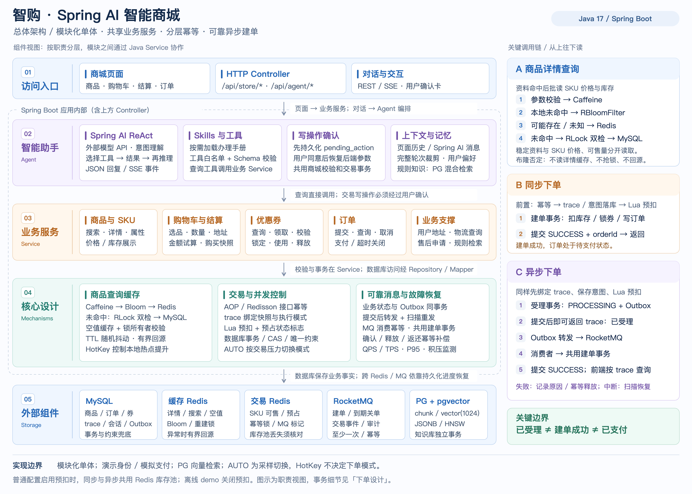

# 整体架构：先理解业务边界

返回 [学习导航](README.md) · 下一篇 [接口流程](api-flows.md)

深入各设计点：[商品缓存](product-design.md) · [幂等](idempotency-design.md) · [可靠消息](messaging-recovery.md) · [压力路由](pressure-monitoring.md) · [数据模型](data-design.md)。

## 1. 项目是什么架构

项目是**按业务模块拆分的 Spring Boot 单体应用**。商品、订单、券和 Agent 在同一个应用进程里，通过普通 Java Service 调用协作；MySQL、Redis、RocketMQ 是外部组件。

页面按钮和 Agent 工具是两个入口，进入相同的业务 Service。价格、库存、归属、优惠资格都在业务层校验，模型没有直接执行数据库 SQL 的权限。

[](images/system-architecture.svg)

左侧按职责分层，右侧串起查询与同步／异步下单。 点击图片查看可缩放 SVG。


图中的 Outbox 是 MySQL 表：先与业务状态同事务写入，再在提交后发送 MQ。架构图表达组件关系，具体事务顺序见 [下单设计](order-design.md)。

前台使用独立页面组织商品详情、购物车、结算、优惠券与订单，Hash 路由支持直达和浏览器返回；仍由同一个 Spring Boot 进程提供静态资源，详见 [商城前台设计](storefront-design.md)。

## 2. 目录为什么按业务拆

```text
com.bitmall.agent
├── product/       商品、SKU、属性、搜索与展示缓存
├── cart/          购物车
├── coupon/        券查询、领取和用户券
├── checkout/      商品、地址、券和金额试算
├── order/         trace、库存预占、建单、支付/关单、MQ、恢复
├── agent/         聊天、模型、工具、Skills、确认卡、会话和记忆
├── aftersales/    售后资格和申请
├── knowledge/     规则文档检索
├── user/          用户、地址数据访问
└── common/        少量通用的幂等切面、异常、计数和持久化工具
```

模块内部职责：

| 目录 | 负责什么 | 以订单为例 |
|---|---|---|
| controller | HTTP 参数、调用入口、返回结果 | 接收 trace 与购买参数 |
| service | 业务顺序、事务和跨模块协作 | 预扣、受理、建单、关闭订单 |
| dao/mapper | MyBatis-Plus 接口及数据库操作 | 条件扣库存、锁 trace 行 |
| dao/entity | 数据库行对应的数据对象 | 订单行、trace 行 |
| dao/repository | 组合 Mapper、组装数据库查询结果 | 读取完整订单和明细 |
| dto / vo | 请求参数 / 返回结果 | OrderSubmitRequest / OrderSubmitVO |
| model | 服务内部使用的命令或快照 | CreateOrderCommand |

`dao` 是数据访问，`entity` 是表对象；业务判断放在 Service。Repository 是数据访问的封装，当前项目并不是完整的 DDD 分层。

## 3. 数据分别放哪里

| 组件 | 存什么 | 为什么这样放 |
|---|---|---|
| MySQL | 商品/SKU、订单/明细、用户券、trace、Outbox、确认卡、会话 | 业务事实与可恢复状态，需要事务和约束 |
| 商品缓存 Redis | 商品资料、SKU 公开价格和展示库存、短期搜索结果、空结果、原生 RBloomFilter、RLock 重建锁 | 减少查询回源，缓存故障时有界回源 |
| 交易 Redis | SKU 可售计数、预占记录、幂等锁/标记、路由协调数据 | Lua 原子预扣、减少重复执行、协调压力模式 |
| Caffeine | 当前实例的热点商品/搜索数据 | 资料命中可省去资料查询；动态 SKU 展示仍需读取，容量有界 |
| RocketMQ | ORDER_BUILD 建单命令、支付超时检查，以及交易变更事件 | 异步建单、到期关单与事件解耦 |

商品缓存与交易分别使用具名 Redisson 客户端；MQ 消费去重保留原独立适配。统一客户端并不替代业务状态、数据库事务和唯一约束。

**两个 Redis 的故障策略不同。** 展示缓存丢了可以重建；交易预占丢了可能影响已受理购买，必须停止相关接单并核对，不能盲目从数据库覆盖库存。

商品详情目前包含价格和库存展示值，但结算/建单读取数据库并重新校验。展示结果可以短暂过时，扣库存依赖事务里的条件更新。

## 4. 先记住这些表的关系

| 表/表组 | 回答什么问题 |
|---|---|
| product / product_sku | 是哪款商品、买哪个规格、当前价格与库存是多少？ |
| customer_order / order_item | 订单当前是什么状态、买了什么？ |
| order_submit_trace | 某次购买是否受理/成功、对应哪个订单、库存整理到哪一步？ |
| user_coupon | 这张用户券是否可用、已锁定还是已使用？ |
| order_message_outbox | 哪条消息还需要发送或重发？ |
| order_inventory_return | 关单后的 Redis 库存返还是否完成？ |
| pending_action | 用户准备确认哪项 Agent 写操作、原始参数是什么？ |
| chat_message / agent_scope_state / user_memory | 页面历史、Spring AI 消息与工具配对、长期偏好分别是什么？ |

`traceId`、`orderId`、`eventId`、`actionId` 是不同职责的编号，不互相替代。详细例子见下单与 Agent 两篇。

## 5. 面试应突出哪些设计

1. **共享业务入口**：页面和 Agent 复用校验与事务，避免模型绕开交易规则。
2. **读写不同的一致性要求**：详情按需缓存，结算和建单核对权威数据。
3. **幂等分层**：分布式锁减重复，数据库约束保交易结果，Lua 状态机保补偿不重复。
4. **可靠异步**：受理状态、发送意图和恢复进度落库；允许重复发送，但消费按购买意图幂等。
5. **业务状态可解释**：已受理、建单成功、待支付、库存待整理分别表示不同阶段。

## 6. 当前实现边界

真实登录、真实支付/退款渠道、分库分表尚未接入；知识默认关键词，可启用 PostgreSQL + pgvector 混合检索；Agent 会话互斥限单进程。订单 Redis 补货同步、库存池丢失后的自动重建、终态预占自动清理也尚未实现。

AUTO 是采样驱动的压力切换，积压保护是软阈值；不是精确的全局限流器。压测暴露了 Outbox 转发与库存整理在过载时的积压，单秒成功建单峰值不代表完整链路能长期维持该吞吐。

源码先读：[ProductController](../src/main/java/com/bitmall/agent/product/controller/ProductController.java)、[OrderController](../src/main/java/com/bitmall/agent/order/controller/OrderController.java)、[AgentChatController](../src/main/java/com/bitmall/agent/agent/controller/AgentChatController.java)，再沿下一篇的流程进入 Service。
