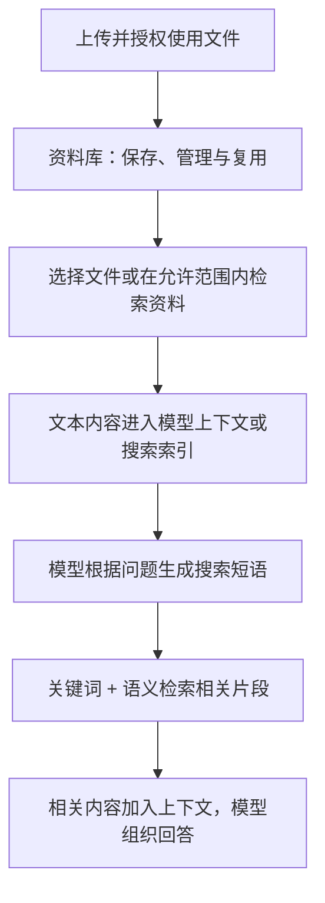
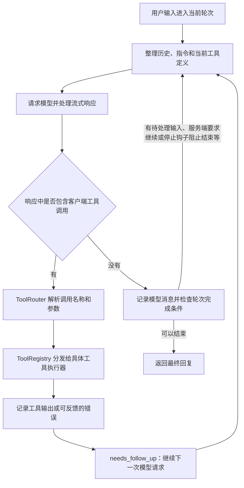
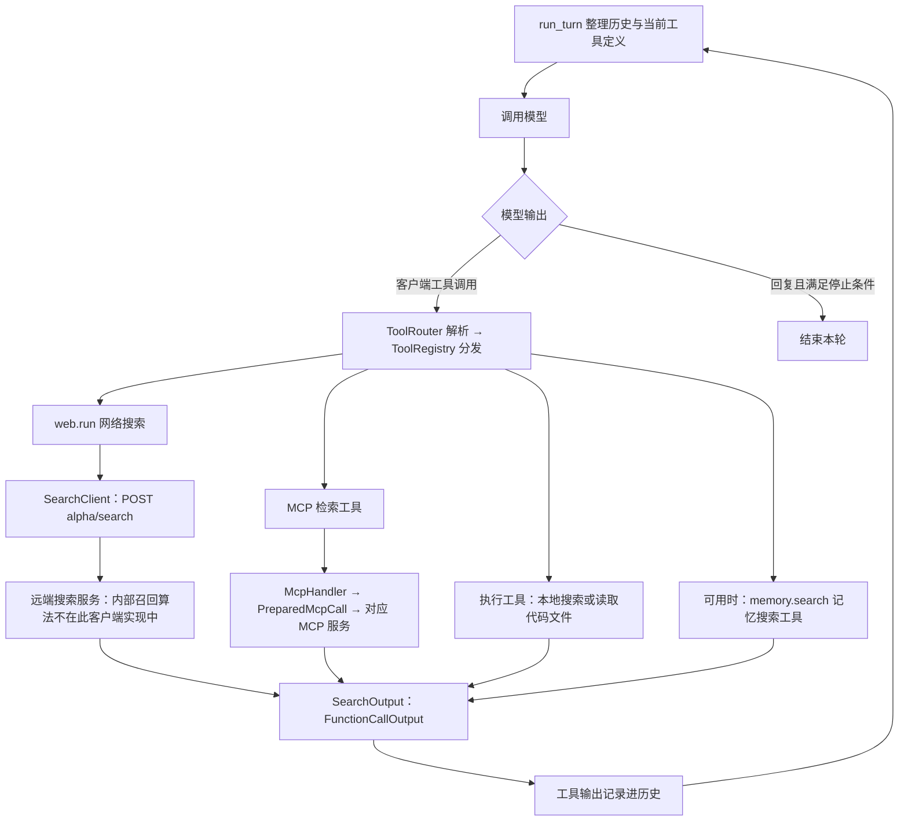

# 参考 Codex 源码：模型决定下一步，运行时负责执行

返回 [阅读导航](README.md) · 配套 [Agent 设计](agent-design.md) / [当前知识检索](knowledge-design.md)

本文区分源码事实、官方产品说明和商城后续方案。2026-11-17 已再次更新官方仓库；最新记录在前，原始快照分析在后。商城运行行为没有变化。

## 最新源码与截图中的“资料库”（2026-11-17）

已在 `/Users/wowo/Agent/codex` 执行 `git pull --ff-only`，从 `6e1ab4d294` 更新到 **`44834c58fa99d0a04f222e18817b99b430f7c0e8`（2026-11-17）**。更新后 HEAD 与 origin/main 一致，工作区干净。

用户截图显示桌面客户端的“资料库”，包含推荐、收藏、文件夹、图像、全部。此前只追查 CLI 的工具循环，没有对应到这个产品入口。官方 [Library 说明](https://help.openai.com/en/articles/20001052-using-library-to-manage-files-in-chatgpt)确认它可以保存、查找和复用资料，并展示允许访问的连接文件。

**页面查找文件，与模型为了回答问题检索文件正文，是两个层次。** 文件在资料库中，不等于每次提问都会把全部文件放进模型上下文。

### 官方公开的文件内容检索机制

| 依据范围 | 可以确认 | 不能据此确认 |
|---|---|---|
| Library 产品说明 | 文件保存、浏览、搜索、添加到对话；连接文件保留来源与权限 | 推荐算法、内容索引实现、后台完整调用顺序 |
| ChatGPT Enterprise 文件处理说明 | 文本部分进入上下文，内容另建私有搜索索引；模型生成搜索短语，使用关键词与语义混合检索补充片段 | 所有套餐、桌面版本使用相同参数与调用链 |
| Responses API 的 file_search | 托管文件检索工具，使用 vector store、语义与关键词搜索，模型可调用并引用资料 | 截图中的资料库直接调用这个公开 API |

依据：[Enterprise 文件处理](https://help.openai.com/en/articles/10029836-optimizing-file-uploads-in-chatgpt-enterprise)、[File search API](https://developers.openai.com/api/docs/guides/tools-file-search)。这是官方产品/接口说明，不是已找到的资料库服务端源码。



此图结合 Library 功能与 Enterprise 公开文件处理机制说明，**不是截图版本的源码调用图**；表格、图片等文件还可能采用代码分析或图像理解。

对自建商城，能直接研究的公开接口是 [Retrieval 指南](https://developers.openai.com/api/docs/guides/retrieval)：文件加入 vector store 后自动分块、生成 embedding 并建立索引；查询支持可选 `rewrite_query`、属性过滤、排名及关键词/语义融合权重。这些能力不证明 Library 后台的全部实现。

### 最新 CLI 核对结果

- 主循环仍为上下文 → 模型调用 → 工具执行 → 结果写入历史 → 继续或结束。入口：[run_turn:215](/Users/wowo/Agent/codex/codex-rs/core/src/session/turn.rs:215)、[build_prompt:1907](/Users/wowo/Agent/codex/codex-rs/core/src/session/turn.rs:1907)。当前还有增量工具模式，不能说每次都发送完整工具清单。
- 工具回包进入历史：[工具调用处理:351](/Users/wowo/Agent/codex/codex-rs/core/src/stream_events_utils.rs:351)、[结果写回:2914](/Users/wowo/Agent/codex/codex-rs/core/src/session/turn.rs:2914)。
- [tool_search:151](/Users/wowo/Agent/codex/codex-rs/core/src/tools/handlers/tool_search.rs:151)仍使用 bm25 库搜索工具元数据。当前库接口名为 EmbedderBuilder/Scorer，不能只凭 embed 这个名字就当成神经网络语义向量检索。
- [web.run:108](/Users/wowo/Agent/codex/codex-rs/ext/web-search/src/tool.rs:108)仍组装请求发往远端搜索；[McpHandler:247](/Users/wowo/Agent/codex/codex-rs/core/src/tools/handlers/mcp.rs:247)处理对应外部服务调用。

本轮在 core/ext 工具目录中没有找到 Library 产品的文件入库、分块、向量索引与正文搜索服务端实现。配置中的 `file_search` 字符串位于保留命名空间列表，不是知识库检索执行器。不能用 CLI 中没找到这套服务，推断产品没有资料内容检索。

本轮检查了 fast-forward 更新、HEAD/远端一致性、工作区与源码入口，没有构建或运行 Codex。下面保留原始源码分析，其链接已固定到旧提交，避免更新后的行号漂移。

## 原始源码分析：2026-09-26 快照

- 本机仓库：`/Users/wowo/Agent/codex`。
- origin：`https://github.com/openai/codex.git`，工作区无本地修改。
- 提交：`6e1ab4d294cdf1d2606a91bf1acf6de0f0959c7a`，提交日期 2026-09-26；核对日期 2026-11-17。
- 以下行号对应原始快照，不是当前 checkout 的行号。原始依据为更新前读取的本机代码，链接已固定到该提交；不推断模型服务端、网页搜索服务或 MCP 服务端的内部算法。

## 主循环确实怎样执行



上图是主路径概括，取消、致命错误、压缩失败等也可能中断流程。`needs_follow_up` 是运行时控制信号，不是“资料已经足够”的语义评分。

| 可核对的事实 | 本机源码入口 |
|---|---|
| `run_turn()` 循环准备历史，调用 `run_sampling_request()`；结合模型继续标记和待处理输入决定是否继续 | [turn.rs:424](https://github.com/openai/codex/blob/6e1ab4d294cdf1d2606a91bf1acf6de0f0959c7a/codex-rs/core/src/session/turn.rs#L424) |
| `build_prompt()` 提供输入、当前可见工具定义、并行调用标记与输出格式 | [turn.rs:1563](https://github.com/openai/codex/blob/6e1ab4d294cdf1d2606a91bf1acf6de0f0959c7a/codex-rs/core/src/session/turn.rs#L1563) |
| 接收到工具调用就先记录调用，创建执行 future，并设 `needs_follow_up=true` | [stream_events_utils.rs:316](https://github.com/openai/codex/blob/6e1ab4d294cdf1d2606a91bf1acf6de0f0959c7a/codex-rs/core/src/stream_events_utils.rs#L316) |
| `build_tool_call()` 从模型输出解析工具名、命名空间和参数；它不是先读取用户原话再做业务意图分类 | [router.rs:248](https://github.com/openai/codex/blob/6e1ab4d294cdf1d2606a91bf1acf6de0f0959c7a/codex-rs/core/src/tools/router.rs#L248) |
| 注册表查找执行器、核对调用种类、运行相关钩子，再分发工具 | [registry.rs:526](https://github.com/openai/codex/blob/6e1ab4d294cdf1d2606a91bf1acf6de0f0959c7a/codex-rs/core/src/tools/registry.rs#L526) |
| 执行结果通过 `drain_in_flight()` 写入对话历史，随后可以再次发给模型 | [turn.rs:2446](https://github.com/openai/codex/blob/6e1ab4d294cdf1d2606a91bf1acf6de0f0959c7a/codex-rs/core/src/session/turn.rs#L2446) |

在已核对的这条主链路中，没有硬编码“每轮先拆子问题 → 术语归一化 → 改写 → 分词 → 意图分类”。模型通过输出文字或工具调用参与控制下一步；源码不能证明模型内部采用了怎样的思考步骤。

## “RAG 工具”的检索代码具体在哪里

这份 CLI 的通用主链路不是一个内置政策知识库 RAG 流水线。必须区分具体的知识获取入口；`tool_search` 只发现工具，不能把它当作执行文档检索的工具。



图中是客户端工具路径。配置也可能使用服务端托管的 WebSearch：CLI 通过工具定义声明搜索能力，由服务端执行；不能将两种网络搜索路径混为一谈。

### 网络资料：web.run

开启并选择独立网络搜索执行器时，`WebSearchTool::handle_call()` 做了以下实际操作：

1. 将模型生成的工具参数解析为 `SearchCommands`，支持 search_query、open、click、find 等；搜索项包含 q，以及可选 domains、recency。
2. 构造 `SearchRequest`：包含会话 ID、模型、commands、搜索设置、近期对话和输出 token 上限。
3. 调用 `SearchClient::search()`，向 provider 对应的 `alpha/search` 地址发 POST；不是在这里执行本地分词或向量检索。
4. 接收服务返回的 `output` 和可选 `results`。`output` 包装为带原 call_id 的 `FunctionCallOutput` 供模型读取；`results` 还用于搜索完成事件等展示信息。
5. 工具结果沿主链路记录进历史，模型可以继续 open、find、再次搜索或回答。是否继续由后续模型响应和轮次控制决定，没有在此工具内固定执行“先分解、再改写、再向量召回”。

这里的 `recent_input()` 保留最近两个用户消息所覆盖的对话尾部，并对助手文本设置 1000 token 预算；不是把全部历史原封不动发给搜索服务。

源码：[请求构造 tool.rs:97](https://github.com/openai/codex/blob/6e1ab4d294cdf1d2606a91bf1acf6de0f0959c7a/codex-rs/ext/web-search/src/tool.rs#L97)、[SearchCommands:34](https://github.com/openai/codex/blob/6e1ab4d294cdf1d2606a91bf1acf6de0f0959c7a/codex-rs/codex-api/src/search.rs#L34)、[远端 POST:34](https://github.com/openai/codex/blob/6e1ab4d294cdf1d2606a91bf1acf6de0f0959c7a/codex-rs/codex-api/src/endpoint/search.rs#L34)、[上下文裁剪:18](https://github.com/openai/codex/blob/6e1ab4d294cdf1d2606a91bf1acf6de0f0959c7a/codex-rs/ext/web-search/src/history.rs#L18)、[输出封装:32](https://github.com/openai/codex/blob/6e1ab4d294cdf1d2606a91bf1acf6de0f0959c7a/codex-rs/ext/web-search/src/output.rs#L32)。托管 WebSearch 的声明见 [hosted_spec.rs:14](https://github.com/openai/codex/blob/6e1ab4d294cdf1d2606a91bf1acf6de0f0959c7a/codex-rs/core/src/tools/hosted_spec.rs#L14)，两条网络搜索路径的选择见 [spec_plan.rs:633](https://github.com/openai/codex/blob/6e1ab4d294cdf1d2606a91bf1acf6de0f0959c7a/codex-rs/core/src/tools/spec_plan.rs#L633)。

这些客户端代码不能证明远端搜索内部采用了 BM25、向量、问题改写还是其他方案。

### 外部知识库：通过 MCP 工具接入

模型调用一个已接入的 MCP 搜索工具时，`McpHandler::handle_call()` 准备实际绑定、读取参数和输出裁剪配置，进入 `handle_mcp_tool_call()`。调用过程解析 JSON、核对工具可用性和相应策略后，经 `PreparedMcpCall::call_with_preparation()` 发给对应服务，结果再包装为 `McpToolOutput`。

Codex 客户端负责调用协议与结果处理；若该服务是一套 RAG 系统，文档入库、分块、embedding、召回、重排是对应服务的职责。仅凭 CLI 不能知道某个外部服务实际如何实现这些步骤。

源码：[McpHandler:198](https://github.com/openai/codex/blob/6e1ab4d294cdf1d2606a91bf1acf6de0f0959c7a/codex-rs/core/src/tools/handlers/mcp.rs#L198)、[入口与参数解析:128](https://github.com/openai/codex/blob/6e1ab4d294cdf1d2606a91bf1acf6de0f0959c7a/codex-rs/core/src/mcp_tool_call.rs#L128)、[实际调用准备:439](https://github.com/openai/codex/blob/6e1ab4d294cdf1d2606a91bf1acf6de0f0959c7a/codex-rs/core/src/mcp_tool_call.rs#L439)。

### 本地代码与本地记忆

本地代码正文可以通过执行工具运行 `rg`、读取文件，再把真实输出交回模型；不能与文件名模糊匹配或工具元数据 BM25 混淆。下面的搜索分类表给出各自证据。

另外，这份源码确实有独立的记忆扩展搜索：`SearchTool::handle_call()` 接受 queries、match_mode、path 等并调用 backend.search；已核对的 `LocalMemoriesBackend` 实现进行文件行子串匹配，支持同一行/行窗口匹配和可选分隔符规范化。这里的 normalized 是字符串匹配选项，不是模型问题重写或品牌术语归一化，也不是向量检索。

源码：[记忆工具:77](https://github.com/openai/codex/blob/6e1ab4d294cdf1d2606a91bf1acf6de0f0959c7a/codex-rs/ext/memories/src/tools/search.rs#L77)、[本地匹配实现:18](https://github.com/openai/codex/blob/6e1ab4d294cdf1d2606a91bf1acf6de0f0959c7a/codex-rs/ext/memories/src/local/search.rs#L18)。这描述扩展存在时的实现，不表示所有会话都已启用它。

## 计划工具是不是自动拆任务

`PlanHandler::handle_call()` 解析模型传来的 `UpdatePlanArgs`，发出 `PlanUpdate` 事件，返回计划已更新。这个执行器本身没有再调用模型去拆问题，也没有按计划自动执行每个步骤。

因此，看到 `update_plan` 不能当作存在一个固定、自动执行的子问题规划流水线。依据：[plan.rs:66](https://github.com/openai/codex/blob/6e1ab4d294cdf1d2606a91bf1acf6de0f0959c7a/codex-rs/core/src/tools/handlers/plan.rs#L66)。

## 搜索工具和知识库检索要分清

| 本次查到的实现 | 搜索什么 | 已确认的算法或行为 |
|---|---|---|
| `ToolSearchHandler` | 延迟加载工具的元数据 | 使用 `bm25` 库，基于各工具 `search_text` 建索引，执行 `search(query, limit)`，返回选中的工具定义 |
| `default_tool_search_text()` | 工具名称、描述、参数 Schema 中的字段和描述 | 构建工具发现的搜索文本；不是从用户整句话固定抽取商城关键词 |
| `file-search` crate | 文件和目录路径 | 使用 `nucleo` 做模糊路径匹配；不是代码正文的语义向量检索 |
| 部分版本的模型提示模板 | 本地文本与文件搜索策略 | 提示优先使用 `rg` / `rg --files`；实际命令由模型生成并通过执行工具运行 |

依据：[tool_search.rs:141](https://github.com/openai/codex/blob/6e1ab4d294cdf1d2606a91bf1acf6de0f0959c7a/codex-rs/core/src/tools/handlers/tool_search.rs#L141)、[查询执行:245](https://github.com/openai/codex/blob/6e1ab4d294cdf1d2606a91bf1acf6de0f0959c7a/codex-rs/core/src/tools/handlers/tool_search.rs#L245)、[元数据拼接:118](https://github.com/openai/codex/blob/6e1ab4d294cdf1d2606a91bf1acf6de0f0959c7a/codex-rs/tools/src/tool_search.rs#L118)、[file-search:1](https://github.com/openai/codex/blob/6e1ab4d294cdf1d2606a91bf1acf6de0f0959c7a/codex-rs/file-search/src/lib.rs#L1)、[提示模板:40](https://github.com/openai/codex/blob/6e1ab4d294cdf1d2606a91bf1acf6de0f0959c7a/codex-rs/core/templates/model_instructions/gpt-5.2-codex_instructions_template.md#L40)。

`ToolSearchHandler::handle_call()` 处理模型提交的 query，校验非空、limit 合法后调用 BM25 搜索；这里没有独立的 LLM 问题改写阶段。这个 BM25 是**工具发现**，不能拿它证明 Codex 使用 BM25 检索全部代码或文档，更不能推断所有远端工具是否使用向量。

## 上下文和并行由运行时维护

- 工具结果加入历史后，后续模型请求可以看到它；历史管理会维护调用与输出对应关系，并清理不受模型支持的媒体内容。这里的 `normalize_history` 指历史协议整理，不是术语归一化。[history.rs:875](https://github.com/openai/codex/blob/6e1ab4d294cdf1d2606a91bf1acf6de0f0959c7a/codex-rs/core/src/context_manager/history.rs#L875)
- 是否允许工具并行由工具能力标记参与控制；并行工具走读锁，非并行工具走写锁。声明支持并行不等于所有调用无条件一起执行。[parallel.rs:138](https://github.com/openai/codex/blob/6e1ab4d294cdf1d2606a91bf1acf6de0f0959c7a/codex-rs/core/src/tools/parallel.rs#L138)
- 上下文接近配置限制时，主循环可以触发压缩或窗口切换；不能把压缩误认为知识检索或问题改写。[turn.rs:599](https://github.com/openai/codex/blob/6e1ab4d294cdf1d2606a91bf1acf6de0f0959c7a/codex-rs/core/src/session/turn.rs#L599)

## 商城可以怎样参考（后续方案，尚未实施）

继续使用已有 Spring AI Agent 循环，由模型决定调用商品、订单、政策或售后工具，不再给所有聊天前置一套固定的 RAG 查询处理流程。

```text
会话上下文 + 工具定义 → 模型选择工具和生成参数
  ├─ 商品/订单查询 → 共享业务 Service
  ├─ 售后写操作 → 预检、持久化确认、用户批准、业务重检
  └─ search_knowledge → 品牌/类别/渠道校验
                        → 按需规范术语、改写检索问题
                        → 有效的文档召回与重排
                        → 返回片段、来源、适用范围和缺口
工具结果写回上下文 → 模型回答、补问或继续调用工具
```

模型可以在工具参数中形成新的检索问题；具体检索服务也可以做可测试的查询处理。原问题必须保留，用于核对改写有没有改变品牌、渠道、条件或用户诉求。调用次数、耗时与结果边界仍由后端限制。

当前知识检索仍是品牌/类别过滤后 LIKE 计分，且每组基本一篇资料；尚无真正的全文/向量混合召回、独立证据评分或完整的定向补检控制。Codex 的客户端主循环也不是这些 RAG 能力已经实现的证据。
