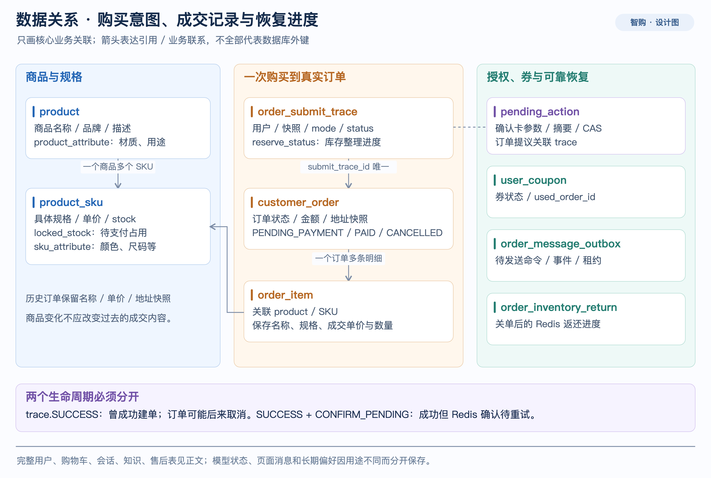

# 数据模型、事务与状态

返回 [文档导航](README.md) · 请求顺序见 [接口流程](api-flows.md)

## 1. 先理解这些表，不用背全部字段

| 业务 | 主要表 | 为什么需要 |
|---|---|---|
| 用户与地址 | app_user / user_address | 数据归属与收货信息；当前登录仍是演示身份 |
| 商品与规格 | product / product_sku | 公共描述与规格级价格、库存分离 |
| 属性与检索 | product_attribute / sku_attribute | 表达商品材质/用途和 SKU 颜色/尺码等 |
| 购物车 | cart_item | 用户选了哪些 SKU、数量和勾选状态；不预占库存 |
| 券 | coupon / user_coupon | 券模板库存与用户领到的具体券分离 |
| 购买意图 | order_submit_trace | 保存快照、模式、业务结果与库存整理进度 |
| 成交记录 | customer_order / order_item | 订单主信息、状态与商品/价格快照 |
| 可靠消息 | order_message_outbox / order_event_receipt | 发送进度与生命周期事件审计 |
| 库存返还 | order_inventory_return | 关单数据库已提交、Redis 仍需返还的任务 |
| Agent 授权 | pending_action | 待确认参数、归属、摘要与执行状态 |
| 会话与记忆 | conversation / chat_message / agent_scope_state / user_memory | 页面历史、Spring AI 消息和长期偏好 |
| 手册与知识 | agent_skill / conversation_skill / knowledge_document | 工具办理规则、加载状态与知识源文档 |
| 物流与售后 | logistics_event / after_sales | 物流事件和售后申请；没有真实配送/退款渠道 |

箭头表达业务关联；完整字段、状态和约束以下面的解释及迁移脚本为准。 点击图片查看可缩放 SVG。

图是关键业务关联，虚线不是外键。订单中的商品名称、规格、单价、地址等使用快照，避免商品或地址修改后历史订单跟着改变。

## 知识索引：源文档与发布版本分开

默认索引已迁入 PostgreSQL 的 `knowledge` schema：`knowledge_index_version`（模型身份、维度、构建状态）、`knowledge_index_chunk`（正文、哈希、JSONB、vector(1024)）和 `knowledge_index_head`（发布指针）。PG 独立 Flyway V1；主库历史 V19 表保留作 LEGACY 兼容，交易库不迁移。索引网络构建在事务外，最终复核源数据后原子发布；失败不覆盖旧指针。详情见 [RAG 设计](knowledge-design.md#离线索引为何单独做)。

## 2. trace 里为什么有两组状态

- `status`：INIT / PROCESSING / SUCCESS / FAILED / EXPIRED，回答购买结果。
- `reserve_status`：预占、待确认、待释放等内部进度，回答 Redis 整理是否完成。

因此 SUCCESS + CONFIRM_PENDING 是合法组合：订单已创建，Redis 确认待重试。不能因为整理未完成而把已成功订单释放掉。

`request_snapshot` 保存成交意图；`request_hash` / `submission_hash` 用于对应快照与提交参数的校验；`version` 用于 CAS；`expires_at` 与 `processing_expires_at` 区分准备有效期和异步处理期限。具体字段以迁移和实体为准。

## 3. 三种库存数不要混淆

| 字段 / 计数 | 表达什么 |
|---|---|
| MySQL stock | 当前可售库存 |
| MySQL locked_stock | 已建单、尚未支付的占用 |
| Redis available | 共享预扣池还允许接多少件 |
| Redis pending | 已预扣、尚未确认落库的数量 |

建单：MySQL `stock-q / locked_stock+q`。支付：只消耗 locked_stock。关闭未支付订单：`stock+q / locked_stock-q`，同时记录 Redis RETURN 任务。

在没有其他库存变化、没有在途预占、Redis 整理完成时，Redis available 应与数据库 stock 对齐。在途期间二者暂时不同有业务含义，不能简单覆盖 Redis 来“修平”。

## 4. 哪些数据库约束真正重要

| 约束 / SQL | 目的 |
|---|---|
| customer_order.submit_trace_id 唯一 | 同一 trace 最多建立一笔订单 |
| cart_item(user_id, sku_id) 唯一 | 同用户同 SKU 合并为一条购物车项 |
| user_coupon(user_id, coupon_id) 唯一 | 当前规则下同用户同模板只领取一次 |
| Outbox(trace_id, event_type) 唯一 | 同购买同类命令/事件不能重复插入 |
| order_inventory_return(order_id, sku_id) 主键 | 同订单同 SKU 返还任务只有一份 |
| stock >= quantity 条件更新 | 并发扣减必须检查影响行数，防止超卖 |
| 订单 / trace 行锁与状态 CAS | 支付、取消、重复建单不能任意交错 |

数据库约束保护的是已定义业务规则，不会自动识别两个不同 trace 是用户误点还是两次合理购买。

## 5. 事务由谁管理

Controller 处理参数与返回值；Service 管理业务事务；Repository 组合 Mapper 并组装对象。BaseMapper 处理基础单表 CRUD，复杂联表、行锁和 CAS 使用 Mapper XML。

MyBatis-Plus 不会自动补库存条件或状态机。显式 SQL 仍需要用户归属、当前状态、版本和影响行数判断；排序与动态表选择采用白名单，用户值使用参数绑定。

绑定 trace、记录预占意图用独立事务；建单库存/券/订单/结果/Outbox 用同一事务。跨 Redis/MQ 的恢复规则见 [消息与恢复](messaging-recovery.md)。

## 6. 直接看当前结构，不用追演化过程

当前完整 DDL 集中在 [数据库资料](database/README.md)：[MySQL](database/mysql-current-schema.sql) 与 [PostgreSQL/pgvector](database/pgvector-current-schema.sql)。快照包含最终字段、索引与约束，不含业务数据或 ALTER 历史。数据库初始化与已有环境升级也在该目录说明。

MySQL / H2 目前均到 **V19**，PG 使用独立 V1。Flyway 自动处理初始化和增量升级；已应用历史保留在 resources，日常学习不必打开。V12 的旧活动表已在 V13 删除；当前快照没有它。

`agent_scope_state` 保留历史表名和旧行；新实现只读写 `spring-ai-v1` 键，不自动重放旧框架工具。

源码：[Mapper SQL](../src/main/resources/mapper)、[OrderTraceRepository](../src/main/java/com/bitmall/agent/order/dao/repository/OrderTraceRepository.java)、[OrderRepository](../src/main/java/com/bitmall/agent/order/dao/repository/OrderRepository.java)。
