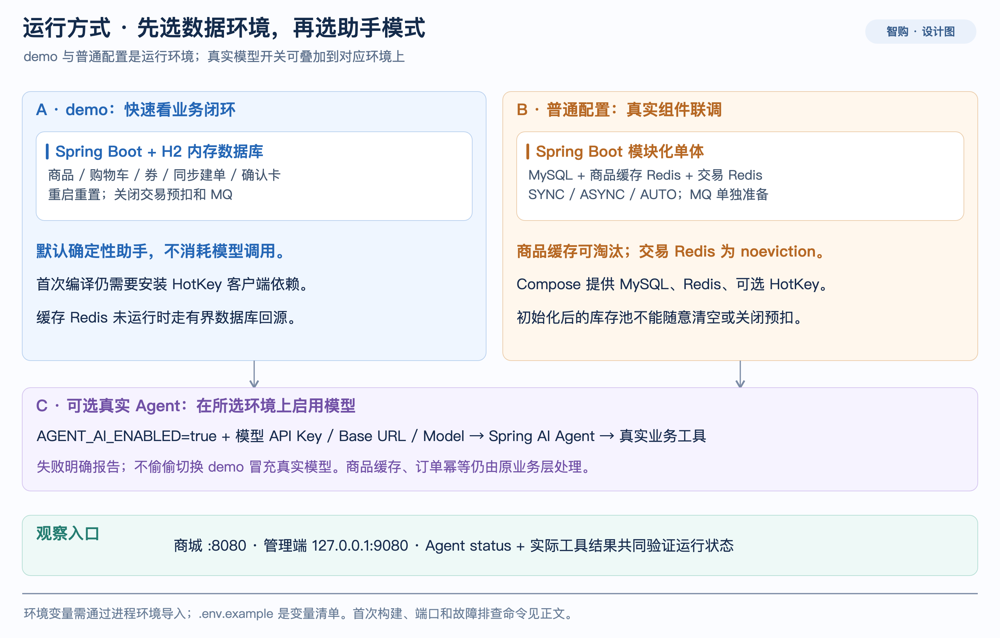

# 本地启动、依赖与排查

返回 [文档导航](README.md) · 验证和压测命令见 [测试与压测](testing.md)

[](images/deployment-modes.svg)

先选择 demo 或普通配置，再决定是否启用真实模型；助手模式不替代底层业务组件。 点击图片查看可缩放 SVG。


## 1. 先选体验方式

| 方式 | 能看到什么 | 需要什么 |
|---|---|---|
| demo | 商城页面、真实 H2 业务、确定性助手、确认卡、同步建单和模拟支付 | Java 17、Maven，首次编译安装 HotKey 依赖 |
| 普通配置 | MySQL、Redis 共享预扣、SYNC / ASYNC / AUTO、MQ | MySQL 8.0.16+、两个 Redis、RocketMQ |
| 真实 Agent | 模型决策、真实工具调用、SSE、多轮会话 | 在对应运行方式上启用兼容 OpenAI 的模型配置 |

文中的 demo 启动命令显式指定 `ORDER_SUBMISSION_MODE=SYNC`，避免继承普通配置的 AUTO 采样要求。demo 不要求启动缓存 Redis；缓存故障会走有界回源，可能看到连接日志。内存 H2 重启重置，不能用 demo 证明真实 MQ 链路或真实模型效果。

## 2. 首次编译与快速体验

项目依赖京东 HotKey 的 snapshot 客户端，即使不启用热点识别，首次编译也需要它。执行：

```bash
bash scripts/build-hotkey.sh
ORDER_SUBMISSION_MODE=SYNC mvn spring-boot:run -Dspring-boot.run.profiles=demo
```

安装脚本从官方仓库拉取固定提交 `f1c81819c7dcc7cf3421f556698e0fbebd244641`，安装客户端并构建 Worker。组件放在忽略提交的 `.runtime/`；脚本保留 Java 17 兼容补丁及锁定版本检查。

打开 <http://localhost:8080>。依次操作：详情选 SKU → 结算 → 下单 → 订单查询/取消；聊天中查询商品，再请求购买并点击确认。demo 默认开启模拟支付，普通配置默认关闭。

## 3. 普通配置：各组件怎么连接

| 组件 | 本地默认地址 | 作用 |
|---|---|---|
| 商城 / 管理端 | 8080 / 127.0.0.1:9080 | 页面 API / 指标 |
| MySQL | 127.0.0.1:3307 / bit_mall | 业务事实与 Flyway 迁移 |
| 商品缓存 Redis | 127.0.0.1:6380 | 可淘汰的公共展示缓存 |
| 交易 Redis | 127.0.0.1:6381 | noeviction，共享预占、锁与路由 |
| RocketMQ | 按 ROCKETMQ_NAME_SERVER 配置 | 5.x Broker；定时关单需要时间轮能力 |
| etcd / HotKey Worker | 2379 / 11111 | 可选热点识别 |

普通配置 MQ 默认地址是共享开发环境 `common-rocketmq-dev.magestack.cn:9876`，开发者需确认当前网络与 Broker 可达。压测脚本使用本机隔离 MQ，不向该共享环境发压。

新环境可用仓库 [docker-compose.yml](../docker-compose.yml) 启动 MySQL 与两个 Redis，先在 shell 设置自己的密码：

```bash
export DB_PASSWORD='替换为本机数据库密码'
export MYSQL_ROOT_PASSWORD='替换为本机管理密码'
docker compose up -d mysql redis order-redis
export DB_USERNAME=bitmall
export ORDER_SUBMISSION_MODE=AUTO
export ORDER_INVENTORY_RESERVATION_ENABLED=true
export ROCKETMQ_ENABLED=true
export ROCKETMQ_NAME_SERVER='替换为可达的NameServer地址:9876'
mvn spring-boot:run
```

Compose 当前没有 RocketMQ 服务，须单独准备 Broker。延时关单采用 5.x 的绝对时间投递：Broker 配置需开启 `timerWheelEnable=true`（本机 5.3.2 已验证）；新增消费组通过 `ROCKETMQ_TIMEOUT_CONSUMER_GROUP` 配置，订阅同 Topic 下的 `ORDER_PAYMENT_TIMEOUT`。

`ORDER_PAYMENT_TTL_SECONDS=900` 是新订单默认待支付窗口，已存在订单读取原来的 `payment_expires_at`。MQ 关闭时仍写超时 Outbox，由数据库扫描兜底；MQ 恢复后积压的超时检查不会误关已支付订单。

参考：[官方定时投递 API](https://github.com/apache/rocketmq-spring/blob/rocketmq-spring-all-2.3.6/rocketmq-spring-boot/src/main/java/org/apache/rocketmq/spring/core/RocketMQTemplate.java)、[5.3.2 时间轮配置](https://github.com/apache/rocketmq/blob/rocketmq-all-5.3.2/store/src/main/java/org/apache/rocketmq/store/config/MessageStoreConfig.java)。上述部署方式由配置提供，本机既有联调/压测采用本地进程，未把 Compose 启动视为本轮实跑结果。

### 异步建单死信消费者

确认部署实例共享同一业务 MySQL、交易 Redis 和建单消费组后，设置 `ROCKETMQ_BUILD_DLQ_ENABLED=true`。仓库默认连接共享开发 Broker，因此死信消费者默认关闭。需要启用 RocketMQ；独立组名为 `<ROCKETMQ_BUILD_CONSUMER_GROUP>_dlq`，读取 `%DLQ%<ROCKETMQ_BUILD_CONSUMER_GROUP>`。启用 ACL 时，给独立消费组配置该死信 Topic 的订阅权限。

核对应用日志中的“异步建单死信核对完成”和“异步建单死信无法匹配原建单记录”。死信处理本身重试耗尽时，在 Dashboard 检查独立组自己的死信队列，订单状态仍由既有恢复任务处理。 [完整流程](messaging-recovery.md#7-异步建单死信怎么处理)

可用变量见 [.env.example](../.env.example)，最终默认值看 [application.yml](../src/main/resources/application.yml)。**普通 `mvn spring-boot:run` 不自动导入 `.env` 文件**，应用通过进程环境读取变量。

## 4. 本机既有数据与真实模型

现有本机 MySQL 启动入口：`python3 scripts/start-local-mysql.py`。本机启动配置在 `.runtime/order-demo/launch.json`，私有数据库凭据在 `.runtime/mysql/`；`python3 scripts/start-current-ai.py` 复用本机已有配置，不能把这些文件当作可分发的部署模板。

启用模型时设置 `AGENT_AI_ENABLED=true`、`OPENAI_API_KEY`、`OPENAI_BASE_URL`、`OPENAI_MODEL`；默认接口路径为 `OPENAI_ENDPOINT_PATH=/v1/chat/completions`。凭据放进启动环境。

真实 AI 失败会报告不可用，不自动切成 demo。`GET /api/agent/status` 可检查配置状态，随后要用实际聊天/工具结果验证运行，不能只凭开关判断模型可用。

## 5. 可选：真正启用京东 HotKey

本机脚本：

```bash
bash scripts/start-cache-infra.sh
HOTKEY_ENABLED=true ORDER_SUBMISSION_MODE=SYNC mvn spring-boot:run -Dspring-boot.run.profiles=demo
python3 scripts/verify-hotkey.py
```

Docker 方式启动 etcd/Worker 后执行 `python3 scripts/init-hotkey.py` 初始化规则。默认规则为 2 秒窗口 20 次访问、热点标记 30 秒，客户端每 500ms 上报；本地商品缓存仍是 2 秒 TTL。

Worker 向宿主机通告 `127.0.0.1:11111`。应用若也容器化，需改为容器可达地址。verify-hotkey 查询真实接口并检查热点推送及本地命中，不是性能压测。

## 6. 常见问题先查什么

| 现象 | 排查顺序 |
|---|---|
| Maven 找不到 hotkey-client | 先运行 build-hotkey.sh，检查 Java 17 / Maven / 拉取网络 |
| 商品查询出现 503 | 查 catalogcache、重建锁等待和回源并发，不立即调大数据库连接数 |
| AUTO 不接单 | 查 ordermonitor 的 fresh / accepting / reason，交易 Redis、采样、积压和 MQ 配置 |
| 返回 PROCESSING 很久 | 查 trace → ORDER_BUILD Outbox → Broker/消费者 → 失败与恢复进度 |
| 已 SUCCESS 仍有任务 | 检查 CONFIRM_PENDING 和生命周期 Outbox；订单已存在，勿重新购买 |
| Redis 重启后库存池不存在 | 停止相关接单，核对持久化库存与在途购买，当前没有自动重建流程 |
| 助手响应快但没调模型 | 查 Agent status 与 AGENT_AI_ENABLED；demo 是规则路径 |

已初始化的交易库存池不能随意清空、关闭预扣或拿数据库 stock 覆盖。补货同步、库存池丢失后的自动重建尚未完成。

### 交易库存池升级

从使用每 SKU `pending` 汇总键的旧版本升级时，先停止所有连接该库存池的旧应用实例，包括下单入口、MQ 消费者和恢复任务，再启动新版。沿用原交易命名空间。已有 `available` 和预占 Hash 会继续用于建单与补偿，历史 `pending` 可保留在 Redis。新版只维护可售量与单笔预占记录。

回退到旧程序前，先停止接收新订单，等待数据库中的待建单、待确认、待释放及待返还任务处理完成。停止新版实例后复核 Redis 与数据库的可售量，为已初始化 SKU 恢复旧程序需要的 `pending` 汇总键。只有确认库存整理已排空的 SKU 才能以零恢复。

H2 导入现有 MySQL 的脚本属于一次性数据迁移工具，见 [迁移脚本](../scripts/migrate-h2-to-mysql.py)；它会替换业务数据，不作为日常启动步骤。

## 7. Redisson 版本切换

缓存与交易客户端已统一到项目现有 Redisson 4.6.1；MQ 消费去重为保留例外。连接仍读取原 Redis 主机/端口/密码/库配置，缓存使用 RTopic 订阅，客户端延迟连接，离线 demo 不要求启动交易 Redis。

Bloom 与缓存 RLock 使用新的 v2 私有键；不能把旧自定义位图复制到新 RBloomFilter。切换时停止旧版本缓存构建实例，再启动新版本并检查 catalogcache 的 Bloom 就绪/回源指标。交易 Redis 数据按上面的库存池升级步骤接续。当前未新增 Redis Cluster 拓扑配置，本次验证多客户端共享单 Redis 的互斥。


## RAG 真实向量检索与离线索引

主 Agent/改写使用既有 `OPENAI_*`（可继续连接 DeepSeek），embedding 独立使用 `RAG_EMBEDDING_*`。DeepSeek 官方公开接口未提供独立 embedding，不把聊天输出当向量。百炼支持 OpenAI 兼容的 embedding 协议，见 [官方接口](https://www.alibabacloud.com/help/en/model-studio/embedding-interfaces-compatible-with-openai)。

1. 在本机私有环境配置 `.env.example` 中的 embedding 字段：`DASHSCOPE_API_KEY`、`RAG_EMBEDDING_BASE_URL`、`RAG_EMBEDDING_PATH=/embeddings`、`RAG_EMBEDDING_MODEL=text-embedding-v4`、`RAG_EMBEDDING_DIMENSION=1024`、`RAG_EMBEDDING_VERSION=text-embedding-v4-config-1`。base URL 从百炼控制台复制，需与 Key 所属地域/工作空间一致，包含兼容路径 `/v1`，不要再重复加 `/v1`。
2. 主库用 `DB_URL / DB_USERNAME / DB_PASSWORD` 保存源文档及交易；PG 用下节 `RAG_PG_*` 保存向量索引。构建和应用必须分别访问同一份源库和 PG 库。内存 demo 源库不能跨进程保留。
3. `mvn -q -DskipTests package`，然后 `bash scripts/build-knowledge-index.sh`。命令只启动知识 DAO/索引依赖，构建后退出，不扫描商城恢复任务、MQ 或 Web Controller。
4. 应用启动时设置 `RAG_MODE=HYBRID`。若未发布、内容已变或模型不兼容，返回明确关键词降级警告；配置 KEYWORD 时不会调用 embedding。
5. 可选设置 `RAG_ENHANCEMENT_ENABLED=true`，使用已有聊天模型做一次批量改写；初期建议保持默认 false，先验证基础召回。当前没有 cross-encoder。

环境文件不会被 Java 自动读取；在自己的终端安全载入并 export 后再启动。请勿把 Key 发在聊天、写入文档或提交 Git。`embedding-version` 是本地兼容标签，更换模型/参数后更新标签并重建，不能只看维度相同就复用。

联调命令（会调用真实模型，产生实际 API 用量）：

```bash
python3 scripts/verify-pgvector.py --real-model
```

该测试用隔离 H2 源库与临时 PG 测试库构建索引，验证真实语义近邻、混合检索证据和一次真实主模型“政策 + 订单”工具循环。结构化结果写 `.runtime/spring-ai/real-semantic.json`、`real-enhancement.json` 与 `real-agent.json`；Spring AI 迁移后已用真实服务执行，详细结果见测试总文档第 17 节；其他环境需要自行配置凭据后再运行。

该命令读取被 Git 忽略的本机私有配置，避免将 Key 放入命令行：

```bash
python3 scripts/verify-pgvector.py --real-model
# 现有聊天网关私有文件可通过 RAGENT_ENV_FILE 指定
```

命令日志与汇总仍由 `verify-pgvector.py` 写入 `.runtime/pgvector/`；上面的结构化模型证据由测试类写入 `.runtime/spring-ai/`。脚本只读取模型相关环境字段，不执行环境文件内容。直接运行 RealRagIntegrationTest 时必须设置 PGVECTOR_TEST_URL/USERNAME/PASSWORD 指向明确的独立测试库；不会沿用应用的 RAG_PG_URL。本机当前私有文件仅本机可读；正常 `mvn test` 默认跳过三个付费真实模型测试，需显式开启。离线批量默认每批 8 条，符合百炼 text-embedding-v4 单批最多 10 条的限制。


## PostgreSQL 与 pgvector

向量库独立于 MySQL/H2 主库。默认 `RAG_VECTOR_STORE=PGVECTOR`，仅配置 KEYWORD 时不连接 PG；HYBRID 的 PG 故障显式降级，不自动走旧 Java 向量扫描。

```text
RAG_PG_URL=jdbc:postgresql://127.0.0.1:5433/bitmall_knowledge
RAG_PG_USERNAME=bitmall
RAG_PG_PASSWORD=本机私有配置
RAG_PG_SEARCH_MODE=EXACT
```

可选将检索方式改为 `HNSW`。1024 维为当前 PG schema 的固定物理维度，更换维度必须新增迁移并重建。

本机方式（macOS）：安装 `postgresql@17` 与 `pgvector`，执行 `python3 scripts/start-local-pgvector.py`。脚本在 `.runtime/pgvector/data` 启动独立集群，只监听 localhost；随机凭据写入权限 0600 的 `.runtime/pgvector/connection.json`，不启动系统服务。将该文件中的连接参数安全加载到上述环境变量；本机生成用户名可能与示例 `bitmall` 不同。支持 `PG_BIN` 指定已有 PG 工具目录。

容器方式：在私有环境设置非空 `RAG_PG_PASSWORD` 后，执行 `docker compose --profile knowledge up -d knowledge-postgres`；默认映射 localhost:5433，数据卷独立。不能与本机方式同时占同一端口，可改 `RAG_PG_PORT` 并同步 JDBC URL。本轮真实验证使用 Homebrew 本机 PG，容器启动未实际执行。

PG 迁移由知识仓库按需执行 [db/pgvector/V1](../src/main/resources/db/pgvector/V1__knowledge_pgvector_index.sql)，历史表位于 `knowledge` schema，vector 扩展位于 `public`。应用账号需对目标 schema 有建表/索引权限；扩展可由 DBA 预先创建，未安装时需可创建扩展的角色。商城主库 Flyway 路径不加入 PG 目录。

索引迁移采用重建：加载主库启用文档 → 调百炼 → 将版本/块/向量/指针一次发布到 PG。旧 V19 JSON 表不删除，不自动导入 PG；仅显式 `RAG_VECTOR_STORE=LEGACY` 才走旧兼容实现。

验证命令：

```bash
python3 scripts/verify-pgvector.py
python3 scripts/verify-pgvector.py --real-model
# 完整回归；MYSQL_TEST_* 需指向本轮独立可丢弃测试库
python3 scripts/verify-pgvector.py --full
```

脚本为 PG 创建随机测试库，结束删除；KEYWORD 的真实断线降级用例正常参与普通回归。真实模型选项使用本机私有配置和现有网关，会产生 API 用量，不把替身 embedding 当真实语义测试。

## Spring Boot 4 / Spring AI 2 运行约定

- 仍使用 Java 17、现有 `OPENAI_API_KEY` / `OPENAI_BASE_URL` / `OPENAI_ENDPOINT_PATH` / `OPENAI_MODEL` 环境变量。`GET /api/agent/status` 的真实模式现在是 `spring-ai`；`demo` 含义不变。
- 旧地址是 `base + endpoint`，现在适配为 SDK 的 API 前缀。例如 base `https://api.siliconflow.cn` 加 `/v1/chat/completions` 转成 `https://api.siliconflow.cn/v1`。不要重复拼 `/v1`。
- embedding 仍独立使用百炼与 `RAG_EMBEDDING_*`，不会把 DeepSeek 聊天模型当向量模型。必须支持标准 `/embeddings`；聊天 endpoint 必须以 `/chat/completions` 结尾。
- 应用 JSON 已迁移 Jackson 3（`tools.jackson`），注解仍用 `com.fasterxml.jackson.annotation`。`spring.jackson.use-jackson2-defaults=true` 只保留原 JSON 缺省字段/日期语义，并不是用回 Jackson 2；第三方 SDK 的 Jackson 2 依赖由该 SDK 使用。
- MyBatis-Plus 换为 Boot 4 starter；Flyway 显式使用 Boot 4 starter。H2 固定 2.3.232：Boot 新带入的 2.4.240 在本项目旧 CHECK 约束迁移测试中出现连接关闭回归，未通过修改历史 SQL 绕开。
- PostgreSQL 表与发布版本不变。旧 Agent 会话状态保持原记录，新消息写 `spring-ai-v1` 键；详见 [Agent 设计](agent-design.md#旧会话怎么处理)。
- 性能压测历史结果来自旧版本，不能直接当作此次升级后的峰值或生产 SLA。

本机当前预览 `http://localhost:18082` 使用真实 Spring AI + PGVECTOR，主业务为保留数据的 demo/H2，显式 SYNC 下单；Redis 缓存与 MQ 未在该预览开启。真实 Redis/MQ 的同步/异步链路已在独立验收环境验证，不能把此预览当完整生产部署。
