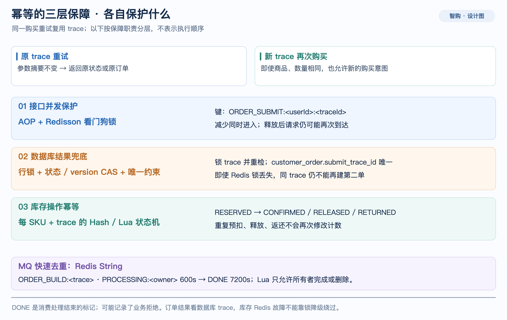

# trace、接口幂等与 MQ 幂等

返回 [文档导航](README.md) · 完整交易顺序见 [下单设计](order-design.md)

[](images/idempotency-layers.svg)

这是一张保障职责图：锁减少并发重复，数据库保证建单结果，Lua 保证库存计数不重复。 点击图片查看可缩放 SVG。


## 1. 先区分“再次购买”和“同一购买重试”

后端发 UUID 作为 traceId，页面为这次购买保存它。提交超时、刷新和重复点击继续使用同一 trace；过一段时间重新买同样商品，重新申请一个 trace。

`POST /api/store/order-tokens` 只发号。首次有效提交才绑定用户、购买快照、内容摘要和有效期；兼容的预绑定接口和 Agent 提议可以提前准备这份记录。

请求内容 SHA-256 用于检查“同一个 trace 是否被换了参数”，不是唯一购买编号。只对用户、商品和数量取哈希，会把明天合理的再次购买也当成重复。

## 2. 接口为什么既有锁又有数据库约束

```text
同一用户 + 同一 trace
  → @Idempotent / AOP
  → Redisson 锁，减少并发重复进入
  → 数据库锁 trace 行，核对归属、快照与状态
  → 状态 / version 条件更新，检查影响行数
  → customer_order.submit_trace_id 唯一约束
  → 重试读取原执行状态或原订单
```

接口场景键为 `ORDER_SUBMIT:<userId>:<traceId>`，实际加环境前缀。锁采用 Redisson 看门狗，业务结束释放；遇到外层事务时在事务完成后释放。

锁只能约束持有期间的并发，释放后同一请求还会回来；进程暂停、断网也可能导致锁丢失。因此，“拿到锁”不是允许无条件再创建一笔订单的理由。

数据库行锁让同一 trace 的事务串行，CAS 在更新时要求旧状态/旧版本仍匹配，唯一约束最后阻止同 trace 插入第二个订单。它们共同保护业务结果。

## 3. 锁失效后会发生什么

假设线程 A 暂停导致租约失效，B 得到锁：

1. B 仍然进入数据库事务并锁 trace。
2. 若 A 已提交 SUCCESS，B 返回原订单；若事务尚在执行，B 等待数据库锁并重新看状态。
3. A 后续恢复，也不能绕过状态和订单唯一约束再建单。

配置允许锁基础设施故障时使用数据库兜底；**抢锁冲突本身不会被当作故障而放行**。这里没有额外叠一套数据库分布式锁。

库存 Redis 是另一条边界。接口锁失败可以依赖数据库幂等，交易库存池丢失则不能直接绕过预占购买。

## 4. MQ 消费键和 Redis 数据结构

| 内容 | 当前设计 |
|---|---|
| 建单消费键 | 环境前缀 + `idempotent:ORDER_BUILD:<traceId>` |
| 数据结构 | Redis String |
| 处理中 | `PROCESSING:<ownerToken>`，TTL 600 秒 |
| 处理结束 | `DONE`，TTL 7200 秒 |
| 完成 / 失败操作 | Lua 比较 ownerToken，只更新或删除自己的标记 |
| 数据库兜底 | trace 终态、行锁/CAS、订单 trace 唯一约束 |

收到 DONE 可以跳过重复处理；收到其他所有者的 PROCESSING 表示仍在处理，不能假装成功执行。TTL 到期或 Redis 故障可能再进入业务层，所以最终判断仍由数据库完成。

ownerToken 防止旧消费者暂停很久后恢复，误删新消费者的标记。业务临时失败移除自己的标记以便重试，事务提交后才标记完成。

DONE 表示本次消费已处理，可能是建单成功，也可能是业务拒绝已经记录。用户购买结果必须查 trace，不能查询这个 Redis 标记推断订单存在。

`ORDER_PAYMENT_TIMEOUT` 消费者直接复用订单生命周期事务：锁订单、复核期限和状态、CAS 关单。它不把 Redis DONE 当作关单依据；重复消息看到 PAID / CANCELLED / CLOSED 不再返还，提前消息抛异常重试。

## 5. 为什么 Lua 还要保存预占标记

接口幂等针对“同一次提交”，预占状态机针对“库存计数操作”。一次已受理请求可能经历 MQ 重投、恢复扫描、网络重试，它们都可能再次调用释放。

每个 SKU + trace 的 Hash 保存数量和 RESERVED / CONFIRMED / RELEASED / RETURNED 状态。Lua 检查旧状态后同时修改计数和状态，重复 RELEASE / RETURN 不会再加一次库存。

直接拿消息里的数量执行 `INCRBY` 补偿，会在重复消费时多返库存。成功后立即删除标记，也会丢失识别迟到补偿的依据。当前终态记录自动清理尚未实现。

## 6. Agent 确认也有自己的幂等

pending_action 的幂等内容含 requestId、工具名和规范化参数；PENDING 到批准/拒绝使用 CAS。它回答“这项提议有没有被用户决定和执行”，订单 trace 回答“这次购买有没有建单”。

用户再次发起同样购买可以产生新提议和新 trace。确认卡 EXECUTED 在异步订单场景表示可靠受理已执行，仍需按 trace 查询最终订单。

源码：[IdempotencyAspect](../src/main/java/com/bitmall/agent/common/idempotent/IdempotencyAspect.java)、[OrderIdempotencyBackend](../src/main/java/com/bitmall/agent/order/idempotent/OrderIdempotencyBackend.java)、[OrderTraceRepository](../src/main/java/com/bitmall/agent/order/dao/repository/OrderTraceRepository.java)、[PendingActionService](../src/main/java/com/bitmall/agent/agent/service/action/PendingActionService.java)。

## 7. 当前 Redis 客户端分工

订单接口锁和缓存重建锁统一为 Redisson RLock。商品 Bloom 是原生 RBloomFilter；商品读写、订阅、库存和路由均通过 Redisson 对象/RScript 访问。MQ 消费去重保留既有 String 标记与所有者 Lua 适配，作为本次用户指定的例外，不能把其消费标记误认为 RLock。
