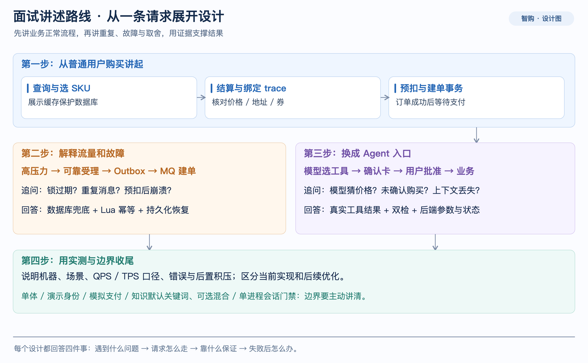

# 面试讲述与追问

返回 [文档导航](README.md)。按“问题 → 流程 → 保证 → 故障”讲，先描述现有实现，再讨论优化。

按普通购买、压力与故障、Agent、实测与边界展开，避免开头堆叠技术名词。 点击图片查看可缩放 SVG。

## 1. 一分钟介绍

> 我做了一个带 Agent 的 Java 商城，按商品、购物车、结算、订单和助手等业务分包。页面与 Agent 共用业务 Service，模型负责理解和选工具，数据库规则决定价格、库存和订单结果。
>
> 我重点实现了多级商品缓存、同一购买的幂等提交、Redis 共享预扣、可靠异步建单，以及用户确认后执行的 Agent 写操作。交易用 trace 绑定快照，同步和异步共用建单事务，跨 Redis / MQ 的失败依靠持久化进度和幂等恢复。
>
> 我还分别测试了查询、建单与缓存重建，区分一秒峰值、平均值、受理和实际建单，并发现后置消息与库存整理会成为持续吞吐瓶颈。

## 2. 最值得讲的五个设计点

| 主题 | 先说明问题 | 讲到哪些机制 | 要承认的取舍 |
|---|---|---|---|
| 查询保护 | 缺失 ID、大量失效、热点重建压数据库 | Bloom、空值、双检重建锁、抖动 TTL、有界回源 | 展示最终一致；全目录失效较粗 |
| 下单幂等 | 重复点击、超时重试、锁失效 | 后端 trace、参数绑定、AOP 锁、行锁/CAS、唯一约束 | 不同 trace 不能自动判为同一意图 |
| 可靠异步 | 预扣后中断、数据库提交但消息未发 | RESERVING、受理 + Outbox 同事务、消费幂等 | 至少一次，后置积压需要独立治理 |
| 防超卖与恢复 | 多入口竞争、重复补偿、未支付占库 | 共享预扣池、条件更新、库存状态机、关单返还 | Redis 池丢失后仍需核对恢复 |
| Agent 业务执行 | 模型猜事实、越权工具、未确认购买 | 工具真实查询、Skills/Schema 双检、持久化确认卡 | 会话门禁限单进程；没有真实登录/支付 |

## 3. 常见追问怎么答

**为什么用单体？** 目前体量适合在同一 JVM 清楚划分业务边界，共用事务和部署；并未为了组件数量拆微服务。未来拆分应先识别独立容量和数据边界。

**缓存已经有库存，下单为什么还查数据库？** 展示缓存可能短暂过时，成交价、券资格与扣减必须由权威数据判断；Lua 预扣控制受理，数据库条件更新做最终校验。

**分布式锁不是保证幂等了吗？** 它只保护持有期间。释放后重试、租约失效仍会重复进入，所以用同 trace 的数据库状态与订单唯一约束保证不重复建单。

**怎么让用户明天再买一样的东西？** 新购买发新 trace，原购买重试保留旧 trace；参数哈希检测内容变化，不永久对相同商品去重。

**为什么失败还需要 trace？** 失败后要知道受理过没有、哪些 SKU 需要释放、原请求应返回什么。建单回滚之后另记失败，恢复凭据不跟着一起回滚。

**为什么不用 MQ 消息里的数量直接返库存？** 消息可能重投，直接加数会重复返还。Lua 根据 SKU + trace 预占状态判断是否还允许释放，同步改计数和状态。

**为什么两种模式都预扣？** 它们共用可售承诺。如果异步已经预留，同步绕过池直接买数据库剩余数，就会消耗已经承诺给排队购买的数量。

**异步什么时候显示成功？** 先显示已受理；消费者建单事务提交，trace SUCCESS 且有 orderId 后显示“订单已创建，待支付”。

**为什么要 Outbox？** 把业务状态和待发送意图放进同一个数据库事务，避免提交后崩溃导致消息永久丢失；发送可能重复，因此消费必须幂等。

**怎么决定同步或异步？** 定期采样交易 QPS、P95、在途、连接池和积压，多次命中 + 冷却切换；首次预占固定购买模式。浏览热点不是直接路由条件。

**Agent 怎么避免直接操作数据库？** 模型只有受控工具，工具适配器调用业务 Service。写工具先存提议，用户确认后恢复后端参数，执行时再做业务校验。

**Skills 是什么？** 数据库办理手册与工具开放规则。成功加载且手册仍在可见上下文中才开放对应工具，执行入口还会复核，不是任意系统命令权限。

**用户说“改成两件”能直接修改旧确认卡吗？** 当前已有卡会阻断新轮次，这是交互限制。合理改进是旧提议失效、重新报价和生成新版本，不能静默修改用户即将确认的参数。

## 4. 指标在简历上怎么写

使用 [测试与压测](testing.md) 的场景、环境和统计口径，不把全部数字拼成一个能力承诺。可表述：

> 在 M4 单机、同机发压、1024 商品工作集的持续缓存过期重建场景下，测得一秒成功查询峰值约 12 万 QPS；该峰值秒有 259 次数据库 loader 调用。测试另行记录平均延迟、503 和数据库回源。

> 同配置下，分散至 64 SKU 的同步建单一秒峰值为 799 TPS；一分钟确认另批测得约 595 TPS。实际压测也观察到后置整理与消息积压，尚不能视为生产持续容量。

数字是可选佐证，设计与故障处理才是主线。不要写“JMeter 1820 TPS”“一人一单”“完整向量 RAG”“真实支付”“分库分表”“分布式 Agent 会话串行”或“消息恰好一次”，这些没有对应实现/证据。

## 5. 演示顺序

1. 查询商品、选具体 SKU、报价；说明搜索库存与可购买规格不同。
2. 同一 trace 重复提交，观察只对应一笔订单。
3. 在有真实 MQ 的隔离环境展示 ASYNC 先受理，再按 trace 查订单。
4. Agent 查询和试算，生成确认卡；确认前无订单，确认后读实际结果。
5. 选择“提交成功、Redis 确认失败”解释为何订单成功和内部整理进度分开。

demo 只能演示其实际开启的能力；真实组件和真实模型需要按 [启动文档](deployment.md) 准备。演示结束能说明一个尚未完成的边界及优化验证方法，比背组件名更有说服力。

RAG 可以准确描述为：版本化小型政策库、DB_KEYWORD + PostgreSQL + pgvector 原生距离查询、RRF、逐组证据预算、真实网关联调。LIKE 不是 BM25，默认精确 SQL 和可选 HNSW 需要分开说明，未做海量 ANN 基准；三项真实模型测试也不等于大规模检索质量评测，见 [知识设计](knowledge-design.md)。
