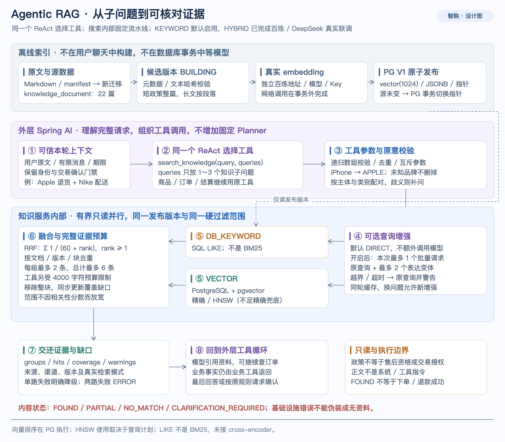
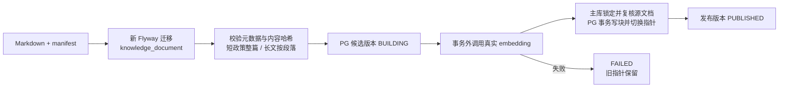

# Agentic RAG：外层选工具，内部返回可核对的证据

返回 [导航](README.md) · [Agent 主链路](agent-design.md) · [接口流程](api-flows.md) · [本次 OpenSpec](../openspec/changes/archive/2026-11-17-build-agentic-rag-pipeline/proposal.md)

**完整请求先进入现有 Spring AI ChatClient 工具循环。模型把知识问题交给 `search_knowledge`，商品、订单和结算继续用各自工具。RAG 内部是固定检索流水线，返回证据，不再启动一个能下单的 Agent。**

代码支持 KEYWORD / HYBRID 和可选查询增强，默认 KEYWORD；HYBRID 默认后端为 PostgreSQL + pgvector。已使用真实百炼 `text-embedding-v4`（1024 维）和既有 DeepSeek 网关验证语义近邻、混合召回、批量增强及“政策 + 订单”工具循环。默认模式和协议替身测试仍与真实模型验收分开报告，结果见测试总文档。

## 一次请求怎么走

[](images/knowledge-retrieval.svg)

例如用户说：“Apple 退货、Nike 配送，再查我的订单。”

1. **外层理解任务**：同一个 ReAct 模型选择搜索和订单工具。可以给搜索传 `queries=["Apple退货", "Nike配送"]`；完整 `query` 保留原请求。不要求每次先调用独立 Planner。
2. **执行层校验**：检查字符串数组、空值、长度、去重后条数及互斥参数。模型不能传 userId、索引版本或自由指定预算。
3. **约束与归一化**：后端另持本轮原文与最近 6 条有限消息，识别 iPhone → APPLE、退钱 → RETURNS，核对品牌、类别和本站/官方范围。“Apple退货 + Nike配送”只生成两组；旧单 query 明确逐项列出时也保留配对。对应关系含糊则补问。
4. **可选增强**：默认直接使用子问题。开启后，将本次未缓存的知识子问题合成一次模型请求，每组保留原查询、最多两条表达变体。严格校验 queryId/结构/长度，以及已识别品牌、类别、数字、否定和渠道；超时或越界就回退并记录 warning。它不重做业务拆分。
5. **限定范围召回**：KEYWORD 用数据库 LIKE。HYBRID 从 PG 已发布 chunk 执行两路查询，固定同一版本、品牌、类别和 `CN_MAINLAND`。默认 EXACT 用合法集合 CTE 后计算余弦；可选 HNSW，迭代扫描后若合法候选不足，回退同范围精确查询。
6. **RRF 排名融合**：按 `Σ 1/(60+rank)` 合并，rank 从 1 开始；表达变体先在通道内去重取最佳名次。旧整数 `score` 仍是关键词分数，`fusionScore` 是排名融合值，二者都不是答案置信度。
7. **完整证据打包**：每组最多 2 条、去重后总计最多 6 条；Agent 工具结果还受 4000 字符预算约束。优先让不同组各留一条；超预算移除完整证据，重算 groups、hits、coverage，不裁半条政策。
8. **回到外层模型**：模型读取资料、按需继续查本人订单，最后综合回答并引用来源。写操作仍须原有手册、预检和用户确认。RAG 不查实时订单、不修改库存、不退款。

同一轮实际业务工具仍由 `synchronized(ctx)` 串行分发；这里只在知识服务内用有界线程池并行只读召回，不宣称业务工具已跨实例并行。

## 为什么要分清子问题和表达变体

| 输入 | 含义 |
|---|---|
| Apple 退货、Nike 配送 | 两个独立信息需求，各有结果与缺口 |
| Apple 退货条件、Apple return policy | 同一需求的表达变体，不能靠重复表达无限加分 |
| 查询订单是否发货 | 实时业务任务，交订单工具，不计入 RAG 的知识缺口 |

原问题提到未知品牌，模型删掉它后只搜索 Apple，后端会保留未知品牌的澄清缺口。原问题只有 Apple，子问题改成小米，不能通过。`它能退吗` 仅在有限用户历史中有唯一品牌时补全，并保留引用依据；多个候选则补问。

这些是**有限规则与保守约束**，不宣称解决任意语言表达的语义等价验证。品牌目录目前仅五个品牌；难以确定的主体/类别组合需要澄清。

## 两个入口，复用同一服务

旧方式继续支持：

```http
GET /api/store/knowledge/search?query=iPhone能退吗&brand=APPLE&category=RETURNS
```

新多问题接口是只读 POST：

```http
POST /api/store/knowledge/search
Content-Type: application/json

{
  "query": "Apple退货、Nike配送，再查我的订单",
  "queries": ["Apple退货", "Nike配送"]
}
```

Agent 工具同名 `search_knowledge`，接受相同字段。`query` 必填 1～1000 字符；`queries` 可省略，元素 1～500 字符，大小写/空白归一化去重后为 1～3 条。原始数组超过 20 条直接拒绝，避免巨大重复输入；不静默截掉超额有效需求。提供 `queries` 时不能同时提供 `brand/category/scope`，否则参数错误。

HTTP 的原始输入就是其 query，没有聊天上下文。Agent 的可信原文来自后端，模型改写 query 不能改掉这份约束。

## 怎么看返回值

| 字段 / 状态 | 具体含义 |
|---|---|
| `FOUND` | 本次每组都有保留的资料，不代表业务操作完成或推断正确 |
| `PARTIAL` | 部分需求无资料、待澄清、失败或证据被预算移除 |
| `NO_MATCH` | 检索正常完成，但没有可用文档，不能解释为允许退货 |
| `CLARIFICATION_REQUIRED` | 条件不足或冲突，确实阻止检索 |
| `groups` | 每组 queryId、问题、意图、状态、实际模式、证据、警告和上下文引用 |
| `hits` | 各组最终保留证据的去重并集，兼容旧调用方 |
| `coverage` | requested、answeredWithEvidence、missingQueryIds；资料覆盖，不是置信度 |
| `warnings / retrievalMode` | 是否回退原查询或仅运行部分召回通道，独立于内容缺失 |

例如 `Apple退货 + Nike保修`：Apple 有证据，Nike 的统一保修资料未收录，整体 PARTIAL。向量服务失败但关键词成功时，内容仍可能 FOUND，但模式为 DB_KEYWORD 且有 warning。两路都失败走工具 ERROR；HTTP 为服务异常，绝不伪装 NO_MATCH。

证据包含 documentKey、contentVersion、品牌/类别/地区、标题、完整块正文、sourceName/sourceUrl、sourceCheckedAt、applicableChannel、scopeNote。HYBRID 还带 chunkId、indexVersion、embeddingModelId、embeddingVersion、dimension、textHash、retrievalChannels 和 fusionScore。本站规则没有官方 URL 时保留其本地来源名称，不编造外部网址。核对日期不是生效日期。

## 离线索引为何单独做

原文位于 [knowledge](../src/main/resources/knowledge/)，[manifest](../src/main/resources/knowledge/manifest.json) 管理身份和来源。当前 22 篇：16 篇品牌摘要、6 篇本站规则；已通过 V18 导入数据库。修改 Markdown/manifest 后要生成**新的**迁移更新源文档，不覆盖已应用 V18。



实现先保存 BUILDING 身份，再在事务外完成网络请求，最终事务中写全部块并切换指针。图中的候选写入表示这一完整阶段。查询只读取发布指针，重新核对启用状态、源哈希和模型身份；文档变更/停用使旧索引失效，显式降级数据库关键词，直到重建。

| PostgreSQL knowledge schema 表 | 职责 |
|---|---|
| knowledge_index_version | 模型 ID/配置版本/维度、构建状态、文档/块数量 |
| knowledge_index_chunk | 索引版本内的块、文本/文档哈希、来源 JSONB 与原生 vector(1024) |
| knowledge_index_head | 当前发布指针，一次事务切换，读者不混读候选数据 |

现在 chunk 正文、向量与发布版本都在 PG 的 `knowledge` schema；`embedding` 为真正的 `vector(1024)`，`metadata_json` 为 JSONB。关键词和向量共享 PG chunk，因此不会混读主库新正文与旧向量。源文档与交易仍在 MySQL（预览用 H2）；历史 V19 表保留，只有明确 `RAG_VECTOR_STORE=LEGACY` 才使用旧 JSON/Java 扫描。

发布时主库只锁定/读取源文档，PG 自己提交版本/块/指针事务；这不是跨数据库分布式写事务。模型网络调用在锁和数据库事务外完成。故障后可能留下不可见 BUILDING 候选，但不会因未完成构建切换发布指针。

模型 ID、版本标签和维度必须一致；维度相同不能证明模型兼容。版本标签是本地兼容性标记，并非供应商承诺的固定修订。当前每次重建会重新生成全部向量；没有实现未变文本的增量复用或旧版本自动清理。

## 数据规模和故障边界

| 项目 | 当前实现 |
|---|---|
| 关键词 | SQL LIKE 计分，明确称 DB_KEYWORD，不是 BM25 |
| 向量 | PostgreSQL 原生 vector(1024)，默认 EXACT；可选 HNSW，过滤不足精确兜底 |
| 规模 | 构建与元数据快照默认最多 1000 块；PG 向量不全量加载到 JVM，未做大库容量评测 |
| 并发 | 默认 4 工作线程、32 个排队任务；拒绝策略和超时显式处理 |
| 截止时间 | 单工具内部默认 8 秒，最多配置 10 秒，并受后端整轮剩余期限约束；SpringAiResponder 的工具等待上限为 15 秒 |
| 查询增强 | 默认关闭；开启后每次工具最多 1 个批量调用，最多用 1.5 秒，失败继续原查询 |
| 本轮缓存 | 相同子问题/过滤/有限历史复用增强与正常召回；内容或索引版本改变重新召回；降级/错误结果不缓存 |
| 重排 | RRF 排序；未接 cross-encoder，不宣称神经重排已启用 |
| 购买渠道 | BRAND/PLATFORM 路由及文档适用说明，没有任意门店级精确过滤 |

主库关键词 SQL 起始超时 2 秒；PG 语句上限 5 秒、锁等待 2 秒、取连接 2 秒，并受外层共同期限限制。线程池与排队有界；外部请求使用共同截止时间，未完成 Future 取消。JDBC 驱动的中断响应由驱动决定，不能声称任意底层 IO 都能瞬时终止。

短政策保留完整正文；长文按完整段落切分，不能推断某一命中段落就是完整合同。当前主要评测对象仍是 22 篇人工政策摘要，正式法律/售后裁决必须核对完整官方条款和业务资格。

## 怎么启用与定位代码

[运行与百炼配置](deployment.md#rag-真实向量检索与离线索引) · [当前 Spring AI 验证](testing.md#17-spring-boot-4-与-spring-ai-2-迁移验证2026-11-17)

| 职责 | 入口 |
|---|---|
| 工具参数与可信上下文 | [AssistantTools](../src/main/java/com/bitmall/agent/agent/service/tool/assistant/AssistantTools.java)、[ToolExecutionContext](../src/main/java/com/bitmall/agent/agent/service/tool/ToolExecutionContext.java) |
| 子问题配对、原意、指代 | [KnowledgeQueryPlanner](../src/main/java/com/bitmall/agent/knowledge/service/retrieval/KnowledgeQueryPlanner.java) |
| 编排、增强、本轮缓存 | [KnowledgeService](../src/main/java/com/bitmall/agent/knowledge/service/KnowledgeService.java) |
| 双路、并发、RRF | [KnowledgeRetriever](../src/main/java/com/bitmall/agent/knowledge/service/retrieval/KnowledgeRetriever.java) |
| 原子索引发布 | [KnowledgeIndexService](../src/main/java/com/bitmall/agent/knowledge/service/KnowledgeIndexService.java)、[PG Mapper](../src/main/resources/pgvector/PgVectorIndexMapper.xml) |
| 完整证据预算 | [KnowledgeEvidencePacker](../src/main/java/com/bitmall/agent/knowledge/service/retrieval/KnowledgeEvidencePacker.java) |

面试可以这样讲：**外层模型负责选工具，搜索工具内部负责带约束的检索；用版本化索引避免文本和向量错位，用覆盖缺口和故障状态避免把没有证据说成业务结论。**


## PostgreSQL 中如何查询和保存

```sql
-- 表位于 knowledge schema；展示关键字段，不是全部建表语句。
embedding     vector(1024)  -- 百炼真实向量，非 JSON/TEXT
chunk_text    text          -- 完整块正文
metadata_json jsonb         -- 标题、来源、核对日期、渠道说明
index_version varchar(80)   -- 与内容/模型发布版本关联
```

默认精确查询在 [PG Mapper](../src/main/resources/pgvector/PgVectorIndexMapper.xml) 使用：

```sql
WITH legal AS MATERIALIZED (
  SELECT chunk_id, embedding FROM knowledge.knowledge_index_chunk
  WHERE index_version = :version
    AND brand_code = :brand AND document_type = :type
    AND region = 'CN_MAINLAND'
)
SELECT chunk_id, embedding <=> CAST(:queryVector AS vector) AS distance
FROM legal ORDER BY distance, chunk_id LIMIT :topK;
```

`<=>` 是余弦距离，越小越接近。已建 `embedding vector_cosine_ops` 的 HNSW 索引，选择 `RAG_PG_SEARCH_MODE=HNSW` 后使用可索引的原始距离排序与 strict_order 迭代扫描；若结果少于 `min(topK, 合法组数量)`，同范围精确补齐。ANN 不保证与精确排名完全一致；小库计划也可能选择顺序扫描，不能只凭建索引就说每次走 HNSW。

数据库连接由 `PgVectorIndexRepository` 的独立 Hikari/MyBatis 管理，不注册第二个全局 DataSource；主库 Flyway 仍执行原 MySQL/H2 V19，PG 独立执行 [V1](../src/main/resources/db/pgvector/V1__knowledge_pgvector_index.sql)。更换 1024 维需新增 PG 迁移/索引并重建，不能只改环境变量。

## Spring AI 模型适配边界

`SpringAiEmbeddingClient` 调用 Spring AI `EmbeddingModel`，将 SDK 返回的 float 向量转换为检索层统一格式；仍校验模型名、响应数量、索引顺序、1024 维、非零和有限值。可选 `SpringAiQueryEnhancer` 使用独立的一次 ChatClient JSON 调用，不注册业务工具。主 Agent 继续使用同一个外层工具循环。

本次未改用通用 PgVectorStore：当前索引有版本头、原子发布、同版本关键词/向量检索、品牌类别硬过滤和 HNSW 不足时精确补查，需要保留这些契约。Spring AI 不要求所有向量库必须使用它的默认表结构，也没有新增第二个能操作交易的 RAG Agent。
