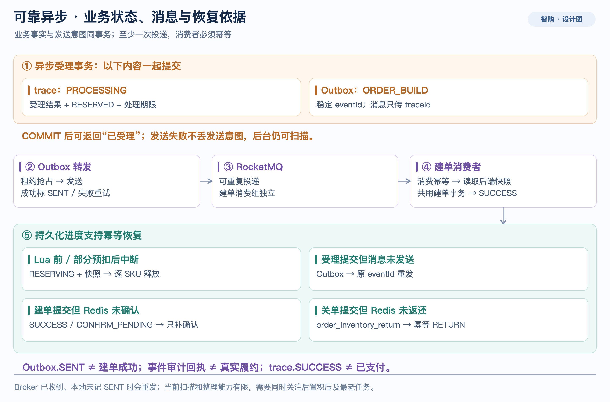

# MQ、Outbox 与故障恢复

返回 [文档导航](README.md) · 正常交易步骤见 [下单设计](order-design.md)

[](images/outbox-recovery.svg)

上半部表示可靠受理到真正建单，下半部说明不同中断位置需要哪些恢复凭据。 点击图片查看可缩放 SVG。


## 1. MQ 承接建单、延时关单与审计

| Tag | 与什么一起落库 | 消费做什么 |
|---|---|---|
| ORDER_BUILD | PROCESSING 受理状态与处理期限 | 从后端 trace 快照真正建立订单 |
| ORDER_PAYMENT_TIMEOUT | 建单事务，保存原支付截止 epoch 毫秒 | 定时检查未支付订单并幂等关单 |
| ORDER_CREATED | 建单事务 | 保存审计事件回执 |
| ORDER_PAID | 支付事务 | 保存审计事件回执；不产生真实扣款 |
| ORDER_CANCELLED | 取消/超时关单事务 | 保存审计事件回执 |

建单、超时关单、事件审计使用各自的消费组。当前后面三类事件没有接入真实仓储、配送或退款，不能把审计回执说成履约已经完成。

## 2. 为什么多一张 Outbox 表

普通数据库事务只能原子提交本库操作，不能顺便保证远程 MQ 也提交。

```text
异步受理数据库事务
  trace → PROCESSING / RESERVED
  INSERT ORDER_BUILD Outbox
  COMMIT
       ↓
提交后唤醒转发器；后台扫描补漏
  条件抢占发送租约 → 发 RocketMQ → 按所有者令牌标记 SENT
       ↓
消费者幂等进入建单事务 → COMMIT → trace SUCCESS + orderId
```

若写受理结果后进程崩溃，Outbox 仍保存“这条消息需要发送”。若 Broker 收到消息后本地未成功标记 SENT，下次会重发同一 eventId。因此采用至少一次投递和幂等消费。

ORDER_BUILD 的 eventId 由 trace 生成稳定编号，正文只传 traceId；消费者读取服务端绑定的快照。生命周期事件的 eventId 在持久化时生成，发送重试复用原 ID。

超时关单也通过 Outbox 保存，`deliver_at_epoch_ms` 是固定的 Broker 投递时刻，`next_attempt_at` 是发送失败后的重试时刻，两者职责不同。同步和异步订单都在实际建单后写此命令；不是在异步受理时开始支付倒计时。详见 [下单设计的支付与超时部分](order-design.md#8-支付取消与超时防超卖也要防库存泄漏)。

## 3. 三种记录分别回答什么

| 记录 | 可以证明 | 不能证明 |
|---|---|---|
| order_message_outbox.SENT | 消息已经发送给 MQ | 消费者已成功建单 |
| order_event_receipt | 对应生命周期事件已保存审计回执 | 库存或订单又执行了一次；真实履约完成 |
| order_submit_trace.SUCCESS + orderId | 建单数据库事务已提交 | 已付款；后置整理和消息全部追平 |

不是每条 MQ 投递都插入一条新的订单；重复投递应该被幂等识别。同一事件的审计回执以 eventId 唯一。

## 4. 消费失败怎么分类

- 临时连接、数据库等基础设施异常：抛异常，让 MQ 重试；Redis 消费标记不能抢先写 DONE。
- 库存、报价、券等明确业务拒绝：建单事务回滚后，在独立事务记录失败及释放进度；该消息可以正常结束消费。
- 已经 SUCCESS 或已进入其他终态：重复消费返回原结果，不再扣库存或创建订单。

正常 ACK 只说明消费处理完成；业务拒绝也可能正常 ACK。成功建单 TPS 在数据库事务提交后计数。

## 5. 故障位置决定恢复动作

| 中断位置 | 恢复凭据 | 恢复动作 |
|---|---|---|
| Lua 前或多 SKU 预扣一半 | 已提交 RESERVING 与购买快照 | 宽限期后逐 SKU 幂等释放 |
| 预扣成功，受理事务失败 | trace 意图与 Redis 标志 | 原 trace 期限内重试；过期释放 |
| 受理提交，MQ 尚未发出 | Outbox | 扫描重发 |
| 建单事务失败 | 原 trace / MQ 命令 | 临时失败重试，明确拒绝记录 FAILED |
| 建单成功，Redis 确认失败 | SUCCESS / CONFIRM_PENDING | 只补 CONFIRM，不能重新建单或释放成功购买 |
| 关单提交，Redis 返还失败 | order_inventory_return | 重试 RETURN |
| Lua 已完成，数据库整理进度未记上 | Redis 终态 Hash | 重试只补进度，不再次改变计数 |
| 交易库存池丢失 | 数据库库存、在途 trace 和历史预占 | 停止相关接单并核对；尚无自动重建 |

Redis 与 MySQL 不在一个原子事务中。恢复线索要先独立提交，失败记录要在建单回滚之后保存，不能把所有内容塞进一个最后会回滚的事务。

## 6. 为什么可靠不等于吞吐足够

当前即时转发、库存整理都是有界线程池；满时可能丢失唤醒，持久化任务仍在，由定时扫描恢复。

默认 Outbox 每 5 秒扫描最多 20 条，仅约 4 条/秒，尚未扣发送耗时；库存恢复每 5 秒最多 50 条，约 10 条/秒。它们适合少量补漏，长时间依赖扫描就会积压。

压测已经观察到订单成功但审计 Outbox 积压，以及大量 CONFIRM_PENDING。优化方向是分别测即时发送/整理吞吐、批量扫描与重试速度、监控最老任务；同时保留租约和幂等。不能只调大发压速率就宣称链路支持更高持续 TPS。

配置入口：[application.yml](../src/main/resources/application.yml)。关键源码：[OrderBuildCommandService](../src/main/java/com/bitmall/agent/order/service/OrderBuildCommandService.java)、[InventorySettlementService](../src/main/java/com/bitmall/agent/order/inventory/InventorySettlementService.java)、[OrderRecoveryService](../src/main/java/com/bitmall/agent/order/service/OrderRecoveryService.java)。
