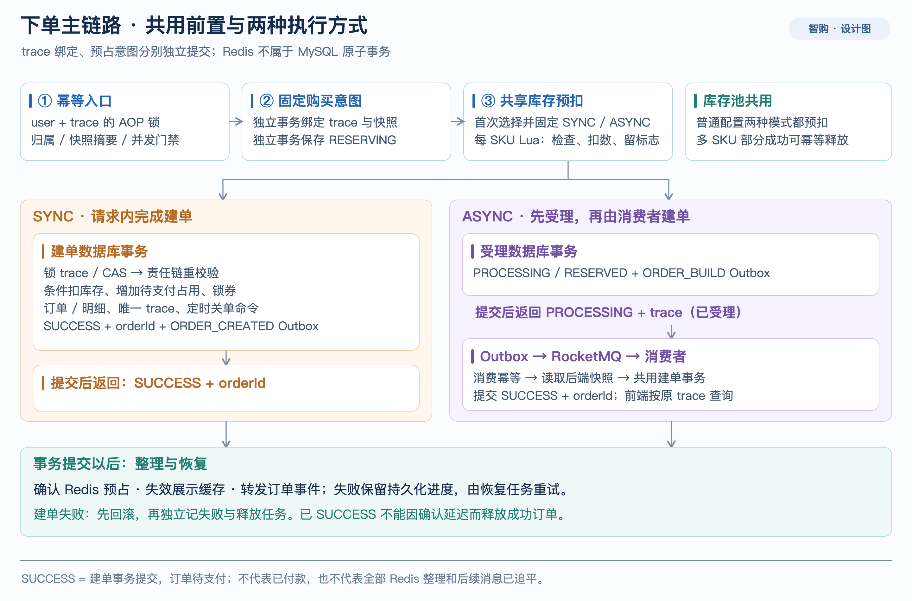
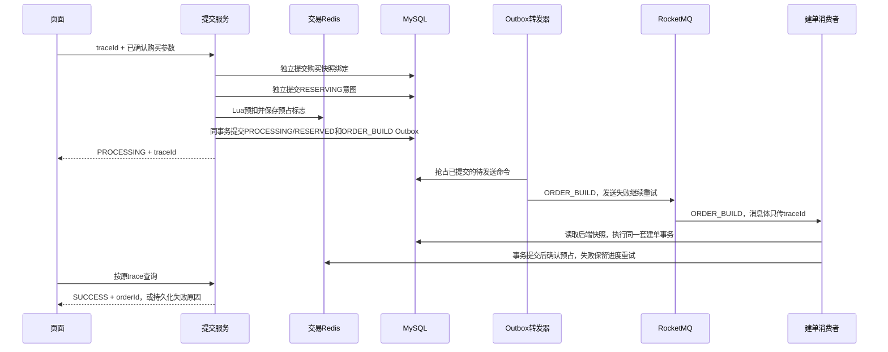
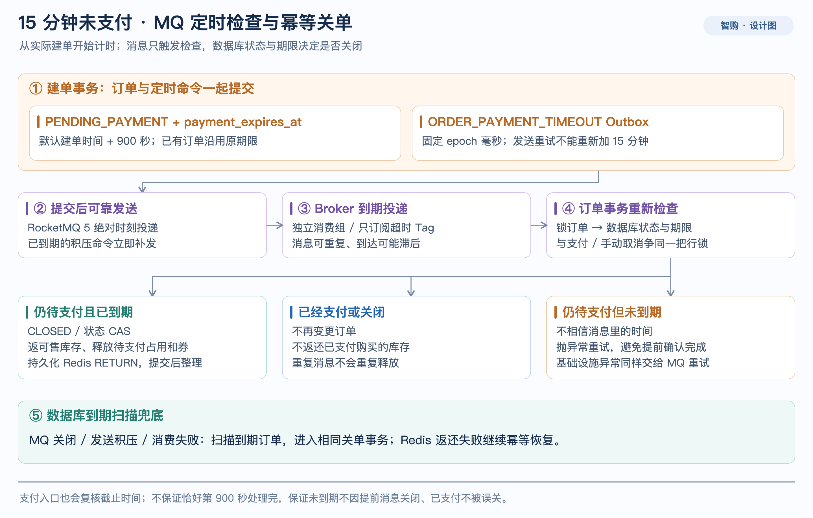

# 下单设计：面试最重要的一条链路

返回 [学习导航](README.md) · 入口清单见 [接口流程](api-flows.md)

专项追问：[trace 与幂等](idempotency-design.md) · [消息与故障恢复](messaging-recovery.md) · [自动切换与监控](pressure-monitoring.md) · [测试与压测](testing.md)。

[](images/order-submission.svg)

两条路线共用预扣与建单规则；图中分别标出独立意图、建单事务、受理事务和提交后整理。 点击图片查看可缩放 SVG。


## 1. 先说清编号和成功边界

| 名称 | 表达什么 | 什么时候生成/保存 |
|---|---|---|
| traceId | 一次购买意图，关联重试和最终结果 | 后端发 UUID；首次有效提交才绑定快照落库，兼容准备入口可以提前绑定 |
| orderId | 已经建立的真实订单 | 建单数据库事务中生成并保存 |
| eventId | 一条可靠消息 | 写 Outbox 时生成；重发复用原编号，ORDER_BUILD 根据 trace 生成稳定编号 |
| actionId | 一次等待用户确认的 Agent 操作 | 生成确认卡时保存；订单提议关联后端 trace |

同一次购买超时/刷新/重试，用同一个 trace；明天再买同样商品，用新 trace。参数 SHA-256 用于发现内容变化，不能永久把相同商品购买判成重复。

**异步返回 PROCESSING 只代表已受理。消费者完成建单事务并提交，才是 SUCCESS + orderId，订单初始状态是 PENDING_PAYMENT。** 建单成功不代表支付成功，也不代表 Redis 整理与所有后续事件已经完成。

## 2. 两种模式先共用哪些步骤

页面通常先试算金额，再发号，再提交 `traceId + purchase`。下单入口是 `OrderSubmissionService.submit`：

1. AOP 按 `ORDER_SUBMIT:<userId>:<traceId>` 获取 Redisson 锁；服务入口还有本实例并发门禁。
2. 首次提交在独立事务中核对参数与报价，绑定用户、购买快照、内容摘要和有效期。重复提交校验归属和摘要，不能换商品/数量/地址/券。
3. 在另一个独立事务保存 **RESERVING 预占意图**，首次预扣前选择并固定本次 SYNC/ASYNC 模式。
4. 初始化/检查 SKU 库存池，按 SKU 顺序执行 Lua 预扣。预扣阶段中断也能由已提交意图恢复。
5. 根据本次已固定的模式，进入同步建单或异步受理。

购物车提交额外核对 `expectedItems`：只比较总金额会漏掉“同价换商品”。消费者以后读取绑定快照，不能重新拿用户后来修改的购物车建单。

**当前普通配置中，同步和异步都预扣 Redis，使用同一个 SKU 库存池。** 如果异步已经预留 8 件、同步却绕开池直接购买数据库的 10 件，就会破坏承诺；这是本实现共用预扣的原因。离线 demo 显式关闭预扣，不能用它证明真实 MQ 预扣路径正常。

## 3. 同步下单经过什么

```text
页面提交
  → AOP 锁 / 并发门禁
  → 独立事务绑定 trace 和快照
  → 独立事务保存 RESERVING
  → Redis Lua 预扣
  → OrderCreationService.create：建单数据库事务
       锁 trace / CAS 受理
       责任链校验快照、数量、当前报价
       验证预占状态和数量
       条件扣 SKU 可售库存，增加 locked_stock
       锁券，写订单主表/明细/券关联
       关联唯一 trace，写 SUCCESS / CONFIRM_PENDING
       写 ORDER_CREATED Outbox
  → 提交后：异步确认 Redis 预占、刷新展示缓存、唤醒消息发送
  → 返回 SUCCESS + orderId
```

**事务边界：** 绑定和预占意图先独立提交；Redis 调用不在 MySQL 原子事务内。真正建单的库存、券、订单、trace 结果与 Outbox 在同一个数据库事务内，一起提交或回滚。这样不会因为回滚建单事务而把“需要释放哪些预扣”的线索也丢掉。

MySQL 内的相关写入一起提交；跨 Redis/MQ 的一致性依靠持久化进度与幂等重试逐步收敛。`@Transactional` 不会自动回滚已经执行的 Redis 命令。

Agent 确认执行还可能有外层业务事务；指标、消息唤醒与整理监听都必须等实际提交，不能在中途把结果当成功。

## 4. 异步下单经过什么



**发 MQ 前已经做了什么：** 参数与归属校验、稳定购买快照、预占意图、Lua 预扣、处理期限、受理状态与可靠发送记录。异步不是“把前端请求扔进 MQ 就返回成功”。

消费者执行 `OrderBuildCommandService.consume → OrderCreationService.createQueued`：

- 先做 MQ 去重，再锁 trace；终态重复消息直接结束。
- 必须是已受理的 ASYNC / PROCESSING，不能靠伪造消息把 INIT 直接变成订单。
- 重新核价、查券和地址、验证预占，执行与同步相同的建单事务。
- 临时数据库异常抛出，让 MQ 重试；明确业务拒绝在事务回滚后另记 FAILED 和释放进度。

用户用原 trace 查询/重试。网络超时表示结果未知，先查持久化结果；不能立即生成新 trace 再买一次。

## 5. Lua 预扣和补偿到底做什么

每 SKU 两个 String：`available` 是 Redis 可售数，`pending` 是尚未落库确认的预占数。每个 `SKU + trace` 再保存一个 Hash：数量和状态。相关键带同一个 `{skuId}`，保证单 SKU 脚本同槽。

假设 10 件库存，购买 1 件：

| 操作 | Redis available | Redis pending | 这笔预占的 Hash |
|---|---:|---:|---|
| 初始 | 10 | 0 | 不存在 |
| RESERVE | 9 | 1 | quantity=1，RESERVED |
| 数据库建单后 CONFIRM | 9 | 0 | CONFIRMED |
| 或建单明确失败 RELEASE | 10 | 0 | RELEASED |
| 已建单未支付，关单后 RETURN | 10 | 0 | RETURNED |

Lua 同时检查库存、改计数、写标志。重试先看 Hash，相同操作不会再扣一次、再加一次。释放还会为未成功预扣的 SKU 留关闭标志，防止暂停的旧线程恢复后才扣库存。

**成功后不能立即删除 Hash。** 迟到消息和补偿仍需要它识别已处理状态。当前尚未实现终态自动清理，不能把无限保留当成最终生产方案。

多 SKU 的脚本是逐 SKU 执行，不是跨所有 SKU 的 Redis 原子事务；部分预扣失败由持久化意图按快照幂等释放。

## 6. 幂等为什么分三层

| 层次 | 解决什么 | 最终能保证什么 |
|---|---|---|
| 接口 AOP / Redisson 锁 | 同一用户同一 trace 同时提交 | 减少并发重复；锁释放后仍可能再次请求 |
| 数据库行锁、状态/版本 CAS、唯一约束 | 锁过期、并发重试、消费者重复执行 | 同一 trace 不会重复建立订单，业务状态合法转换 |
| Redis Lua 状态机 | 预扣/确认/释放/返还被重复调用 | 库存计数不会因重复补偿反复变化 |

行锁让同一 trace 的数据库事务排队；CAS 是更新时带上“旧状态/旧版本”条件，影响行数为 1 才表示抢到处理权；订单唯一约束再阻止插入相同 submit_trace_id。三者不是只靠“请求前查一下有没有订单”。

MQ 建单去重 key 为 `ORDER_BUILD:<traceId>`，Redis String 从所有者令牌 `PROCESSING:<token>` 转为 DONE；失败只能删除自己的令牌，不能误删后来者。DONE 表示消费已处理，其中也可能是业务失败已记录；它是减少重复执行的缓存，不是订单存在的唯一依据；建单仍看数据库 trace 与唯一关联。

Redis 锁/去重服务故障时，配置允许依靠数据库 CAS 兜底；这里没有再叠一套“数据库分布式锁”。**交易库存 Redis 故障不适用这种降级**：不能绕过丢失的预占直接建单。

## 7. Outbox 为什么需要、两类消息有什么区别

MySQL 与 MQ 不能靠普通 `@Transactional` 原子提交。先建订单再直接发消息，会有“数据库已成功、进程在发送前崩溃”的空隙。

| 类型 | 同事务保存的内容 | 消费后实际做什么 |
|---|---|---|
| ORDER_BUILD 命令 | PROCESSING 受理结果 + traceId 消息 | 真正创建订单，是异步下单业务链路的一部分 |
| ORDER_CREATED / PAID / CANCELLED 事件 | 订单状态变更 + 事件原文 | 当前消费者保存 order_event_receipt 审计回执，不重复建单/扣库存 |

转发器按数据库条件抢占发送租约，提交后尽快发送；没有唤醒或发送失败由扫描补发。Broker 收到但本地 SENT 未更新时会重发，因此系统按“可重复投递 + 幂等消费”设计，不能宣称端到端消息恰好一次。

Outbox 的 SENT 只表示消息已发送，不能证明消费者已建单。`order_event_receipt` 只证明对应审计事件被保存，不能替代 trace 的购买结果。

## 8. 支付、取消与超时：防超卖也要防库存泄漏

防超卖的数据库底线是 `UPDATE ... WHERE stock >= 购买数量` 这样的条件更新，并检查影响行数；不能先查库存，再无条件扣。Lua 预扣减少竞争，数据库仍做最终检查。

数据库 `stock` 是可售，`locked_stock` 是待支付占用：建单 `stock-1 / locked+1`；支付只 `locked-1`，不再扣一次可售；关单则 `stock+1 / locked-1`。

取消和模拟支付争抢同一订单行锁，再做状态条件更新。只有待支付状态能关闭；已支付要走售后。关单事务同时释放券、保存 `order_inventory_return`，提交后再 RETURN Redis，重复扫描/请求不重复返库存。

默认待支付有效期 **15 分钟**，从真实建单时间开始计算，异步排队时间不消耗支付窗口；`ORDER_PAYMENT_TTL_SECONDS` 可配置。建单事务同时写入 `ORDER_PAYMENT_TIMEOUT` Outbox，消息中的绝对投递时刻固定为该订单的支付截止时间。

[](images/payment-timeout.svg)

提交后 Outbox 用 RocketMQ 5 定时投递接口发送；发送失败重试复用原截止时间，不能重新加 15 分钟。若补发时已过期，立即发送检查命令。

消费者独立订阅超时 Tag，调用 `OrderLifecycleService.closeExpired`：锁订单 → 核对数据库状态与期限 → 仍待支付且到期才关单。已支付、已取消、已关闭直接结束；未到期则抛异常重试，不能相信消息伪造的时间提前关单。消息重投和支付竞争都由同一个订单行锁、状态 CAS 与关单事务保护。

默认每 5 秒的数据库到期扫描继续兜底：MQ 关闭、发送积压、消费失败或死信时仍可关单。MQ 到期投递可能因 Broker / 消费积压滞后，不保证恰好第 900 秒完成；系统保证不提前关闭，支付入口也会复核期限。已有订单沿用其保存的截止时间，不因新默认值而改写。

trace.SUCCESS 表示这笔购买曾建单成功，后续关闭不会改成 FAILED，订单当前状态看订单表。

源码：[超时命令](../src/main/java/com/bitmall/agent/order/mq/message/OrderPaymentTimeoutMessage.java)、[超时消费者](../src/main/java/com/bitmall/agent/order/mq/consumer/OrderPaymentTimeoutConsumer.java)、[定时发送适配](../src/main/java/com/bitmall/agent/order/mq/producer/OrderEventProducer.java)、[关单事务](../src/main/java/com/bitmall/agent/order/service/OrderLifecycleService.java)。

## 9. 哪些中断要恢复

| 故障位置 | 持久化依据与处理 |
|---|---|
| Lua 前/执行一部分后进程崩溃 | 已提交 RESERVING 与快照；宽限期后按每 SKU 标志释放 |
| Lua 成功，异步受理事务回滚 | 原 trace 可在期限内重试；过期由恢复释放 |
| 受理已提交，MQ 没发出去 | Outbox 重发原命令 |
| 建单事务回滚 | 不计 SUCCESS、不确认库存；临时异常 MQ 重试 |
| 建单提交，Redis CONFIRM 失败 | 保留 SUCCESS / CONFIRM_PENDING；只补整理，不再建单 |
| RELEASE/RETURN 已执行，进度落库失败 | Lua 识别终态；重试只补进度，不再次增加库存 |
| Redis 库存池丢失 | 停止相关购买；核对在途预占与数据库后人工恢复，不能盲目覆盖 |

明确失败后先回滚建单事务，再用独立事务写失败与释放任务。若把失败原因写在被回滚的事务中，失败记录本身也会消失。

## 10. 什么时候同步，什么时候异步

AUTO 每秒采样提交 QPS、同步 P95、在途请求数、Hikari 使用/等待、已受理积压和最老等待时间；Redis 聚合在线实例并协调模式。请求读取有时效的本地快照，不逐请求 COUNT 数据库。

连续高压升级、连续低压且经过冷却后恢复；默认高压 3 次、低压 10 次、冷却 30 秒。首次预占意图提交后固定本次模式，重试不能随系统切换而改路线。采样不可用/过期、异步不可用或积压超限时应拒绝新受理，不能假装低压力。

异步就绪信号目前表示配置已启用，不是 Broker 实时连通性探测。Broker 故障依靠 Outbox 重发、任务期限和积压保护处理。

默认同步预算 60 QPS 是配置起点，需要按资源和压测调整；不是机器实测上限。商品浏览 HotKey 决定本地缓存提升，**不直接决定同步/异步**，也没有 SKU 活动绑定。

异步用于缓冲突发，并不会凭空增加数据库处理能力。当前积压保护是采样软阈值；Outbox 即时发送和库存整理的有界线程池在过载时会丢唤醒、转由扫描补做，恢复速度可能很慢，这也是实际压测暴露的限制。

## 11. 只沿这些源码入口读

- [OrderSubmissionService](../src/main/java/com/bitmall/agent/order/service/OrderSubmissionService.java)：总流程；[OrderTraceBindingService](../src/main/java/com/bitmall/agent/order/service/OrderTraceBindingService.java)：首次绑定。
- [OrderInventoryService](../src/main/java/com/bitmall/agent/order/inventory/OrderInventoryService.java)、[InventoryIntentService](../src/main/java/com/bitmall/agent/order/inventory/InventoryIntentService.java)：预扣与独立恢复意图。
- [OrderCreationService](../src/main/java/com/bitmall/agent/order/service/OrderCreationService.java)：两种模式共用建单事务；[OrderAsyncAdmissionService](../src/main/java/com/bitmall/agent/order/service/OrderAsyncAdmissionService.java)：异步短受理事务。
- [IdempotencyAspect](../src/main/java/com/bitmall/agent/common/idempotent/IdempotencyAspect.java)、[OrderIdempotencyBackend](../src/main/java/com/bitmall/agent/order/idempotent/OrderIdempotencyBackend.java)：锁和 MQ 标记。
- [InventorySettlementService](../src/main/java/com/bitmall/agent/order/inventory/InventorySettlementService.java)、[OrderRecoveryService](../src/main/java/com/bitmall/agent/order/service/OrderRecoveryService.java)：幂等整理与恢复。

面试能串起第 3/4 节的正常流程，再从第 6/7/9 节选择一个失败场景讲清楚，就能说明这些组件为什么存在。
