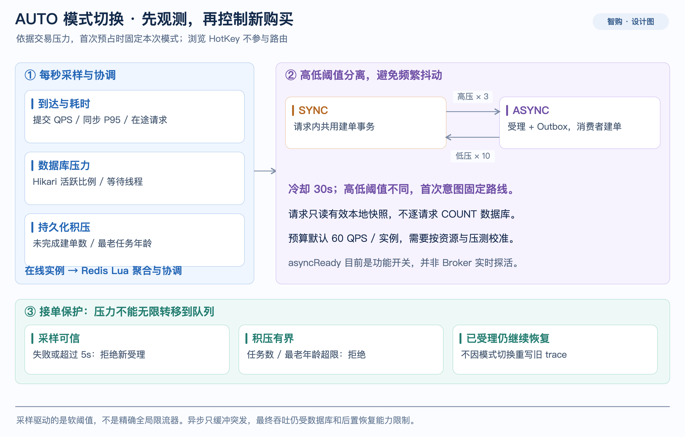

# 自动切换、限压与监控

返回 [文档导航](README.md) · 交易链路见 [下单设计](order-design.md)

[](images/pressure-routing.svg)

先采样和协调，再决定新购买的路线；接单保护与模式切换是不同判断。 点击图片查看可缩放 SVG。


## 1. 同步与异步怎么选

支持 SYNC、ASYNC、AUTO 三种配置。普通配置默认 AUTO，根据交易压力决定后续新购买的模式；没有 SKU 活动绑定，也不根据库存多少或浏览 HotKey 直接决定。

库存只有 1 件也可能没有并发；库存很多也可能遭遇突发。异步可以缓冲提交高峰，但最终创建订单仍然占用数据库连接和库存行锁，并不会凭空增加数据库容量。

## 2. 压力采样从哪里来

OrderPressureRouter 每秒采样本机和数据库积压，通过 Redis Lua 聚合在线实例。请求只读取有时效的本地路由快照，不在每次下单时 COUNT 全表。

| 信号 | 说明 |
|---|---|
| 提交 QPS / 同步预算 | 判断到达速率是否超过配置预算 |
| 同步 P95 | 反映请求是否明显变慢；样本不足时不据此放大判断 |
| 在途请求 / 入口并发数 | 判断请求是否开始堆在应用内 |
| Hikari 活跃比例与等待线程 | 判断数据库连接池是否紧张 |
| 已受理任务数 / 最老任务年龄 | 判断消费能否追上生产 |

多个实例面对同一数据库采样到的积压，聚合时取最大值而非重复相加；各实例请求量和配置预算累加。数据库使用率取最大值，避免一个实例严重拥堵被平均掩盖。

## 3. 怎样避免频繁来回切换

- 连续高压默认 3 个采样、连续低压 10 个采样，切换还要满足 30 秒冷却。
- 高低阈值分开，例如同步 P95 高阈值 300ms、低阈值 150ms，连接使用率分别 80% / 50%。
- 默认同步预算为每实例 60 QPS，是待压测校准的起点，不是机器上限。
- 本地快照超过 5 秒、采样失败、异步不可用或积压过高时拒绝新受理，不能把未知当成低压力。
- 默认任务积压上限 1000、最老等待 20 秒；这是采样软阈值，可能暂时超出。

首次保存预占意图时固定该 trace 的模式。系统随后从 ASYNC 切回 SYNC，之前排队的购买仍按原模式完成，不能一次重试就换一条库存处理路线。

`asyncReady` 当前只表示 MQ 功能已配置开启，未实时探测 Broker 健康。Broker 故障依靠 Outbox 重试、任务期限和积压保护处理。

## 4. “队列”具体指什么

| 位置 | 内容 | 是否持久化 |
|---|---|---|
| 应用线程池队列 | 待执行的发送/整理唤醒 | 否；丢唤醒由持久化任务补漏 |
| Outbox 待发送区 | 已受理但尚待发 MQ 的命令/事件 | MySQL 表 |
| MQ 消费积压 | Broker 已收到、消费者还没处理完的消息 | 由 Broker 保存 |
| trace 业务积压 | 已受理但未完成建单的购买 | MySQL 表 |
| 库存整理积压 | 已成功建单等情况下，尚待确认/释放/返还 | trace / 返还表 |

这些积压不能只看其中一个。PROCESSING 归零后仍可能存在大量成功订单的 Redis 整理或审计消息待发送。

## 5. 查看哪些端点

管理端默认只监听 `127.0.0.1:9080`。

| 端点 | 用途 |
|---|---|
| /actuator/health | 基础健康信息 |
| /actuator/catalogcache | L1/Redis 命中、回源、布隆、重建、HotKey 和故障状态 |
| /actuator/ordermonitor | 下单计数、在途量、持久化积压与 AUTO 路由 |
| /actuator/prometheus | Micrometer 指标 |
| /actuator/throughput | 显式开启后读取固定一秒桶，默认未装配/未暴露 |

开启逐秒统计还需将 `app.throughput.enabled=true` 并在 `management.endpoints.web.exposure.include` 中加入 throughput；压测脚本会显式配置。

现有 [Prometheus 示例](../deploy/monitoring/prometheus.yml) 和 [告警规则](../deploy/monitoring/order-alerts.yml) 提供应用与 Broker 指标抓取、入口压力、异步建单和库存整理告警。

QPS、建单 TPS 和缓存 loader 的口径及结果统一看 [测试与压测](testing.md)。Outbox 分类待发送数、关单库存返还和完整的通知平台仍是独立监控项。

源码：[OrderPressureRouter](../src/main/java/com/bitmall/agent/order/monitor/OrderPressureRouter.java)、[路由 Lua](../src/main/resources/lua/order_auto_route.lua)、[OrderMonitorEndpoint](../src/main/java/com/bitmall/agent/order/monitor/OrderMonitorEndpoint.java)。

## 6. 异步建单与死信告警

`/actuator/ordermonitor` 的 `asyncBuild` 每 10 秒采样一次，显示 `sampledAtEpochSeconds`、`fresh` 和三个阶段。每个阶段都有 `pending` 与 `oldestWaitSeconds`。只统计异步购买，多个应用实例观察同一数据库时取最大值。

| 阶段 | 年龄起点 | 告警后先检查 |
|---|---|---|
| `processing` | 应用受理时间 | Outbox 发不出去，还是 Broker 收到了但建单消费变慢 |
| `confirm_pending` | 建单结果落库时间 | 订单已经存在，核对 Redis 预占确认 |
| `release_pending` | 失败结果落库时间 | 用户已得到失败结果，核对 Redis 预占释放 |

等待至少 60 秒并持续 10 秒时预警。采样在 30 秒内没有更新时，新建单和库存告警停止使用陈旧数据，并提示采样失效。购买的处理期限以各笔 trace 保存的截止时间为准，告警不触发建单或库存状态更新。

在 RocketMQ 5.x Broker 上启用 `metricsExporterType=PROM`。同机部署可将 `metricsPromExporterHost` 设为 `127.0.0.1`，端口默认 5557。在 `deploy/monitoring/prometheus.yml` 配置每个 Broker 的指标地址。若覆盖了 `ROCKETMQ_BUILD_CONSUMER_GROUP`，同步更新 `order-alerts.yml` 中的建单消费组。规则读取 Broker 指标 `rocketmq_send_to_dlq_messages_total`，兼顾近期增量和首次观察到的正值。接入一个已有历史计数的 Broker 时，首次采集也可能发出一次核查提醒。Broker 指标抓取失败有独立告警。 [RocketMQ Broker 指标说明](https://rocketmq.apache.org/docs/observability/01metrics/)

可用下面的命令校验和运行样例。在 Prometheus 的 Alerts 页面确认告警，接入现有 Alertmanager 后可发送通知。 [死信排查流程](messaging-recovery.md#7-异步建单死信怎么处理)

```bash
promtool check config deploy/monitoring/prometheus.yml
promtool test rules deploy/monitoring/order-alerts.test.yml
prometheus --config.file=deploy/monitoring/prometheus.yml
```
