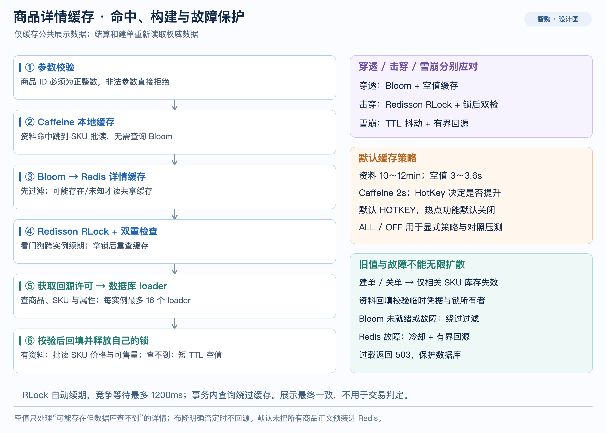

# 商品查询、检索与缓存设计

返回 [文档导航](README.md) · 接口参数见 [接口流程](api-flows.md)

[](images/catalog-cache-flow.svg)

从上往下读缓存未命中后的流程，右侧对照三类缓存问题、默认策略和故障边界。 点击图片查看可缩放 SVG。


## 1. 商品和 SKU 为什么分开

商品描述“这是哪款产品”，SKU 描述“具体购买哪个规格”。同一款电脑的不同内存、容量有不同 SKU，价格和库存也在 SKU 上。

搜索先找候选商品；购买前查详情、选定 SKU；结算与建单重新核对数据库。搜索返回的库存可能是多个匹配 SKU 的合计，不能拿来判断某一个规格一定有货。

## 2. 搜索怎样保证条件没有串规格

`GET /api/store/products` 与 Agent 的 `product_search` 共用 ProductService：

1. 校验预算、页码、每页数量和排序白名单，规范化关键词及有限同义词。
2. 对启用商品和 SKU 筛选。预算、颜色、尺码、库存必须由**同一个 SKU 同时满足**；材质、用途等检查商品属性。
3. 多个关键词都必须匹配，可匹配名称、品牌、品类、规格或属性。按明确的相关性权重、评分、销量等排序。
4. 每个商品选最便宜的匹配 SKU 展示，规格和价格来自同一行；全部结果排序后分页。
5. 返回匹配总数和下一页信息；没有结果就提示调整条件，不偷偷扩大预算或忽略规格。

例如用户找“黑色、42 码、有货”的鞋，不能因为黑色 41 码有货、白色 42 码有货，就把该商品判为符合要求。

当前是 MySQL 关键词和结构化属性查询；没有 Elasticsearch、通用中文分词或个性化推荐模型。数据扩大后需另建搜索索引及可靠同步机制。

## 3. 详情缓存完整读取顺序

```text
GET /api/store/products/{productId}
  → 参数校验：productId 必须为正整数
  → 按本地策略查 Caffeine；资料命中跳至 SKU 批读
  → 本地未命中：Redisson RBloomFilter 判断存在性
      明确不存在：直接返回，不取重建锁、不查数据库
      可能存在或过滤器未知：继续
  → 查 Redisson 管理的 Redis 缓存；资料命中跳至 SKU 批读
  → 获取 Redisson RLock（有界等待，等待时可重查缓存）
  → 拿锁后再次查缓存，命中则跳至 SKU 批读
  → 取得本实例回源并发许可 → 查询数据库
  → 商品详情 / 短期空结果 → 核对临时回填凭据和 RLock 所有者后回填
  → finally 只释放当前线程仍持有的 RLock
  → 批读各 SKU 的价格与可售数量，返回完整详情
```

拿到 RLock 后再查一遍，是因为等待期间其他线程或实例可能已回填；同一把 Redis 锁直接合并多个 JVM 的构建，不再先竞争本机条带锁。

参数校验最先执行；**Caffeine 资料命中跳至 SKU 批读，本地未命中后先检查 Bloom，再读 Redis 详情缓存**。Bloom 明确否定时不读共享详情缓存、不抢锁、不回源；可能存在或过滤未知时继续读 Redis。L1 命中无需额外查询 Bloom。

缓存关闭、查询处于业务 SQL 事务中时直接执行 loader。事务里的读取不能拿展示缓存代替业务数据，也不能把未提交数据写进公共缓存。

## 4. 缓存“三件套”各解决什么

| 问题 | 当前机制 | 仍需注意 |
|---|---|---|
| 穿透：不存在的 ID 不断查库 | 商品 ID Bloom；误判后查不到则缓存空值 | Bloom 判断“可能有”仍要继续查；过滤器未就绪/故障时绕过过滤，不把它当无商品 |
| 击穿：一个热门 key 失效 | Redisson RLock + 锁后双检 | 看门狗续期；回填在 Redis 中同时核对实际锁所有者与临时回填凭据 |
| 雪崩：一批 key 同时过期 | TTL 随机抖动 + 回源并发上限 | Redis 整体故障仍需限流与拒绝，随机 TTL 本身解决不了 |

布隆只用于按 ID 查询详情，不能拿来判断任意搜索组合。它保存商品 ID 的存在性位图，商品内容仍然按访问需要缓存，并未把百万商品全文全部预装到 Redis。

Bloom 使用 **Redisson 原生 `RBloomFilter<Long>` + LongCodec**，不再自己计算哈希或操作 GETBIT/SETBIT。新私有键使用 `bloom:redisson:v2:`，不能把旧位图直接当成新过滤器。

当前没有商家端的新增商品/SKU 接口；Bloom 在启动后扫描存量商品 ID，并默认每 5 分钟补全。`registerBeforePublish` 是预留且经过测试的登记方法，尚无正式发布业务调用，不能描述成完整商品发布链路。直接向数据库新增商品，下一次扫描前可能被过滤拦截；商家端建设留待后续功能。

预留方法的职责是：在数据库事务中先登记商品 ID，并留下待完成登记记录；SQL 事务完成回调补位后移除记录。增量补全不会先清空已有位，构建还会合并未完成登记、复核数据库 ID，再按构建锁所有权发布就绪状态。回滚留下的位最多导致误判；丢键/未就绪/连接失败则绕过过滤，不能当成不存在。进程中断留下的登记可能增加误判，需要后续管理清理，不能任意删除共享位。

## 5. 默认参数和键怎么理解

| 项目 | 默认值 / 说明 |
|---|---|
| 资料 Redis TTL | 10～12 分钟，不含 SKU 价格和库存 |
| SKU 价格 / 数据库展示库存 | 分键批读，60～72 秒 / 3～3.6 秒，不进 Caffeine |
| 搜索 Redis TTL | 5～6 秒；规范化完整查询条件的 SHA-256 作为键的一部分 |
| 空详情 Redis TTL | 3～3.6 秒；空值包装与“缓存没有这个 key”不同 |
| 本地缓存 | TTL 2 秒，最多 2000 项；空详情不提升到本地 |
| 回源控制 | 每实例最多 16 个并发 loader；跨实例互斥使用 RLock |
| 重建锁 | Redisson 看门狗自动续期（默认 30 秒续期窗口）；总竞争等待上限 1200ms |
| Redis 故障冷却 | 3 秒；超出回源保护可返回 503 |

逻辑详情键如 `product:108`；实际键为 `<namespace>:{catalog}:display:product:108`，只存商品与规格资料；同一前缀下另有 `sku:price:<id>` 和 `sku:availability:<id>`。loader 一次可能执行多条 SQL，回源数不能当成 SQL 次数。

## 6. HotKey 与 Caffeine 是什么关系

默认 `CATALOG_LOCAL_MODE=HOTKEY`：京东客户端上报访问，Worker 聚合热度并推送标记，应用将热点数据提升至自己的 Caffeine。

- etcd 保存规则并帮助发现 Worker；Worker 做热度聚合，不保存商城商品正文。
- 热点标记有效期与 Caffeine 商品值 TTL 是两个配置。
- `HOTKEY_ENABLED` 默认 false，因此仅用默认配置运行不会自动享有本地缓存。
- ALL / OFF 分别用于明确开启全量本地缓存、关闭本地缓存；压测用它们隔离不同路径。
- 商品浏览 HotKey 不决定下单走同步还是异步，交易使用独立的 [压力路由](pressure-monitoring.md)。

## 7. 更新与失效怎样处理

建单和关单提交后只删除相关 SKU 的展示库存；支付不再扣可售，不清展示缓存。商品资料和价格继续复用，搜索按短 TTL 刷新。

这是展示数据的最终一致性。Pub/Sub 不持久化，断线可能漏通知，短 TTL 继续兜底；直接改数据库不会自动发布应用事件。结算、报价、库存条件扣减仍以数据库为准。

启用交易池时批读可接单量，不另存一份数量副本。池不存在则批查数据库：从未初始化才展示 SQL 库存；已初始化但丢键或交易 Redis 故障返回 503。代价是尚未初始化的 SKU 需要 SQL 核实。浏览不会初始化或修复库存池。

源码：[ProductService](../src/main/java/com/bitmall/agent/product/service/ProductService.java)、[ProductSearchService](../src/main/java/com/bitmall/agent/product/service/ProductSearchService.java)、[CatalogCache](../src/main/java/com/bitmall/agent/product/cache/CatalogCache.java)、[CatalogBloomFilter](../src/main/java/com/bitmall/agent/product/cache/CatalogBloomFilter.java)。

## 8. Redis 技术选型与切换边界

商品缓存使用 RBucket、RLock、RBloomFilter、RTopic 和 RScript；库存 String/Hash 通过 Redisson RBucket/RMap 读取，预扣/整理及压力协调继续用 RScript 保持多步原子性。**MQ 消费去重是此次保留的旧适配例外**，没有顺手改变其标记和失败重试语义；MySQL、RocketMQ 和本地 Caffeine 各自仍承担原职责。

RLock 名称使用 `load-lock:redisson:v2:`，与旧字符串锁隔离；切换时应停止旧缓存构建者再启动新版本，避免混跑两种锁实现。旧展示缓存可自然过期，原交易库存键、数量、状态与命名空间不变，不能清空库存 Redis 迁移。

当前支持并验证的是多个应用客户端共享单 Redis 的协调；统一客户端不等于已经验证 Redis Cluster、故障切主或跨地域部署。数据库事务和唯一约束继续保证最终交易结果。


## 真实目录与展示依据

当前使用 32 款真实品牌商品和 38 个 SKU，具体来源与价格口径见 [前台设计中的商品清单](storefront-design.md#真实商品与价格从哪里来)。V17 新增商品身份并下架旧虚构目录，保留历史订单、库存与 trace；不复用旧 SKU。商品详情属性保存来源、核对日期及官网价/发布价口径，Agent 与页面读取相同数据。

参考价为人工核对快照，品牌官方库存、真实销量、评分没有接入。本项目库存为演示数据；页面不再用旧虚构评分销量陈列真实品牌。后续更新目录需新增迁移，不能改写已经部署的 V17；生成脚本可校验当前冻结清单是否与 SQL 一致。

部署时一起切换提供查询或产生库存事件的应用实例。新详情使用独立的 `:display:` 键，旧键自然过期，不要清交易 Redis。短期搜索结果仍按数据库搜索快照展示，选择规格后以详情可接单量和最终结算为准。
