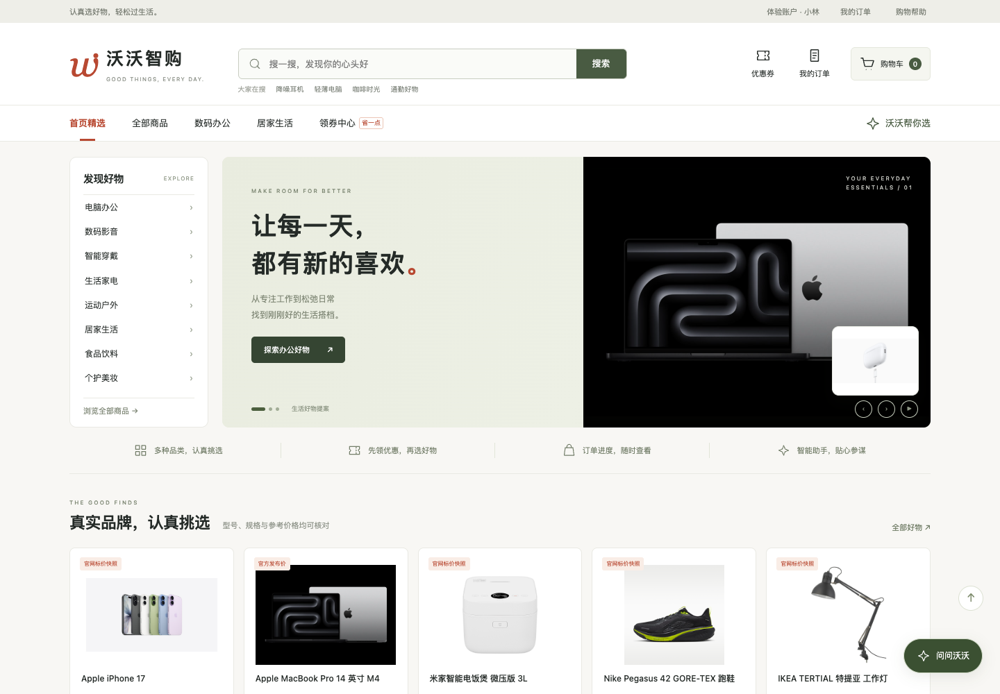
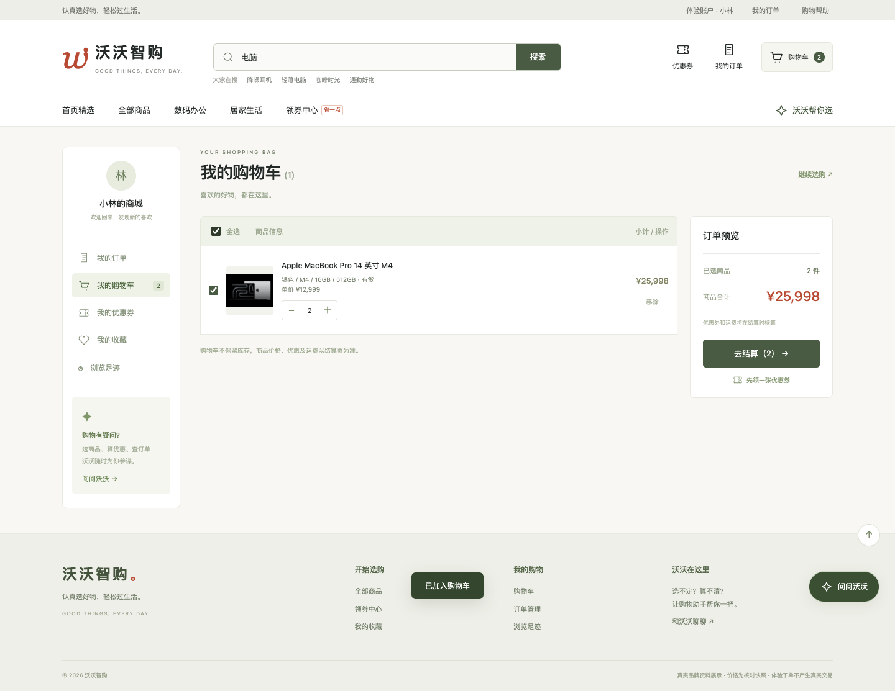
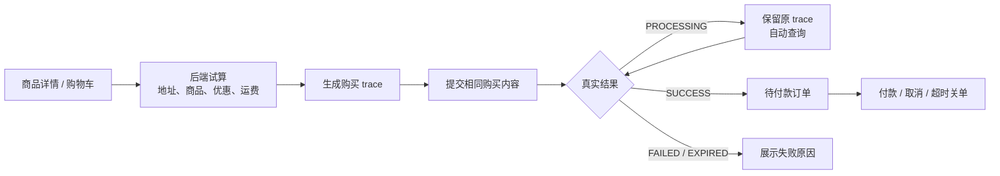

# 商城前台：页面组织与购买体验

返回 [文档导航](README.md)。前台采用原生 HTML / CSS / JavaScript，不需要额外 Node 服务；Spring Boot 同时提供页面、REST 和助手 SSE。商品、金额、库存及订单状态均来自已有业务接口。

## 页面怎样组织

参考 [小米商城](https://www.mi.com/shop) 的搜索、分类与购物入口，以及 [宜家商城](https://www.ikea.cn/cn/zh/) 的场景陈列与购物袋组织方式，形成沃沃智购自己的页面。当前目录使用真实品牌型号与本地保存的品牌资料图片，型号、规格和参考价均保留出处；不编造评分或销量，不代表品牌授权销售。

| 页面地址 | 用户能做什么 | 设计要点 |
|---|---|---|
| `#/` | 主题浏览、精选好价、榜单、领券、商品推荐 | 搜索优先，主题帮助发现商品，陈列使用真实目录数据 |
| `#/catalog` | 关键词、品牌、预算、颜色、尺码、材质、用途、库存、排序与翻页 | 收起复杂筛选；旧响应不能覆盖新查询，失败能重试 |
| `#/product/201` | 查看商品与规格参数，选 SKU、数量、收藏、加购或立即购买 | 规格决定价格与库存；无货不可购买；支持直达和刷新 |
| `#/cart` | 勾选、全选、调整数量、确认移除、结算 | 后端保存选择并汇总金额；空选择不能结算；不保留库存 |
| `#/coupons` | 领券、查看可用/使用中/已用/过期状态 | 活动券 ID 用于领取，用户券 ID 用于结算；状态不混用 |
| `#/checkout` | 核对地址和商品、选择符合门槛的券、提交 | 重新试算，以服务端金额为准；失败清除旧报价并允许重新核算 |
| `#/orders` | 状态筛选、订单搜索、详情、物流、倒计时、取消 | 显示最近 20 笔；详情用订单快照，物流用真实返回字段；取消要确认 |

收藏和足迹仅保存在当前浏览器。订单详情中的商品图仅辅助识别，历史名称、规格和金额始终使用订单快照。手机使用底部导航、两列商品和单列交易页面。

## 一次购买怎样走

- **处理中**：已经受理，订单可能尚未创建；保留原 trace 查询。
- **建单成功**：真实订单事务已提交，进入待付款；不代表付款成功。
- **响应丢失**：保留购买内容与 trace，查询原请求结果；不会直接生成另一笔购买。
- **支付期限**：倒计时读取后端截止时间，到期刷新后端状态，不在浏览器自行把订单改成关闭。
- **模拟支付**：仅后端配置允许时显示，操作明确标记“模拟支付”。

地址使用后端默认地址；体验身份、模拟商品、模拟支付的边界保留在页面。没有接入真实登录、支付渠道或发货系统。

## 代码从哪里读

| 文件 | 职责 |
|---|---|
| [index.html](../src/main/resources/static/index.html) | 页面结构、导航、商品与会员交易区域、助手和确认框 |
| [styles.css](../src/main/resources/static/styles.css) | 色彩、卡片、交易布局、手机断点、键盘焦点和减少动效偏好 |
| [catalog.js](../src/main/resources/static/catalog.js) | 商品图片与价格来源展示索引，不参与交易计算 |
| [navigation.js](../src/main/resources/static/navigation.js) | Hash 页面导航、浏览器历史与操作确认；不处理交易规则 |
| [app.js](../src/main/resources/static/app.js) | 商品接口、购物车、券、试算、trace 恢复、订单状态与助手 SSE |
| [storefront.js](../src/main/resources/static/storefront.js) | 首页陈列、搜索联想、SKU 详情、浏览器收藏与足迹 |

实际浏览器验收、运行命令和边界统一见 [测试总文档第 12 节](testing.md#12-商城前台浏览器验收)。

## 真实商品与价格从哪里来

当前启用 **32 款商品、38 个 SKU、8 个品类**，覆盖 Apple、小米/米家、Nike、IKEA、MUJI。价格资料核对于 **2026-11-16**；官网标价是核对时快照，Apple 部分机型采用其对应年份的官方发布价，页面会分别标注，不能当作今天的实时最低成交价。

数据只维护在 [real-products.json](../src/main/resources/catalog/real-products.json)：包含各 SKU 的规格和参考价格、来源 URL、发布时间、核对日期、图片原始地址与本地路径。SQL 和展示索引由 [生成脚本](../scripts/generate-catalog-migration.py)生成；已有迁移只允许 `--check`，不自动重写历史文件。

| 商品 | 最低规格参考价（人民币） | 价格口径与来源 |
|---|---:|---|
| Apple MacBook Pro 14 英寸 M4 | ¥12,999 | [官方发布价](<https://www.apple.com.cn/newsroom/2024/10/apples-new-macbook-pro-features-the-incredibly-powerful-m4-family-of-chips/>) · 2024-10-30 |
| Apple MacBook Air 13 英寸 M4 | ¥7,999 | [官方发布价](<https://www.apple.com.cn/newsroom/2025/03/apple-introduces-the-new-macbook-air-with-m4-and-a-gorgeous-new-sky-blue-color/>) · 2025-03-05 |
| Apple Mac mini M4 | ¥4,499 | [官方发布价](<https://www.apple.com.cn/newsroom/2024/10/apples-all-new-mac-mini-is-even-more-mighty-and-more-mini/>) · 2024-10-29 |
| Apple Studio Display 27 英寸 | ¥11,499 | [官方发布价](<https://www.apple.com.cn/newsroom/2022/03/apple-unveils-all-new-mac-studio-and-studio-display/>) · 2022-03-08 |
| Apple iPhone 17 | ¥6,799 | [官网标价快照](<https://www.apple.com.cn/shop/buy-iphone/iphone-17>) |
| Apple AirPods Pro 2（USB-C） | ¥1,899 | [官方发布价](<https://www.apple.com.cn/newsroom/2023/09/apple-upgrades-airpods-pro-2nd-generation-with-usb-c-charging/>) · 2023-09-12 |
| Apple AirPods 4 | ¥999 | [官方发布价](<https://www.apple.com.cn/newsroom/2024/09/apple-introduces-all-new-airpods-4-with-industry-defining-audio-and-design/>) · 2024-09-09 |
| Apple Watch Series 10 | ¥2,999 | [官方发布价](<https://www.apple.com.cn/newsroom/2024/09/introducing-apple-watch-series-10/>) · 2024-09-09 |
| 米家智能电饭煲 微压版 3L | ¥459 | [官网标价快照](<https://www.mi.com/shop/buy?product_id=14536>) |
| 米家扫拖机器人 6 | ¥2,699 | [官网标价快照](<https://www.mi.com/shop/buy?product_id=24243>) |
| 米家冰箱 十字430L 2026款 | ¥1,949 | [官网标价快照](<https://www.mi.com/shop/buy?product_id=22503>) |
| 米家洗衣机Pro 超电解智投 洗烘12kg | ¥3,299 | [官网标价快照](<https://www.mi.com/shop/buy?product_id=22521>) |
| 巨省电 小米空调 1.5匹新1级能效 | ¥1,999 | [官网标价快照](<https://www.mi.com/shop/buy?product_id=13143>) |
| 米家微波炉 | ¥429 | [官网标价快照](<https://www.mi.com/shop/buy?product_id=10330>) |
| 米家无线吸尘器 3C | ¥599 | [官网标价快照](<https://www.mi.com/shop/buy?product_id=20336>) |
| REDMI手环 4 | ¥169 | [官网标价快照](<https://www.mi.com/shop/buy?product_id=25768>) |
| Nike Pegasus 42 GORE-TEX 跑鞋 | ¥1,099 | [官网标价快照](<https://www.nike.com.cn/t/pegasus-42-gore-tex-耐克飞马男子防水公路跑步鞋-wzt6auPv/IQ0450-001>) |
| Nike Pegasus Premium 跑鞋 | ¥1,499 | [官网标价快照](<https://www.nike.com.cn/t/pegasus-premium-耐克顶级飞马男子公路跑步鞋-VQWzfn/HQ2592-020>) |
| Nike Streakfly 2 跑鞋 | ¥959 | [官网标价快照](<https://www.nike.com.cn/t/streakfly-2-男子公路竞速跑步鞋-m74iEgEy/HF6416-101>) |
| Nike Zoom Fly 6 SE 跑鞋 | ¥799 | [官网标价快照](<https://www.nike.com.cn/t/zoom-fly-6-se-男子公路竞速跑步鞋-Wp6eiX9I/IV4083-001>) |
| Nike Elemental Premium 双肩包 | ¥239 | [官网标价快照](<https://www.nike.com.cn/t/elemental-premium-双肩包-8xlHHcKA/DN2555-010>) |
| Nike Hayward 双肩包 | ¥449 | [官网标价快照](<https://www.nike.com.cn/t/hayward-双肩包-M6Hglw/HJ8200-525>) |
| IKEA STELNA 斯黛纳 玻璃杯 | ¥3.99 | [官网标价快照](<https://www.ikea.cn/cn/zh/p/stelna-si-dai-na-da-bei-tou-ming-bo-li-50258912/>) |
| IKEA LACK 拉克 边桌 | ¥69.99 | [官网标价快照](<https://www.ikea.cn/cn/zh/p/lack-la-ke-bian-zhuo-hei-se-00352988/>) |
| IKEA TERTIAL 特提亚 工作灯 | ¥89.99 | [官网标价快照](<https://www.ikea.cn/cn/zh/p/30355438/>) |
| IKEA POÄNG 波昂 低背扶手椅 | ¥699 | [官网标价快照](<https://www.ikea.cn/cn/zh/p/poaeng-bo-ang-di-bei-fu-shou-yi-tian-ran-se-mi-se-kai-tuo-tian-ran-se-mi-se-s69551607/>) |
| IKEA GRANKÖLEN 格兰科伦 被套和枕套 | ¥199 | [官网标价快照](<https://www.ikea.cn/cn/zh/p/grankoelen-ge-lan-ke-lun-bei-tao-he-zhen-tao-shen-lan-se-60666981/>) |
| IKEA KAFFEREP 卡弗雷普 燕麦饼干 | ¥49.99 | [官网标价快照](<https://www.ikea.cn/cn/zh/p/kafferep-yan-mai-bing-gan-30374922/>) |
| IKEA VINTERSAGA 温特萨加 生姜饼干 | ¥49.99 | [官网标价快照](<https://www.ikea.cn/cn/zh/p/vintersaga-wen-te-sa-jia-bo-pian-sheng-jiang-bing-gan-70611974/>) |
| IKEA DRYCK 苹果越桔味碳酸饮料 | ¥39.99 | [官网标价快照](<https://www.ikea.cn/cn/zh/p/dryck-bubbel-aepple-lingon-ping-guo-yue-jie-wei-tan-suan-yin-liao-20226767/>) |
| MUJI 无印良品米糠发酵精华液 | ¥128 | [官网标价快照](<https://www.muji.com.cn/cn/store/commodity/103226>) |
| MUJI 敏感肌用基础补水乳霜 | ¥108 | [官网标价快照](<https://www.muji.com.cn/cn/store/commodity/100563>) |

品牌图片已保存在 `static/images/products/`，共约 7.4 MB，页面无需请求品牌图床。图片是品牌资料图，多配色合图不表示用户同时购买多款；实际购买按选中的 SKU。素材与品牌标识的权利归原权利人，当前用于本地学习展示，不表示品牌授权。

原虚构目录使用旧 ID，只下架，不把旧 SKU 改成另一个真实商品。因此旧订单里的虚构名称与价格仍是当时快照；旧购物车条目会隐藏，原始记录保留。新商品使用 201～232，新 SKU 使用 20101 等独立编号。库存仍为本项目演示库存，优惠券、运费和模拟支付由本项目规则决定，与品牌商城无联动。

变更上线需要先停止旧实例接单，核对在途购买及库存整理，再应用 V17；默认商品缓存空间切到 `wowo:catalog:real:v2`，显式配置旧命名空间的部署也需同步更换展示缓存空间。交易 Redis 和历史预占不能清空。此次未在原共享商城数据库上执行迁移，仅在隔离环境验证。
