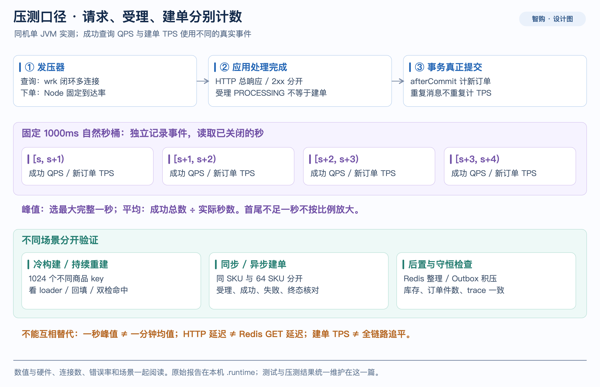

# 测试与压测：统一口径和结果

当前商品缓存顺序变更见 [第 18 节](#18-商品详情先-bloom-后共享缓存2026-11-17)。框架版本验收先看 [Spring Boot 4 / Spring AI 2 验证](#17-spring-boot-4-与-spring-ai-2-迁移验证2026-11-17)。下方早期压测与改版记录按历史保留，不能替代当前版本的实测。
返回 [文档导航](README.md)。这是唯一的测试说明与压测报告；早期结果日期为 **2026-11-16，Asia/Shanghai**，第 13～15 节分别为 **2026-11-17** 的真实目录、品牌政策与 Agentic RAG 验证；第 16 节为迁移 Spring AI 前 PostgreSQL/pgvector 的 239 项验收，第 17 节为当前 Spring AI / Boot 4 的 242 项验收。第 1～9 节是较早版本的容量数据，第 10 节是延时关单验证，第 11 节是 Redisson 替换的正确性验证，第 12 节是本次商城前台浏览器验收；不能跨版本混用容量结论。

[](images/measurement-pipeline.svg)

图解释计数方法，下面表格才是实测结果；QPS、受理量、成功建单和后置积压分别核对。 点击图片查看可缩放 SVG。


## 1. 测试分别证明什么

| 类型 | 主要覆盖 | 不能替代什么 |
|---|---|---|
| 功能 / 事务集成测试 | 搜索条件、报价、券、建单/取消、回滚、状态与幂等 | 生产容量、真实模型任务效果 |
| 真实 Redis 测试 | Bloom、重建锁、预扣 Lua、路由与补偿 | Redis Cluster、多机网络故障演练 |
| 真实 MySQL 测试 | 方言、外键、长文本、唯一约束、微秒精度和事务 | H2 结果不能代替这一层 |
| Agent 框架测试 | 真正运行 ReAct/工具/中间件，模型由测试实现替换 | 商用模型的任务成功率与响应质量 |
| 真实组件压测 | 本机实际 HTTP、MySQL、Redis、MQ 吞吐和恢复 | 云网络、多实例部署、生产持续容量 |

测试源码统一在 [src/test](../src/test)，发压脚本在 [scripts](../scripts)。历史测试代码继续保留；合并的是说明文档。

## 2. 怎么运行回归

```bash
mvn test
```

需要 Java 17 / Maven 和已安装的 HotKey 依赖；部分集成测试启动独立临时 Redis，需要 PATH 中有 `redis-server`。部分测试支持 `REDIS_SERVER` 覆盖，AUTO 路由测试直接使用 PATH。

真实 MySQL 测试通过 `MYSQL_TEST_URL` 显式启用，同时设置 `MYSQL_TEST_USERNAME` / `MYSQL_TEST_PASSWORD`，指向独立可丢弃测试库，然后执行：

```bash
mvn -Dtest=MySQLMigrationIntegrationTest test
```

未提供变量会跳过这一类测试，普通测试绿灯不代表已测真实 MySQL。此前基线联调完成 153 项无跳过；后续秒桶/缓存增量验证为 34 项通过，两次范围不同，不能相加当作当前全量测试数。

## 3. QPS、TPS 和耗时怎么算

- **QPS**：服务端在一个完整自然秒中处理完成的指定 HTTP 请求数；总响应与 2xx 成功响应分开。
- **建单 TPS**：建单事务 afterCommit 后计数；一秒内提交多少个新订单。不是全库事务吞吐，也不是 HTTP 返回 PROCESSING 数。
- **一秒峰值**：epoch 对齐、固定 1000ms 桶的最大计数；不把短片段乘比例放大，不用 20 秒平均代替。
- **平均成功 QPS**：成功响应总数 ÷ 实际测量秒数。
- **延迟**：HTTP 请求整体耗时；P99 表示 99% 的样本不超过该值。异步受理延迟与最终建单等待时间分别观察。
- **回源**：进入详情 loader 的次数，一个 loader 可以执行多条 SQL。

发号、试算、轮询、监控不混入正式下单 QPS。TPS 峰值和 QPS 峰值独立选取，可能来自不同自然秒。

异步的成功界线是消费者建单事务提交，持久化 SUCCESS + 真实 orderId，订单初始为 PENDING_PAYMENT。预扣、Outbox、发送成功、ACK 都不能单独证明建单成功，更不表示支付成功。

## 4. 机器、部署与发压方式

| 项目 | 实际配置 |
|---|---|
| 主机 | Apple M4，10 核，16GiB；未绑核、未限 CPU 配额 |
| 应用 | 单 JVM，最大堆 512MB；Hikari 16，提交并发上限 32 |
| 数据库 | MySQL 8.0.42，buffer pool 256MiB，事务与 binlog 每次提交刷盘 |
| Redis / MQ | 独立缓存和交易 Redis；测试 Redis 无持久化；MQ 单 Broker 5.3.2、ASYNC_FLUSH |
| 网络 | 压测器、应用、数据库和中间件同机，loopback |
| 查询 | wrk 4.2.0，2 个工作线程，多条 HTTP/1.1 长连接、闭环持续请求 |
| 下单 | 4 个 Node 发压进程，按目标到达率发送，每笔使用不同后端 trace |

`wrk -t2 -c128 -d20s --latency --timeout 5s` 表示 2 个 I/O 工作线程维护 128 条连接，收到响应后继续发，持续 20 秒；不是只发 128 次。与 JMeter 类比，128 连接近似 128 个无思考时间的虚拟用户，wrk 的 2 个线程不等于 2 个 JMeter 用户。

每次请求没有固定耗时，5 秒是超时阈值。机器有 10 核不代表应用独占 10 核；最近多 key 连续查询没有采集应用 CPU 核数消耗，也没有单独计时 Redis GET。下表毫秒数均不能当作跨云 Redis 单次访问耗时。

## 5. 多 key 商品查询：包含真实构建

工作集为 1024 个独立商品、SKU 和缓存 key，复制同一详情模板，复杂度相近；不是百万商品规模。ALL 表示启用本地缓存，OFF 表示只使用 Redis；生产默认仍为 HOTKEY，且 HotKey 开关默认 false。

### 5.1 冷缓存与双重检查

四个 Node 进程，最多 64 个在途请求；同时最多 8 个冷 key，每个 key 并发 8 次。1024 key 共 8192 请求，所有响应核对商品和 SKU 归属。

| 模式 | 总请求 | 数据库回源 / 回填 | 完成时间 | 拿到本机锁后再次命中 |
|---|---:|---:|---:|---:|
| 本地 + Redis | 8192 | 1024 / 1024 | 约 1.315s | 7168 |
| 仅 Redis | 8192 | 1024 / 1024 | 约 1.278s | 7164 |

这组验证冷构建与合并，每个商品只回源一次；有限任务不代表可持续冷缓存容量上限。冷构建完整自然秒成功峰值分别为 5264 / 6013，未放大尾秒。

额外两个 JVM 共享 Redis，64 个新 key、512 请求：64 次回源/回填，全部 200。Redis 锁获得 99 次，其中 35 次在锁后重查命中，没有重复进 loader。这是跨实例重建正确性验证，不混入单 JVM 峰值。

### 5.2 多 key 全命中参照

| 模式 | 一秒成功峰值 QPS | 数据库回源 |
|---|---:|---:|
| 本地缓存 ALL | 130698 | 0 |
| Redis，关闭本地 | 56742 | 0 |

本地缓存 64 连接、20.10212 秒完成 2358170 次请求，平均 QPS 117309.52；wrk 平均延迟 **0.799ms**，P50 0.416ms，P99 5.815ms，零错误。该阶段本地命中，Redis 和回源均为 0；不代表公网请求或真实模型有这个延迟。

### 5.3 持续过期重建

Redis 详情 TTL 改为 2～2.4 秒，本地 1 秒；16 / 32 / 64 / 128 连接每档 20 秒。每个完整秒都存在回源，缓存命中与真实构建同时发生。

| 模式 | 连接数 | 平均成功 QPS | 一秒成功峰值 | 峰值秒回源 | 全阶段回源 | P99 ms | HTTP / 传输错误 |
|---|---:|---:|---:|---:|---:|---:|---:|
| ALL | 16 | 52279.25 | 90576 | 131 | 7257 | 31.23 | 0 / 0 |
| ALL | 32 | 97776.97 | 107890 | 115 | 7157 | 4.65 | 0 / 1 |
| ALL | 64 | 100732.42 | 114543 | 49 | 7209 | 40.20 | 41 / 0 |
| ALL | 128 | 109324.13 | 120162 | 259 | 7208 | 25.50 | 183 / 0 |
| OFF | 16 | 29346.17 | 43822 | 199 | 9245 | 26.01 | 0 / 0 |
| OFF | 32 | 46461.64 | 49892 | 397 | 9597 | 22.32 | 0 / 0 |
| OFF | 64 | 49393.74 | 53800 | 646 | 9450 | 15.70 | 5 / 0 |
| OFF | 128 | 49208.89 | 55402 | 204 | 9585 | 14.38 | 33 / 0 |

128 连接档：ALL 实际 20.030802 秒、2190033 响应、183 个 503，平均延迟 1.72ms；OFF 实际 20.103887 秒、989323 响应、33 个 503，平均 2.86ms。503 来自缓存并发保护，未计入成功 QPS。

`(2190033 - 183) / 20.030802 = 109324.13` 是平均值。峰值 120162 来自另一完整秒，该秒总响应 120170，8 个非 2xx，回源 259 次。

同一档回源最忙的秒：ALL 回源 702 / 成功查询 97496，OFF 回源 820 / 成功查询 52237。高 QPS 并非每次查数据库，也没有只选零回源秒充当重建结果。

## 6. 下单一秒峰值：与查询分开测试

每单一件、无券、无真实支付，独立 SKU 每个初始 500 万件；同一 SKU 和 64 个分散 SKU 分开测试，模式固定，避免路由变化干扰对比。

| 场景 | 总响应 QPS 峰值 | 2xx QPS 峰值 | 发压完整秒建单 TPS 峰值 | 含收尾全程 TPS 峰值 |
|---|---:|---:|---:|---:|
| 同步，同一 SKU | 1202 | 633 | 635 | 635 |
| 异步，同一 SKU | 600 | 600 | 433 | 565 |
| 同步，64 SKU | 809 | 799 | 799 | 799 |
| 异步，64 SKU | 432 | 427 | 448 | 448 |

同步同 SKU 的 1202 包含大量 429；异步 2xx 可以只表示受理。异步 565 出现在发压停止的混合尾秒，该秒还有 348 个 HTTP 响应，不能说是纯排空秒，也不能代替完整发压秒的 433。

四场共 75054 个新订单，秒桶 afterCommit 合计与数据库成功 trace 一致，同 trace 重复订单 0，最终数据库/Redis 可售守恒、无遗留预占。审计 Outbox 尚有未发送：同步同 SKU 18571 条、同步分散 1029 条、异步分散 14 条；异步同 SKU 均 SENT。

所以这些值只是数据库建单峰值，不能声称全部后置链路已经追平。

## 7. 持续一分钟结果与 AUTO 功能验证

一分钟确认来自单独批次，是区间平均值，不能与一秒峰值混在一起：

| 场景 | 60 秒平均建单 TPS | HTTP 错误率 | 当时判定 |
|---|---:|---:|---|
| 同步同 SKU，300 请求/秒 | 299.12 | 0.22% | 通过该轮判据 |
| 异步同 SKU，300 请求/秒 | 299.32 | 0.17% | 通过该轮判据 |
| 同步 64 SKU，600 请求/秒 | 595.36 | 0.66% | 通过该轮判据；收尾仍需整理 |
| 异步 64 SKU，400 请求/秒 | 399.42 | 0.04% | 通过该轮判据 |

当时判据包括错误/客户端丢弃各不超过 1%、实际受理达到目标 98%、受理后未完成不超过 max(5,1%)、窗口内建单/受理至少 97%，不等于零错误或无限期稳定。

单独 AUTO 基线：5 → 90 → 3 请求/秒，观察 SYNC → ASYNC → SYNC；预算使用 60。1966 次不同购买全部建单，另 200 次原 trace 重复请求没有增加订单，最终库存 `20000 = 18034 可售 + 1966 待支付`，Redis pending 为 0。这验证自动切换和一致性，90 请求/秒不是容量极限。

## 8. 测到了哪些瓶颈

1. 同 SKU 更新受库存行锁和事务刷盘约束；异步受理仍要落 trace / Outbox，不会自动倍增数据库 TPS。
2. 转发及库存整理线程池较小，过载后丢唤醒，依赖低速扫描，曾出现大量 CONFIRM_PENDING 和慢恢复。
3. 早期 Outbox 时间比较精度与字段微秒精度不一致，导致同秒消息不能立即抢占；已统一并增加真实 MySQL 回归。
4. 入口 QPS、最终建单 TPS、后置任务恢复能力需要分别评估，不能只挑最高指标。

## 9. 复现与原始证据

先构建 JAR、准备本机 MySQL 私有连接配置、Redis、Node、wrk 4.2.0 与 RocketMQ 5.3.2。本项目脚本会创建随机临时库及隔离进程，结束清理；本轮未对原商城库存或共享开发 MQ 发压。

```bash
mvn package
python3 scripts/run-multikey-cache-test.py --keys 1024 --seconds 20 --concurrencies 16,32,64,128
python3 scripts/run-peak-test.py --one-second --peak-only \
  --scenarios sync-hot,async-hot,sync-spread,async-spread \
  --probe-seconds 15 --order-rates 200,400,600,800,1200 --refine-steps 0 --backlog-limit 300
```

多 key 脚本使用 `.runtime/load-infra/wrk/wrk`；峰值脚本支持 `--wrk` / `--rocketmq-home` 覆盖默认位置。AUTO 基线入口为 `scripts/run-load-test.py`。详情见 [多 key 脚本](../scripts/run-multikey-cache-test.py)、[升压脚本](../scripts/run-peak-test.py)、[基线脚本](../scripts/run-load-test.py)。

这些编排脚本按当前 macOS 本机环境编写，读取 `.runtime/mysql/connection.json` / `root.cnf`，MySQL 客户端路径使用 `/usr/local/mysql/bin/mysql`。换机器需要先适配客户端位置和私有连接配置，不能只复制命令就视为已复现。

| 证据 | 本机原始文件 |
|---|---|
| 多 key 全阶段 / 秒桶汇总 | [report.json](../.runtime/multikey-cache-tests/20261116-160702-f403ba/report.json) / [summary.json](../.runtime/multikey-cache-tests/20261116-160702-f403ba/summary.json) |
| 一秒建单峰值 / 同秒计数 | [report.json](../.runtime/peak-tests/20261116-152758-9e4e83/report.json) / [秒桶汇总](../.runtime/peak-tests/20261116-152758-9e4e83/one-second-summary.json) |
| 一分钟确认及分轮来源 | [汇总](../.runtime/peak-tests/summary-20261116.json) |
| AUTO 与库存守恒基线 | [report.json](../.runtime/load-tests/20261116-123303-67bb7d/report.json) |

原始目录还有各档 wrk.log、请求结果、seconds.json、数据库终态与守恒导出。`.runtime` 被 Git 忽略，这些链接是本机证据；克隆仓库需按脚本重跑。文档保留核心环境、口径、失败与结果，不用保留多篇重复历史报告。

本轮结果未覆盖公网/跨云延迟、百万真实商品、多实例交易容量、真实支付和真实模型并发推理，不能推广为这些场景的性能承诺。

## 10. 15 分钟定时关单验证

本次增量后的全量回归为 **170 项通过、0 失败、0 跳过**，包含独立真实 MySQL 的 V16 迁移和真实 Redis 预占/返还。新增用例覆盖默认 900 秒截止时间、定时 Outbox 与订单同进同退、绝对时刻重发、提前/重复/异常消息、支付竞争、库存与券只释放一次。

真实组件验证脚本：[verify-payment-timeout.py](../scripts/verify-payment-timeout.py)。该脚本复用隔离基础设施，在随机数据库、两个 Redis 和本机 RocketMQ 5.3.2 上验证；只将本轮支付窗口缩短为 12 秒，应用正式默认仍是 900 秒。恢复扫描间隔改为一小时，确保新订单由 MQ 关单；分别执行 SYNC 和 ASYNC，每组检查未支付、已支付和手动取消三笔购买。

```bash
python3 scripts/verify-payment-timeout.py
```

本轮两组均通过，共 6 笔订单、6 条定时消息实际消费：各组未支付订单 CLOSED、已支付保持 PAID、手动取消保持 CANCELLED。每组专用 SKU 初始 10 件，最终数据库 stock=9 / locked_stock=0，Redis available=9 / pending=0，用于未支付购买的券恢复 AVAILABLE，没有重复返还。

[本机完整报告](../.runtime/payment-timeout-tests/20261116-212709-b0e536/report.json)保存定时投递时刻、观察到关闭的时间、订单及 trace 编号。同目录 application.log 保留真实消费者日志；两组从各自到期到观察关闭约 9.1 秒和 1.0 秒，不能把定时消息描述为严格零延迟。临时服务已停止、随机数据库已删除。

此功能新增每单一条定时命令，前文吞吐数来自加入该消息前的版本，不能视为本次变更后重新测得的容量。

## 11. Redisson 统一与缓存顺序验证

Redis 业务访问已改为 Redisson，MQ 消费去重为保留例外；Bloom 改为原生 RBloomFilter。该历史版本流程为参数校验 → Caffeine / Redis 命中直接返回 → 全未命中后 Bloom → RLock → 锁后双检 → 有界回源；当前顺序已在第 18 节更新为 Caffeine → Bloom → Redis。旧的条带锁/位图参数和前文吞吐数据仅对应其当时版本。

本次全量 **174 项通过、零失败、零错误、零跳过**，含独立 MySQL 和真实 Redis。缓存组验证了 Bloom 在重建锁前拒绝、非法参数最先拒绝、L1 命中不访问 Bloom、原生过滤器跨客户端共享、看门狗续期、失锁旧持有者不能回填/误解锁，以及位图丢失时保留未提交登记。

两个独立 JVM 使用各自 Redisson 客户端，共享本轮隔离 Redis/数据库：64 个不同冷商品，每个请求 8 次，共 **512 个真实 HTTP 200**，逐条核对商品及 SKU。数据库 loader / 回填均为 **64 次**；获得 RLock 202 次，其中 138 次被锁后重查拦住；另有 559 次等锁检查循环。证明两进程之间重建合并，不是只在单 JVM 放两个包装对象。

[跨 JVM 原始报告](../.runtime/redisson-cache-tests/20261116-221729-313797/report.json)与[全量回归汇总](../.runtime/redisson-cache-tests/20261116-221729-313797/regression-summary.json)保留本机证据。该冷构建约 0.53 秒，是有限正确性任务，**不是重新测得的 QPS 峰值或持续容量**。

真实 RocketMQ 5.3.2 的 SYNC/ASYNC 延时关单也复验通过，各检查未支付、已支付、手动取消三种订单，数据库/Redis 库存与券一致；[本轮消息报告](../.runtime/payment-timeout-tests/20261116-221638-fd1cb6/report.json)。仍只将测试窗口缩成 12 秒，正式默认 900 秒，扫描间隔设一小时，证明由 MQ 消费关单。

复现：构建最新 JAR 后执行 `python3 scripts/verify-redisson-cache.py` 和 `python3 scripts/verify-payment-timeout.py`，基础设施前提与上文相同。本轮临时数据库与子进程均已清理；未验证 Redis Cluster、切主、跨地域或新增容量上限。


## 12. 商城前台浏览器验收

2026-11-16 使用最终打包 JAR 启动专用 `demo` 进程：HTTP 18080、管理端口 19080、独立内存 H2、SYNC、Redis 缓存/预占/锁和 MQ 关闭、规则助手、模拟支付开启。Chrome 通过 Playwright 驱动，浏览器时区 Asia/Shanghai。测试会创建、取消和模拟支付订单，只对专用演示进程执行。

**16 项检查通过，未预期的浏览器错误为 0**。人工注入的一次提交响应丢失和一次不存在商品的 404 单独记为预期故障，并未计入无错误结论。

| 检查 | 实际结果 |
|---|---|
| 首页、商品搜索、预算、SKU 选择 | 商品来源为真实接口，规格与数量可选，支持详情直达、刷新及返回 |
| 购物车与券 | 数量与勾选持久化，全选金额核对 API；移除确认取消不删除；领取后状态刷新 |
| 试算与建单 | 真实报价、券抵扣与 stable trace 提交；SUCCESS 后核对订单为 PENDING_PAYMENT |
| 订单 | 状态筛选、搜索、详情、倒计时、确认取消；服务端确认 CANCELLED；显式模拟支付后为 PAID |
| 响应丢失 | 浏览器让真实 POST 完成后丢弃响应；只发送一次建单 POST，轮询原 trace 恢复，订单只出现一次 |
| 历史物流与助手 | 物流条目数核对后端；规则助手使用真实 SSE，页面保留“演示模式”标识 |
| 设备布局 | 桌面 1440×1000；360/390/768 宽度的首页、目录、详情、购物车、券、订单、结算均无横向溢出；另保存有商品的手机购物车和结算截图 |
| 失败反馈 | 商品不存在时显示错误和返回入口；没有用默认商品冒充查询成功 |

[原始报告](../.runtime/storefront-tests/report.json)和同目录截图保存本机证据；[验收脚本](../scripts/verify-storefront.cjs)可重复执行。设计和部分页面预览在 [商城前台设计](storefront-design.md)。

先构建，再启动独立进程：

```bash
mvn -q -DskipTests package
java -jar target/wowo-smart-commerce-0.1.0-SNAPSHOT.jar \
  --spring.profiles.active=demo \
  --server.port=18080 \
  --management.server.port=19080 \
  --app.catalog-cache.enabled=false \
  --app.catalog-protection.bloom-enabled=false \
  --app.inventory.enabled=false \
  --app.order-processing.locks-enabled=false \
  --app.order-processing.submission-mode=SYNC \
  --app.order-messaging.enabled=false \
  --app.agent.ai-enabled=false
```

在已有 Playwright 和本机 Chrome 的环境执行；没有安装时可放在临时目录，无需给 Java 应用增加前端构建依赖：

```bash
npm install --prefix /private/tmp/bitmall-storefront-browser --no-package-lock --no-audit --no-fund playwright@1.58.2
PLAYWRIGHT_MODULE=/private/tmp/bitmall-storefront-browser/node_modules/playwright \
  node scripts/verify-storefront.cjs
```

脚本通过 `CHROME_PATH` 覆盖 Chrome 路径，通过 `STOREFRONT_TEST_URL` / `STOREFRONT_TEST_OUTPUT` 覆盖专用目标和证据目录。它要求后端开启模拟支付且助手为 demo；这仍不能代替环境隔离约定。

本轮完成前端 JS 语法检查、静态资源打包和浏览器购买流程；**没有重跑第 11 节的 174 项后端回归、Redis/MQ 联调或容量压测**。本次不修改后端交易规则。浏览器验收不证明真实模型质量、支付渠道或云端吞吐；当前实例保留供界面预览，重启后内存测试数据消失。


## 13. 真实商品目录验证（2026-11-17）

当前启用目录换成 32 款真实品牌商品、38 个 SKU 和 32 张本地品牌图片，来源与价格核对日期为 2026-11-16。所有价格有具体规格和来源，区分官网标价快照与历史官方发布价。图片合计 7,410,963 字节；未伪造实时更新、品牌库存、销量或评分。

### 后端与迁移

**179 项测试通过，0 失败、0 错误、0 跳过**；包含独立 MySQL 与真实临时 Redis。[汇总](../.runtime/real-catalog/regression-summary.json)和[日志](../.runtime/real-catalog/regression.log)保存本机证据。

- `RealCatalogMigrationTest`：在独立 H2 先执行到 V16，保存全部旧订单、明细和 SKU 库存，再执行 V17；核对 32 款新商品、38 个新 SKU、旧目录下架，历史数据保持原值。
- `RealCatalogIntegrationTest`：独立真实目录上下文，逐款比较冻结清单、SKU 规格与价格、32 个本地图片文件；校验旧 SKU 不可新购、Agent 工具读取相同来源，以及新 SKU 试算、同 trace 幂等建单、取消归还库存。
- MySQL 回归执行完整 V17，验证真实方言、迁移数量及既有交易。旧有 13 组交易/缓存/搜索测试通过显式 `LegacyCatalogFixture` 启用它们所依赖的旧价格与缺货边界；没有跳过 V17，没有将此夹具打进应用。真实目录的用例使用独立数据库且不加载此夹具。

首次在受限沙箱执行 Spring 测试时，Mockito 的 JVM attach 无法完成；在本机执行后完成上述全量回归。夹具遗漏及商品工具测试调用问题也已修正，最终结果以本节汇总为准。

### 浏览器与资源

[verify-real-catalog.cjs](../scripts/verify-real-catalog.cjs)逐款核对实际 HTTP 返回的 32 个详情、38 个 SKU 价格与全部 32 个图片资源；检查跨品类详情来源、日期、演示库存提示与手机布局，未预期浏览器错误为 0。最终 JAR 再次复核，证据见[报告](../.runtime/real-catalog/browser-report.json)。

更新到新商品 ID 后，[verify-storefront.cjs](../scripts/verify-storefront.cjs)的 **16 项完整购买检查通过**，包括领券、试算、待付款、取消、模拟支付、真实 POST 响应丢失后的原 trace 恢复、助手 SSE，以及 360/390/768 宽度布局。[本轮购买报告](../.runtime/real-catalog/storefront-flow/report.json)保存结果与截图。

浏览器为专用 demo/H2 进程、SYNC、无 Redis/MQ、规则助手和模拟支付；真实 Redis/MySQL 只在后端回归中验证，不冒充实际 MQ 异步联调、真实模型或真实支付。本次未做新的容量压测，早期 QPS/TPS 不代表本次商品目录的容量。

```bash
python3 scripts/generate-catalog-migration.py --version 17 --check
PLAYWRIGHT_MODULE=/private/tmp/bitmall-storefront-browser/node_modules/playwright \
  node scripts/verify-real-catalog.cjs
PLAYWRIGHT_MODULE=/private/tmp/bitmall-storefront-browser/node_modules/playwright \
  STOREFRONT_TEST_OUTPUT=.runtime/real-catalog/storefront-flow node scripts/verify-storefront.cjs
```

启动专用进程沿用第 12 节命令。商品清单及图片抓取脚本分别位于 `src/main/resources/catalog/real-products.json` 与 `scripts/fetch-catalog-images.py`；后续改价必须新建迁移，不得覆盖已部署的 V17 或通过清空交易 Redis 处理升级。


## 14. 品牌政策知识检索验证（2026-11-17）

本轮将知识库改为 16 篇品牌政策摘要和 6 篇本站规则，新增品牌/类别/渠道识别与只读查询接口。实现流程见 [知识检索设计](knowledge-design.md)。

**全量 200 项通过，0 失败、0 错误、0 跳过**，包含隔离 MySQL 和真实临时 Redis；[汇总](../.runtime/brand-policies/regression-summary.json)、[日志](../.runtime/brand-policies/regression.log)为本机原始证据。此前 179 项是商品目录变更当时的记录。

| 验证 | 实际范围 |
|---|---|
| BrandPolicyIntegrationTest | 17 项：五品牌及产品家族、类别、多品牌对比、未知品牌、参数冲突、缺失资料、本站渠道、LIKE 特殊字符、22 篇资料、只读 API、咨询不写售后 |
| BrandPolicyMigrationTest | 独立 H2 从 V17 升级 V18，旧订单/SKU/库存及旧知识文本保留，新增 16 篇品牌与 6 篇本站资料 |
| MySQLMigrationIntegrationTest | 真 MySQL 全量 V18、品牌/类别筛选、来源日期及 LIKE 转义；测试库完成后清理 |
| AgentScopeIntegrationTest（历史名称，现为 SpringAiIntegrationTest） | 脚本模型驱动真实 ReAct 工具调用，验证结构化品牌/类别与来源回包、整篇文档预算裁剪；没有调用远端 LLM |
| verify-brand-policies.cjs | 实际 Chrome，10 组真实查询 API；聊天真实 HTTP/SSE；品牌对比、来源链接、无资料、本站渠道、390px 布局与安全渲染，共 8 组检查通过，未预期浏览器错误 0 |

浏览器[报告](../.runtime/brand-policies/browser-report.json)和[桌面品牌对比](../.runtime/brand-policies/brand-comparison-desktop.png)、[手机回答](../.runtime/brand-policies/ikea-policy-mobile.png)保留本机证据。安全渲染一项注入 SSE 夹具，验证 HTTPS 链接可点、javascript/带凭据链接和 HTML 注入不能执行；其他政策回答由真实 demo 检索服务返回。前后核对订单列表不变，政策咨询没有生成交易确认卡。

浏览器目标为专用 H2/demo、SYNC、Redis/MQ 关闭的预览进程；完整回归中的 Redis 不代表本轮做了真实 MQ 联调。未测远端模型自然语言效果，未做新的性能压测。200 项通过不能证明任意未收录品牌均可自动理解，当前仍是有限别名规则和模型结构化参数结合的检索。

```bash
mvn test
python3 scripts/generate-knowledge-migration.py --version 18 --check
PLAYWRIGHT_MODULE=/private/tmp/bitmall-storefront-browser/node_modules/playwright \
  node scripts/verify-brand-policies.cjs
```

真实 MySQL 用例需使用本机隔离库配置，普通 `mvn test` 的结果应按实际组件条件判断，不将 H2 代替 MySQL。浏览器脚本默认访问 localhost:18080，可用 STOREFRONT_TEST_URL 指定专用 demo 实例；它会写入测试聊天记录，不能对用户环境执行。JAR 打包通过，包含全部 22 篇原文、manifest 与双数据库 V18，测试夹具不进入应用包。


## 15. Agentic RAG 检索流水线（2026-11-17）

本轮最终完整回归 **229 项：226 通过，0 失败/错误，3 项真实模型测试默认跳过**。包含临时真实 MySQL 库、H2 与临时 Redis，MySQL 测试库已清理。另显式联网运行三个真实模型测试，**3 项全部通过**；它们正是默认跳过的三项，不将两次结果相加当唯一测试数。

| 范围 | 入口及实际覆盖 |
|---|---|
| 执行层参数 | KnowledgeRequestTest：数组元素、长度、空白、互斥、去重后限量 |
| 多问题与异常 | KnowledgePipelineIntegrationTest（17 项）：配对、遗漏、渠道/地区/指代、来源、两路/部分故障、回退、缓存失效、完整证据预算、期限取消与 HTTP 503 |
| 索引协议与离线入口 | EmbeddingProtocolTest（4 项）：本机 HTTP 替身、响应顺序、模型身份、维度/零向量、独立命令构建退出 |
| MySQL V19 | KnowledgeMySQLIndexIntegrationTest：真实方言/锁/JSON/发布与失败保留原指针；embedding 明确为替身 |
| 原有 Agent | AgentScopeIntegrationTest（现为 SpringAiIntegrationTest）：增加混合政策→订单循环及嵌套数组类型检查；既有确认、Skills、历史测试继续通过 |
| 真实模型 | RealRagIntegrationTest（3 项）：真实百炼语义近邻 + 混合召回、严格 JSON 增强适配器、真实 DeepSeek 多工具回答 |

真实组件与模型结果详见 [本次验证记录](../openspec/changes/archive/2026-11-17-build-agentic-rag-pipeline/verification.md)。原文及汇总保存在本机 `.runtime/rag/regression-final.log / regression-final.json / real-tests.log / real-summary.json`，未提交 Git，其他机器按 [运行配置](deployment.md#rag-真实向量检索与离线索引) 重现。

本次真实 embedding 为 `text-embedding-v4`（1024 维），发布索引 `knowledge-c7de0c4d-ea17-42cc-b20f-dada5b079c25`。固定非字面近义样本与相关段落的余弦为 0.739406，与配送干扰段落为 0.380286；实际返回 DB_KEYWORD+VECTOR。语义检查加混合检索测试约 425ms。这个小样本只证明真实语义路径运行，不代表完整检索质量基准。

现有 DeepSeek 网关的一次真实工具序列为 `search_knowledge → search_knowledge → order_query`，整轮约 16858ms。分品牌引用官方资料，并读取本人订单，没有写操作或确认卡。严格增强适配器测试约 1605ms（8 秒测试期限）；服务默认增强预算为 1.5 秒，慢请求会回退原查询。默认 Agent 验收未开启增强，不能混为已应用该次改写。模型 token usage 未在 SDK 持久状态统一提供，未填写假数据。

最终 JAR 的独立索引入口在单独 H2 文件库调用百炼构建 22 块并正常退出；本机预览 `http://127.0.0.1:18082` 的 GET/POST 均返回真实混合证据，POST 为 Apple/RETURNS、Nike/SHIPPING 两组。证据在 `.runtime/rag/preview-index.log / http-report.json / preview.json`。预览独立于旧商城数据，默认关闭商品 Redis 缓存和 MQ，并使用真实主模型；不是这次的压测环境。

本轮没有重跑交易压测。LIKE 不叫 BM25，精确余弦不叫 ANN；未接 cross-encoder，未做增量向量复用或旧索引清理。OpenSpec strict 与本地链接另行校验，CLI 通过不代替上述业务和模型测试。

归档后的 OpenSpec 校验为 17 个基线与 6 个归档 change 全部 strict 通过，活动变更为 0；本地相对文件链接缺失为 0。


## 16. PostgreSQL 与 pgvector（2026-11-17）

本轮最后一次完整运行 **239项全部通过，0失败/错误/跳过**。同一次运行包含临时真实MySQL、PostgreSQL/pgvector、H2、Redis及3项真实百炼/DeepSeek模型测试；两个临时测试库均清理。历史第15节的229项是当时版本，本节为新的真实结果。

| 入口 | 本次实际验证 |
|---|---|
| PgVectorIndexIntegrationTest（9项） | vector(1024) 类型、knowledge schema、主库隔离、快照无向量数组、同版双路和过滤、失败/回滚/源停用、原生距离0/1/2排序、512块稀疏合法组HNSW返回10条合法候选及索引计划 |
| PgVectorUnavailableIntegrationTest（1项） | 真正拒绝连接时KEYWORD/商品查询可用，HYBRID有界降级并警告 |
| RealRagIntegrationTest（3项） | 真实百炼向量写入临时PG、真实语义与混合查询、严格JSON增强适配器、DeepSeek政策+订单工具循环 |
| 其余原回归 | 交易、幂等、Redis、消息适配、确认/Skills、主库迁移与旧LEGACY兼容全部继续执行 |

完整命令为 `python3 scripts/verify-pgvector.py --full --real-model`，其中本轮 MYSQL_TEST_* 由临时MySQL库配置，PG测试库由脚本创建并清理。普通运行未设置模型开关时3项真实模型仍会跳过；PG定向测试需显式独立测试库，不能把跳过当通过。

实测 PostgreSQL **17.11**、pgvector **0.8.6**，真实embedding **text-embedding-v4 / 1024维**。已知向量的数据库余弦距离顺序为0、1、2；HNSW可执行计划在 `.runtime/pgvector/hnsw-plan.txt`（测试显式禁用顺序扫描，仅证明索引路径可用）。默认EXACT，22块小库不声称每次走HNSW；ANN不保证全量精确排名。

当前JAR预览 `http://127.0.0.1:18082` 已用真实百炼重建22块到PG，版本 `knowledge-e9aed650-58e3-48d5-b203-60caa59f5167`；POST原生混合查询和真实Agent政策问答都通过。预览保留原H2演示业务数据，交易主库没有迁到PG。

证据：本机 `.runtime/pgvector/full-tests.log / full-tests-summary.json / preview-index.log / http-report.json / preview.json`。图与流程见 [RAG设计](knowledge-design.md)，逐项规格映射见 [本次验证记录](../openspec/changes/archive/2026-11-17-add-pgvector-knowledge-store/verification.md)。源码已加入独立连接失败清理、锁等待/语句超时及测试库隔离，未重跑业务压测，没有大库容量或ANN质量结论。容器配置已提供，但本轮只实测本机服务。

## 17. Spring Boot 4 与 Spring AI 2 迁移验证（2026-11-17）

当前代码基线：Java 17 / Spring Boot 4.1.2 / Spring AI 2.0.2 / MyBatis-Plus 3.5.18 / Jackson 3。前面各节为历史记录，旧框架名称和性能数据不能当成本轮实测。

| 验证 | 本次实际结果 |
|---|---|
| 完整本地回归 | 242 项，239 项通过、3 项真实模型测试显式跳过，0 失败、0 错误；本机隔离 MySQL/PG、H2 与临时 Redis |
| 单独真实模型验证 | 上述 3 项随后全部通过；不是额外的 3 个不同用例。合计 242 个不同用例均验证通过 |
| SpringAiIntegrationTest | 19 项，保留技能开放/收回、猜隐藏工具拒绝、确认后建单、领券、取消、参数篡改、历史恢复、多问题 RAG 等业务断言 |
| AgentStateMigrationTest | 3 项，版本键/用户隔离、缺失工具结果补齐且不重放、旧会话导入普通历史 |
| OpenAITransportTest | 本机 HTTP/SSE 替身，验证分片工具参数、真实文本增量、工具结果配对和关闭自动工具循环 |
| EmbeddingProtocolTest | 模型身份、索引顺序、维度、非零向量与独立离线命令；协议替身不是语义模型验收 |
| 真实百炼/DeepSeek | text-embedding-v4 1024 维，公开品牌政策；语义相关/无关余弦约 0.7394 / 0.3803，批量改写约 1.545 秒；Agent 约 18.199 秒，实际工具序列 search_knowledge → search_knowledge → order_query，无交易确认卡 |
| 真 RocketMQ 5.3.2 | Boot 4 打包程序 + 随机 MySQL + 两个 Redis + 本机 Broker，SYNC/ASYNC 各 3 笔：未支付 CLOSED、已支付 PAID、手动取消 CANCELLED；共 6 条延时检查到达，库存与券核对通过 |
| 数据库快照 | 从随机空 MySQL 库生成 28 张当前表，在第二个临时库导入并比对；PG 快照在独立库导入 3 张表，确认 vector(1024)；临时库清理 |
| 文档与构建 | JAR 打包、JS/Python 语法、OpenSpec 校验，更新并渲染 Spring AI 架构图 |

MQ 验证仅将本轮支付窗口设为 12 秒，默认仍 900 秒。恢复扫描间隔设为一小时，新订单靠真实定时消息关闭；不是扫描替代 Broker 的演示。库存初值 10，三笔中一笔支付后最终 MySQL/Redis 可售均为 9、锁定 0、pending 0，券恢复 AVAILABLE。隔离进程停止、测试库删除。

本轮发现 Boot 默认 H2 2.4.240 在旧 CHECK IN 约束的跨连接迁移场景失败，固定为已验证的 2.3.232；未修改历史 V1～V19。Jackson 3 保留既有缺省字段/日期兼容设置；模型测试替身按 Spring AI 2 的 getOptions API 与标准 embedding usage 字段调整。

原始证据（本机忽略提交目录）：`.runtime/spring-ai/full-tests-summary.json`、`full-tests.log`、`real-tests-summary.json`、`real-{agent,semantic,enhancement}.json`、`mq-verification.log`；真实 MQ 详细记录 `.runtime/payment-timeout-tests/20261117-213754-7f57a3/report.json`。敏感连接信息不写入文档。

这次没有重跑峰值压测，也未验证多实例会话互斥、真实支付退款或大规模 ANN 召回率。框架改为 Spring AI 不会自动补齐这些能力。真实模型只验证本次固定问题，不代表所有自然语言输入都保证正确。

## 18. 商品详情先 Bloom 后共享缓存（2026-11-17）

当前顺序为参数校验 → Caffeine → Bloom → Redis → RLock/锁后双检 → 有界数据库回源。此次只调整查询顺序，未建设商家新增商品/SKU 接口；Lombok 已允许按需使用，现有普通类没有批量转换。

命令：`mvn -q -Dtest=CatalogCacheReadOrderTest,CatalogCacheIntegrationTest,PlainJavaModelsTest test`。本轮 **31 项通过，0 失败/错误/跳过**：3 项顺序测试、23 项本机真实隔离 Redis 缓存集成测试、5 项 Java 模型兼容测试。证据 `.runtime/cache-read-order/tests.log` 与 `summary.json`。

新用例验证：明确不存在不读共享缓存/不抢锁/不回源；可能存在先过滤再读共享空值；搜索不走商品 ID Bloom。原集成回归继续覆盖本地命中、参数非法、空值缓存、Bloom 丢键放行、跨客户端重建、失锁回填保护、看门狗与 TTL。

初次运行暴露旧测试“100 个 ID 最多误判一个”的错误假设（出现 2 次回源）。已改为先选出 100 个真实过滤明确否定的 ID，再严格要求零回源/零锁竞争；误判后的空值缓存另有独立用例。不将概率误判当作确定性保证。此次未重跑全量交易、真实模型、MQ 或峰值压测。

## 19. 商品资料与 SKU 展示拆分（2026-11-19）

隔离 H2 与真实 Redis 完成 80 项定向测试和 Maven 打包。连续 100 笔订单 → 目标 SKU 库存从 120 到 20；持续查询的两款商品资料未再回源。异步预扣后数据库库存 10、详情可接单量 9。以上是功能回归，不是新版本性能峰值。早期 L1 压测只反映当时完整详情缓存，不能套用到如今仍需批读 SKU 的接口。

## 20. 精简交易 Redis 库存（2026-11-19）

`mvn -o -B package` 成功。228 项通过，21 项需要额外环境配置而跳过，0 失败、0 错误。22 项库存集成测试和 25 项商品缓存集成测试全部通过。覆盖旧库存预占接续、重复补偿、已初始化可售键缺失和数据库提交后的恢复。

`python3 scripts/verify-payment-timeout.py` 使用隔离 MySQL、Redis 和真实 RocketMQ 验证同步和异步各 3 笔订单。6 条关单检查均被消费，待确认及待返还任务归零，两组数据库和 Redis 最终可售量均为 9。对账现按待处理任务和可售量核对，本轮未重新测量峰值。
